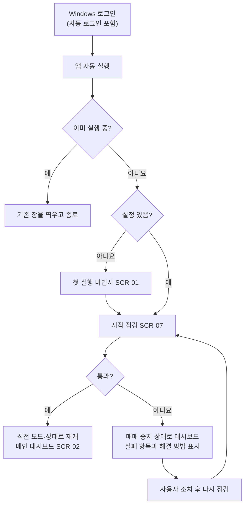
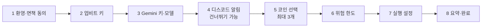
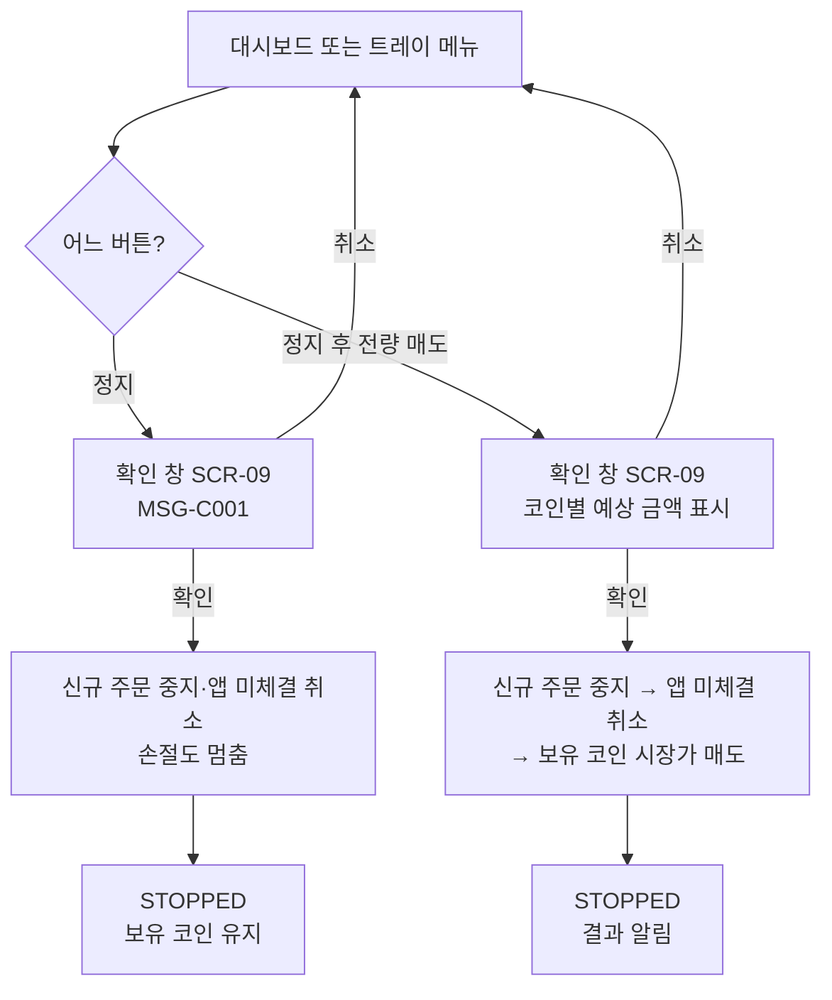
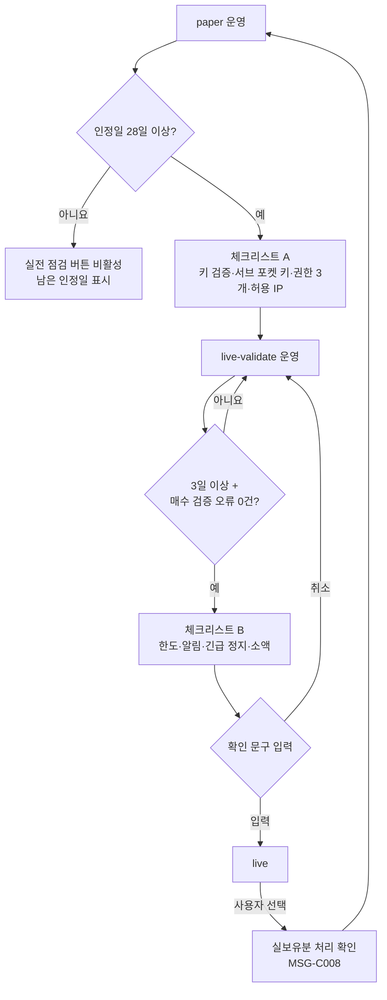

# 화면 흐름도

상태: 초안 · 관련: [화면 정의서](screen-spec.md), [상태 전이 정의서](../03-functional/state-machines.md)

## 1. 정보 구조

```text
트레이 아이콘 (SCR-10)
└─ 메인 대시보드 (SCR-02)
   ├─ 코인 카드 x3 → 코인별 시그널·주문 기록
   ├─ 시그널 기록 (SCR-04)
   ├─ 거래 기록 (SCR-05) → CSV 내보내기
   ├─ 설정 (SCR-06)
   │  ├─ 계정·키
   │  ├─ 코인 선택 (SCR-03)
   │  ├─ 매매 규칙
   │  ├─ 위험 한도
   │  ├─ 알림
   │  ├─ 실행·시작
   │  └─ 고급(모델 ID, 주기, 로그)
   ├─ 시작 점검 결과 (SCR-07)
   ├─ 실전 전환 (SCR-08)
   ├─ 정지 / 정지 후 전량 매도 (SCR-09)
   └─ 정보·면책 (SCR-11)
첫 실행 마법사 (SCR-01): 저장된 설정이 없을 때만
```

## 2. 앱 시작



## 3. 첫 실행 마법사



- 각 단계의 키는 입력하는 즉시 검증한다. 업비트는 잔고 조회, Gemini는 짧은 호출, 디스코드는 테스트 메시지로 확인한다.
- 네이버 검색 키 단계(W4)는 뺐다(D-097, 뉴스를 수집하지 않음). 화면 ID는 바꾸지 않고, 단계 번호만 앞당겼다.
- 검증에 실패하면 다음 단계로 넘어가지 않는다.
- 예외: 디스코드 알림은 건너뛸 수 있다. 업비트 키는 "나중에 입력"을 고르면 paper 모드로만 동작하고, 실전 점검 전에 반드시 입력해야 한다.

## 4. 긴급 정지



## 5. 실전 전환


