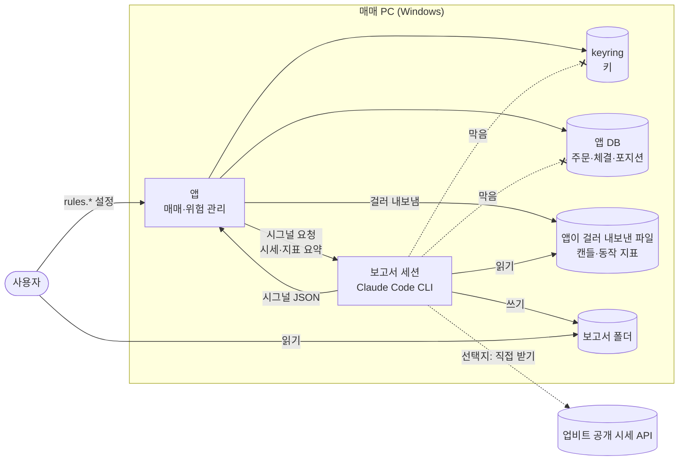

# 분석 보고서 세션 제안서

상태: 제안(사용자 결정 대기: D-106·D-107·D-108 세부) · 2026-11-09 작성, 같은 날 D-108(LLM 시그널) 추가 · 관련: [결정 로그](../10-management/decision-log.md) D-105~D-107, [규칙 조건 후보 비교 리포트](../research/rule-candidates.md), [매매 로직 명세](trading-logic.md), [4단계 시작 전 결정 묶음](stage4-decisions.md), [위험 관리 정책서](risk-policy.md), [보안 정책](../07-security-legal/security-policy.md), [설정 항목 정의서](settings.md), [LLM 시그널 명세](../05-integration/llm-signal.md)

2026-11-09 사용자 결정으로 규칙 조건은 "분석 보고서 세션"이 쓴 보고서를 보고 사용자가 고른다(D-107). 보고서 세션은 매매 PC에서 도는 Claude Code CLI 세션이다. 이 문서는 그 세션의 보안 경계, 실행 방식, 보고서 내용, "크게 빗나감"의 정의, 수정 주기, 앱 변경, 로드맵 위치를 선택지와 영향으로 정리한다. 같은 날 사용자는 LLM 시그널도 Gemini 대신 이 세션이 내기로 정했다(D-108). 시그널 쪽은 9장에 정리했다. 마지막 12장에 사용자에게 물을 항목을 모았다.

> 이 문서는 선택지와 영향만 적는다. 어떤 조건이나 방식이 수익을 내는지 판단하지 않고, 권하는 선택도 없다. 기술 설계의 제안안은 "(문서 제안안)"으로 표시했다. Claude Code에 관한 사실은 공식 문서(code.claude.com/docs, 2026-11-09 확인)에서 확인한 것만 출처와 함께 적었다. Windows 자체의 동작처럼 이 세션이 공식 문서로 확인하지 못한 것은 "미확인"으로 적었다.

## 1. 정해진 것 (2026-11-09 사용자 결정, 지휘 세션 전달)

| 결정 | 질문 | 사용자 답 | 뜻 |
|---|---|---|---|
| D-105 규칙상 청산(유효) | "규칙이 깨지면 자동으로 팔까" | "규칙상 청산 없음" | 앱이 스스로 파는 경우는 손절, 그리고 사용자가 켠 익절·LLM 부정 매도뿐이다. 사용자 명령 매도(정지 후 전량 매도, 선택 해제 매도, 모드 전환 매도)는 그대로다 |
| D-106 지표 캔들 단위(방향 유효, 세부 대기) | "조건을 계산할 캔들" | "사용자에게 몇 시간(또는 몇 분) 봉으로 볼 것인지 입력 받을 것임." | 캔들 단위는 사용자 설정이다. 허용 값·기본값은 7장 |
| D-108 LLM 시그널 출처(방향 유효, 세부 대기) | Gemini 결정 4개(D-054·D-102·D-098·D-104)와 확인 질문 2개 | 9.1절 원문 | 코인별 긍정·부정 시그널은 Gemini가 아니라 같은 Claude Code CLI 세션이 낸다. D-006·D-097은 그대로다 |
| D-107 규칙 조건 고르는 방식(방향 유효, 세부 대기) | ① "살 때 함께 볼 차트 조건", ④ "조건에 쓰는 숫자", 확인 질문 1·2 | 아래 원문 | 보고서 세션이 캔들 데이터로 P·A·R·V(와 숫자 변형)의 동작을 분석한 보고서를 쓰고 계속 고친다. 보고서는 동작만 싣는다. 조건·숫자는 사용자가 보고서를 보고 고른다. 앱이 실행될 때 보고서 세션도 실행돼야 한다 |

D-107의 사용자 답(원문 그대로):

- 질문 ①: "캔들에 대한 해석은 직접 데이터를 추출하여 분석 후, 해당 분석을 기반으로 매수 및 매도 시그널을 파악(너가 선택지로 줬던 계산 요소들에 대한 것들)하여 결과 보고서 작성. 이후 결과 보고서가 크게 빗나갔을 경우, 결과 보고서를 계속 수정 및 참고하는 방식으로 진행할 예정임."
- 질문 ④: "앞서 말한 '데이터 직접 추출 및 결과 도출' 부분 참고."
- 확인 질문 1(분석과 보고서 수정은 누가 하나): "앱을 설치할 윈도우 피씨 내에 클로드 앱이 있으므로, 해당 앱을 통해 클로드 씨엘아이를 만들어서 해당 세션이 보고서를 작성하는 방법으로 할 것임. 따라서 첫 보고서 작성 이후 해당 클로드 코드 씨엘아이 세션이 지속적으로 보고서를 고치는 역할을 맡을 예정. 즉, 앱이 실행될 때, 해당 클로드코드 씨엘아이 세션 또한 실행이 되어야 함."
- 확인 질문 2('좋은 시그널'을 무엇으로 가리나): "동작만 보고 내가 고름"

함께 정리한 것:

- **D-006은 그대로다.** 매수는 LLM 긍정 + 규칙 조건 + 위험 한도다. 보고서는 규칙 조건을 고르는 자료일 뿐이고 매수 판단에 직접 들어가지 않는다. 같은 세션이 내는 LLM 시그널(D-108)은 "LLM 긍정" 자리에 들어간다(9장).
- **D-021·D-072는 D-107로 대체됐다.**
  - D-021은 "1단계에서 후보를 비교해 결정"이었다.
  - D-072는 "비교 완료, 사용자 선택 대기"였다.
  - 이제 고르는 방법은 보고서 세션의 보고서를 보고 고르는 것이다.
  - [규칙 조건 후보 비교 리포트](../research/rule-candidates.md)는 보고서 형식의 기준으로 계속 쓴다(4장).
- **D-108로 대체된 것:** D-004(Gemini 무료 등급 시그널), D-054(Gemini 호출 API), D-055(Gemini 429 구분), D-098(기본 모델), D-102(google-genai 버전), D-103(Gemini 추가 약관 판단). D-099·D-100·D-104는 Claude Code 기준으로 다시 묻는다.
- **ADR-0007은 이 제안서에 대한 답을 받은 뒤 쓴다.** Gemini 시그널 ADR(ADR-0002)을 대신할 결정도 이 답 뒤에 쓴다.

## 2. 보안 경계 (안전 항목)

### 2.1 막을 것과 허용할 것

- **왜 필요한가:** 보고서 세션은 키가 저장된 매매 PC에서 돈다. 앱과 같은 Windows 사용자로 돌면 키(Windows 자격 증명 관리자, keyring), 앱 DB(주문·체결·포지션), 설정 파일에 닿을 수 있다.
- **읽은 내용이 나가는 곳:**
  - Claude Code는 모델과 주고받는 "all user prompts and model outputs"를 네트워크로 보낸다([Data usage](https://code.claude.com/docs/en/data-usage), 2026-11-09 확인). 보고서 세션이 파일 도구로 읽은 내용도 모델 입력이 되므로 밖으로 나간다고 보고 다룬다.
  - 개인 요금제(Free·Pro·Max·Ultra)의 서버 보관 기간은 30일이다. 모델 개선에 쓰도록 허용하면 5년이다.
  - 로컬에도 대화 기록이 `~/.claude/projects/` 아래 평문으로 기본 30일 남는다(같은 문서).
- **막을 대상:** 키, 잔고, 주문 내역, 계정 정보, IP. 보고서 세션의 대화·보고서·로그에 쓰지 않는다.
- **허용 후보:**
  - 공개 시세 캔들: 앱이 걸러 내보낸 파일, 또는 업비트 공개 시세(Quotation) API.
  - 보고서 폴더 쓰기.
  - 빗나감 비교용 동작 지표: 앱이 걸러 내보낸 파일(5장).
- **바꿀 수 없는 것:** 보고서 세션은 앱 설정과 규칙을 바꾸지 못한다. 사용자가 보고서를 보고 화면에서 고른다.
- **앱 캔들 캐시를 직접 읽게 하면 안 되는 이유:** 캔들 캐시는 앱 DB의 `candles` 테이블이다([데이터 모델](../04-data/data-model.md) 4장). 그래서 캐시를 직접 읽게 하면 같은 DB의 주문·체결·포지션에도 닿는다. 앱이 캔들만 따로 파일로 내보내는 방식(문서 제안안)이면 보고서 세션이 DB를 열 이유가 없다.
- **요청 한도 안전:**
  - 업비트 시세 API의 한도는 IP 단위다(시세 그룹 초당 10회, [로드맵](../10-management/roadmap.md) 외부 사실 표). 보고서 세션이 같은 PC에서 공개 API를 직접 부르면 앱과 한도를 나눠 쓴다.
  - 앱은 한도의 절반 이하만 쓴다(NFR-06). 둘의 합이 한도를 넘으면 429·418이 날 수 있고, 418이면 앱이 매매를 멈추고 알린다(CLAUDE.md).

### 2.2 막는 방법 선택지

네이티브 Windows에서 셸 명령을 운영체제 수준으로 막는 Claude Code 기능(샌드박스)은 동작하지 않는다. 그래서 한 가지 방법으로 모두 막을 수 없고, 아래를 조합한다.

| 방법 | 막는 것 | 한계 | 근거(2026-11-09 확인) |
|---|---|---|---|
| ① 권한 거부 규칙: 설정의 `permissions.deny`에 `Read(경로)`·`Edit(경로)`, 실행 때 `--disallowedTools` | 내장 파일 도구, Bash에서 Claude Code가 알아보는 파일 명령(`cat`, `head`, `tail`, `sed`, `tee`), `> file` 같은 리디렉션 대상 | 파일 이름을 적지 않고 읽는 명령(`grep -r pattern .`)과 Python·Node 스크립트처럼 파일을 직접 여는 하위 프로세스는 막지 못한다. 문서는 운영체제 수준으로 막으려면 샌드박스를 켜라고 한다 | [Configure permissions](https://code.claude.com/docs/en/permissions) "Read and Edit" |
| ② 작업 폴더 한정: 작업 디렉터리와 `--add-dir`, `permissions.blockReadsOutsideWorkingDirectories`·`blockWritesOutsideWorkingDirectories` | 파일 도구가 작업 폴더 밖을 읽고 쓰지 못한다. 이 두 키는 모든 권한 모드(`bypassPermissions` 포함)에서 적용된다 | 셸 명령, MCP 도구, 훅이 실행하는 프로그램은 막지 않는다 | 같은 문서 "Working directories" |
| ③ 관리 설정: `C:\Program Files\ClaudeCode\managed-settings.json` 또는 `HKLM\SOFTWARE\Policies\ClaudeCode` 레지스트리 | ①·②의 규칙을 사용자·프로젝트 설정과 명령줄 인자가 덮어쓰지 못한다. 어느 수준에서든 거부된 도구는 다른 수준에서 허용할 수 없다 | 막는 범위는 ①·②와 같다. 그 파일이나 레지스트리를 쓰려면 관리자 권한이 필요하다(Windows 동작, 미확인). `HKCU` 값은 사용자가 쓸 수 있어 관리 출처로 치지 않는다 | [Deploy managed settings](https://code.claude.com/docs/en/managed-settings), Configure permissions "Settings precedence" |
| ④ 샌드박스(`sandbox.enabled`) | 셸 명령과 그 하위 프로세스의 파일·네트워크 접근을 운영체제가 막는다 | macOS·Linux·WSL2에서만 돈다. 네이티브 Windows에서는 명령이 샌드박스 없이 돈다. 꺼진 것이 기본이다. 기본 읽기 범위는 "most of the machine"이라 `filesystem.denyRead`가 필요하다. 파일 도구·MCP 서버·훅은 샌드박스 밖에서 돈다 | [Configure the sandboxed Bash tool](https://code.claude.com/docs/en/sandboxing), [Set up](https://code.claude.com/docs/en/setup) "Set up on Windows" |
| ⑤ WSL2 안에서 실행 + ④ | ④를 쓸 수 있다 | WSL2에서 Windows 실행 파일(`cmd.exe`, `powershell.exe`, `/mnt/c/` 아래 파일)을 띄우는 요청은 Unix 소켓으로 Windows에 넘어간다. 이를 막으려면 seccomp 필터가 설치돼 있어야 한다. WSL에서 Windows 드라이브가 `/mnt/c`로 보이는 것은 WSL 동작이라 미확인이고, 그 경로를 막는 `denyRead` 구성 세부도 미확인이다 | sandboxing "WSL2 notes" |
| ⑥ 별도 Windows 계정으로 실행 | keyring과 `%LOCALAPPDATA%`는 Windows 사용자 계정마다 따로라서, 다른 계정에서는 기본 권한으로 닿지 않는다(Windows 동작, 미확인) | 보고서 세션이 읽을 파일과 보고서 폴더를 두 계정이 함께 쓰는 곳에 두고 권한을 따로 줘야 한다. Claude Code 로그인도 그 계정에서 따로 해야 한다. Windows에서 로그인 정보는 `%USERPROFILE%\.claude\.credentials.json`에 있고 사용자 프로필 폴더의 권한을 따른다 | [Authentication](https://code.claude.com/docs/en/authentication) "Credential management" |
| ⑦ 네트워크 제한 | (가) 샌드박스의 `network.allowedDomains`(처음에는 비어 있음), (나) `WebFetch(domain:...)` 규칙, (다) Windows 방화벽 | (가)는 ④가 도는 곳에서만 된다. (나)는 WebFetch 도구에만 적용되고, 셸 명령(curl, Python)의 네트워크는 Bash 규칙이나 샌드박스로 다룬다. (다)는 미확인 | sandboxing "Network isolation", permissions "WebFetch" |
| ⑧ 훅(`PreToolUse`) | 도구가 실행되기 전에 검사해 막을 수 있다 | 훅은 샌드박스 밖에서 사용자 권한으로 돈다. 훅이 보지 못하는 하위 프로세스 동작은 막지 못한다 | [Hooks](https://code.claude.com/docs/en/hooks), sandboxing "What runs outside the sandbox" |
| ⑨ 데이터 설계: 앱이 캔들·동작 지표만 걸러 내보낸다(문서 제안안) | 보고서 세션이 DB·설정을 읽을 이유를 없앤다 | 도구를 막는 장치가 아니라서 다른 방법과 함께 써야 한다 | 2.1 |
| ⑩ 제한 모드(`--restricted`, v2.1.248 이상) | 명령·코드를 실행하는 내장 도구와 WebFetch를 뺀다(`--tools`에 이름을 따로 주면 남는다). 파일 도구를 작업 폴더로 한정한다. 관리 설정과 `--settings`만 읽고 사용자·프로젝트 설정은 읽지 않는다. `bypassPermissions`를 거부한다 | 보고서 계산에 명령 실행이 필요하면 그 도구를 `--tools`로 다시 줘야 하고, 그 도구는 ①과 같은 한계를 갖는다. 요금제 로그인으로 도는지는 문서에 없다(미확인) | [CLI reference](https://code.claude.com/docs/en/cli-reference) `--restricted` |

- **실행 방식과의 관계:** 비대화형 실행(`claude -p`)에서 승인이 필요한 호출은 응답할 사람이 없으면 거부된다. `--permission-mode dontAsk`는 승인이 필요한 호출을 모두 거부한다. `--permission-prompts none`은 사람에게 묻는 도구를 빼고 거부된 요청을 다시 시도하지 않게 한다. 출처: [Run Claude Code programmatically](https://code.claude.com/docs/en/headless), 2026-11-09 확인.
- **지킬 규칙(문서 제안안):**
  - `bypassPermissions` 모드를 쓰지 않는다. 설정의 `disableBypassPermissionsMode`로 잠글 수 있다(permissions "Managed settings").
  - 허용 도구는 최소로 둔다: 보고서 폴더 쓰기와, 내보낸 파일을 읽어 계산하는 명령.
  - 보고서 세션의 지시문에 "키·잔고·주문 내역·계정 정보·IP를 읽거나 쓰지 않는다", "수익성 판단·추천을 하지 않는다", "앱 설정을 바꾸지 않는다"를 적는다.

## 3. 실행과 수명

### 3.1 Claude Code에서 확인한 사실 (2026-11-09)

- **비대화형 실행:** `claude -p "..."`는 끝나면 종료한다. 성공하면 종료 코드 0, 실패하면 0이 아니다. 실행 중 실패(예: 로그인 없음)는 표준 출력에 결과로 찍힌다. 그 밖의 옵션:
  - `--max-turns`: 한 실행의 턴 수를 묶는다.
  - `--bare`: 훅·스킬·플러그인·MCP 서버·자동 메모리·CLAUDE.md 자동 탐색을 건너뛴다. OAuth 로그인 정보와 시스템 키체인을 읽지 않으므로 요금제 로그인으로는 돌지 않고, Claude Console 키(`ANTHROPIC_API_KEY`)나 `--settings`의 `apiKeyHelper`가 필요하다. 문서는 `--bare`를 스크립트 호출의 권장 모드로 적었고, 앞으로 `-p`의 기본이 된다고 적었다. 그 뒤 요금제 로그인으로 `-p`를 쓰는 방법은 미확인이다.
  - `--bare` 없이 돌리면 `-p`도 작업 폴더와 `~/.claude`의 훅·MCP 서버 설정을 대화형 세션처럼 불러오고, 작업 폴더 신뢰 확인 창을 띄우지 않는다. 한 실행만 훅을 끄려면 `--settings '{"disableAllHooks": true}'`를 준다([hooks](https://code.claude.com/docs/en/hooks) "Disable or remove hooks").
  - `--restricted`: 2.2 ⑩.
  - `--output-format json`: 결과를 JSON으로 낸다.
  - SIGTERM으로 멈추면 종료 코드 143이고, 진행 중이던 턴은 결과 없이 끝난다. Windows에서 같은 신호를 보내는 방법은 미확인이다.
  - 출처: [headless](https://code.claude.com/docs/en/headless), [CLI reference](https://code.claude.com/docs/en/cli-reference).
- **설치:** Windows 10 1809 이상, PowerShell이나 CMD에서 설치하고 관리자 권한은 필요 없다. Git for Windows는 선택이다. 없으면 셸 도구로 PowerShell을 쓴다([setup](https://code.claude.com/docs/en/setup)).
- **로그인:**
  - Pro·Max·Ultra 요금제 계정으로 `/login` 한다.
  - 로그인 만료 3일 전에 시작 화면에 경고가 뜬다. 만료되면 모델 요청이 "Login expired · Please run /login"으로 실패한다(authentication).
- **Claude 데스크톱 앱 예약 작업**([Schedule recurring tasks in Claude Code Desktop](https://code.claude.com/docs/en/desktop-scheduled-tasks)):
  - 앱이 켜져 있고 컴퓨터가 깨어 있을 때만 돈다. 잠자기 중인 시각의 실행은 건너뛴다.
  - 양식에서 고르는 최소 간격은 1시간이다.
  - 놓친 실행은 다시 켜질 때 가장 최근 것 1회만 보충한다.
  - 작업마다 권한 모드를 정하고, 권한 질문에서 멈춘 실행은 사용자가 그 세션을 열어 답해야 한다.
- **`/loop`:** 열린 세션 안에서만 돈다. 반복 작업은 만든 지 7일 뒤 만료된다([scheduled-tasks](https://code.claude.com/docs/en/scheduled-tasks)).

### 3.2 "앱이 실행될 때 실행" 방식 선택지

| 선택지 | 동작 | 영향 | 한계 |
|---|---|---|---|
| A. 앱이 하위 프로세스로 비대화형 실행 | 앱이 정한 주기마다 `claude -p`를 고정된 지시문과 옵션으로 띄우고 끝나기를 기다린다. 결과와 종료 코드를 기록한다 | 앱이 언제 도는지 통제한다. 실행마다 새 세션이라 상태가 남지 않는다. 앱 실행과 같이 묶인다 | 승인할 사람이 없으니 허용 규칙을 미리 정해야 한다. 앱 프로세스가 Claude Code를 띄우므로 앱과 같은 Windows 계정이 된다(⑥을 쓰려면 다른 계정으로 띄우는 방법이 필요하고, 이는 미확인) |
| B. 대화형 세션을 앱 시작 때 띄움 | 앱이 터미널 창으로 `claude`를 띄우고 사용자가 지켜본다 | 사용자가 권한 질문에 답할 수 있다 | 창이 계속 떠 있다. 사용자가 없으면 질문에서 멈춘다. 앱이 세션 상태를 알기 어렵다 |
| C. Windows 작업 스케줄러 | 로그온 때나 정해진 시각에 `claude -p`를 실행한다 | 앱이 꺼져 있어도 돌 수 있다. 다른 계정으로 실행하도록 정할 수 있다(Windows 동작, 미확인) | 앱 실행과 직접 묶이지 않는다. 설정은 사용자가 한다 |
| D. Claude 데스크톱 앱 예약 작업 | 데스크톱 앱에 예약 작업으로 등록한다 | 사용자가 이미 데스크톱 앱을 쓴다. 실행 기록을 앱 화면에서 본다 | 데스크톱 앱이 켜져 있어야 하고, 최소 간격은 1시간(양식)이다. 권한 질문에서 멈출 수 있다 |
| E. 사용자가 따로 켜고 앱은 상태만 확인 | 보고서 세션은 사용자가 원하는 방식으로 돌린다. 앱은 최신 보고서 파일의 시각만 보고 오래되면 경고한다 | 앱과 Claude Code가 서로 묶이지 않는다 | "앱이 실행될 때 실행"을 앱이 보장하지 않는다 |

### 3.3 없음·실패·종료 처리 (문서 제안안)

- **매매는 그대로다.** 보고서 세션이 없거나, 로그인이 안 됐거나, 사용량 한도에 닿았거나, 오류가 나도 매매와 위험 관리는 그대로 동작한다. 앱은 경고만 한다(새 경고 문구와 알림 번호는 구현 때 정한다).
- **시그널은 neutral이 된다.** 시그널도 이 세션이 내므로(D-108), 세션을 쓸 수 없으면 시그널은 neutral이고 신규 매수가 일어나지 않는다. 손절과 위험 한도는 그대로 돈다(9.7).
- **시작 점검에 넣지 않는다.** 앱 시작은 보고서 세션을 기다리지 않는다.
- **보고서는 설정을 바꾸지 않는다.** 그래서 보고서가 없거나 오래돼도 앱은 사용자가 마지막으로 저장한 `rules.*` 설정으로 동작한다.
- **앱이 끝날 때:**
  - A는 실행 중인 `claude -p`를 멈추고, 다음 앱 시작 뒤 첫 주기에 다시 돈다.
  - B·C·D·E는 앱과 별개로 남을 수 있다. 앱 종료 때 무엇을 할지(그대로 둠, 멈춤 요청)는 선택이다.
- **잠자기·꺼짐:** 컴퓨터가 잠들면 D는 그 실행을 건너뛴다. 다른 방식의 동작은 구현 때 시험한다.

## 4. 보고서 내용

### 4.1 기준 형식

[규칙 조건 후보 비교 리포트](../research/rule-candidates.md)의 동작 지표를 기준으로 한다.

| 항목 | 내용 | 리포트 위치 |
|---|---|---|
| 참 비율 | 마감된 캔들 중 조건이 참인 비율 | 6.1 |
| 전환 수 | 참·거짓이 바뀐 횟수(30일당) | 6.1 |
| 참 구간 길이 | 참이 이어진 구간 길이의 중앙값 | 6.1 |
| 손절만 구성의 거래 수 | 규칙이 참이면 진입하고 손절로만 나오는 시뮬레이션의 거래 수와 보유 시간 분포 | 6.2, 6.4 |
| 비용 | 거래마다 드는 수수료·슬리피지 가정(리포트는 수수료 0.05%, 슬리피지 0.1%) | 5장 |
| 하루 최대 주문 수 | 코인 합산, 일일 주문 상한(20건)과 비교 | 6.5 |
| 조건 간 중복, 민감도 | 조건끼리 겹치는 정도, 숫자 이웃값의 동작 | 6.6, 6.8 |

- **넣지 않는 것:** 수익률 표, 손익 금액, 최대 낙폭처럼 손익이 들어가는 값. 사용자가 "동작만 보고 내가 고름"을 골랐다(확인 질문 2). 리포트는 최대 낙폭을 실었지만 보고서에는 넣지 않는다.
- **판단하지 않는다:** 보고서 세션도 수익성 판단과 추천을 하지 않는다. 지시문에 적는다.
- **다루는 범위:** 사용자가 고른 캔들 단위(D-106)와 코인(`coins`, 최대 3개), 조건 P·A·R·V와 그 숫자 변형.
- **D-105 반영:** 규칙상 청산이 없으므로 "규칙이 거짓이 되면 청산" 시뮬레이션(리포트 시뮬레이션 B)은 싣지 않는다. 손절만 구성(시뮬레이션 A)이 앱 동작과 같다. 익절·LLM 부정 매도는 사용자가 켤 때만 동작하고, 시뮬레이션에는 넣지 않는다(리포트와 같다).

### 4.2 과최적화 처리 선택지

리포트 8장은 같은 기간으로 고르고 확인하면 그 기간에 맞춘 선택이 될 위험을 경고했다.

| 선택지 | 동작 | 영향 |
|---|---|---|
| A. 고르는 기간과 확인 기간을 나눈다 | 앞쪽 기간의 동작으로 조건을 보고, 뒤쪽 기간에서 같은 동작이 나오는지 따로 싣는다. 나누는 비율은 사용자가 정한다 | 확인 기간만큼 고르는 데 쓰는 데이터가 준다 |
| B. 여러 구간에서 반복되는지 본다 | 기간을 여러 구간으로 나눠 구간마다 동작 수치를 싣는다 | 표가 길어진다. 구간이 짧으면 수치가 흔들린다 |
| C. 경고 문구만 싣는다 | 나누지 않고 리포트 8장 같은 경고를 붙인다 | 가장 단순하다. 기간에 맞춘 선택을 걸러 내는 장치가 없다 |

### 4.3 저장과 판 관리

- **공개 저장소에는 두지 않는다.** 보고서는 사용자 PC의 실데이터(코인 선택, 운영 기록 비교)를 담을 수 있다.
- **위치 선택지:**
  - A. `%LOCALAPPDATA%\upbit-autotrader\` 아래 `reports` 폴더(문서 제안안). 앱 데이터와 같은 곳이라 같은 계정이면 찾기 쉽다. ⑥(별도 계정)이면 보고서 세션 계정이 이 폴더에 닿지 않는다(미확인).
  - B. 두 계정이 함께 쓰는 별도 폴더. ⑥과 함께 쓸 수 있다. 폴더 권한을 사용자가 정한다.
- **판(버전) 관리(문서 제안안):**
  - 파일 이름에 판 번호, 만든 날짜(KST), 데이터 기간을 넣는다.
  - 이전 판은 지우지 않는다.
  - 판마다 앞 판과 달라진 점을 맨 위에 적는다.
  - 형식은 읽을 Markdown과 수치 JSON 두 가지다. 앱 화면은 JSON의 표를 보여 줄 수 있다.

## 5. "크게 빗나감"의 정의

사용자는 "결과 보고서가 크게 빗나갔을 경우" 보고서를 고친다고 했다. 무엇이 빗나감인지 정한다. 수익률 기준은 쓰지 않는다(확인 질문 2).

| 정할 것 | 선택지 | 영향 |
|---|---|---|
| 무엇을 비교하나 | A. 규칙 동작: 운영 중 평가 시점의 참 비율, 전환 수를 보고서 값과 비교 / B. 거래 동작까지: 진입 수, 손절 수, 하루 주문 수도 비교 / C. A와 B 모두 | A는 규칙 조건만 본다. B는 위험 한도·LLM이 섞인 결과라 규칙만의 차이를 가려내기 어렵다 |
| 차이 기준 | A. 보고서 값과의 상대 차이가 사용자가 정한 비율을 넘으면 / B. 보고서가 낸 구간별 범위(최소~최대) 밖이면 / C. 자동 판정 없이 정기 비교표만 | A·B는 자동으로 알릴 수 있다. C는 사용자가 매번 본다 |
| 확인 주기 | 주 1회, 월 1회, 인정일 28일마다, 보고서를 고칠 때 | 4시간 평가면 코인당 하루 6회, 28일이면 코인당 168회 평가다. 짧은 주기는 비교할 표본이 적다 |
| 고침을 누가 시작하나 | A. 보고서 세션이 정기적으로 비교하고 기준을 넘으면 고친다 / B. 앱이 기준을 넘으면 알리고 사용자가 고침을 지시한다 / C. 사용자만 시작한다 | A는 보고서 세션이 운영 기록을 읽어야 한다(아래). B·C는 사용자가 개입한다 |

- **비교 자료(문서 제안안):** 앱이 동작 지표만 걸러 파일로 내보낸다. 보고서 세션은 DB를 읽지 않는다.
  - 내보내는 항목: 코인, 기간, 평가 수, 규칙 참 횟수, 전환 수, 진입 수, 손절 수, 하루 주문 수.
  - 금액·잔고·주문 번호·identifier는 넣지 않는다.

## 6. 수정 주기와 사용량

- **주기 선택지:** 매일, 매주, 매월, 빗나감이 감지될 때만, 사용자가 요청할 때만.
- **사용량:**
  - 보고서 한 번에 드는 Claude 사용량은 **미측정**이다. 4단계 전 시험 실행으로 잰다.
  - Pro·Max·Ultra 요금제에서는 Claude Code 사용량이 요금제 한도에 들어간다. `/usage`가 한도에 무엇이 들어갔는지 보여 준다([costs](https://code.claude.com/docs/en/costs), 2026-11-09 확인).
  - `--max-turns`로 한 번 실행의 길이를 묶을 수 있다.
  - `--max-budget-usd`는 API 요금 추정치 기준이고, 요금제 한도와 같은 값이 아니다(cli-reference).
- **한도에 닿았을 때(문서 제안안):** 그 회차를 건너뛰고 경고하고, 다음 주기에 다시 한다. 매매에는 영향이 없다.
- **같은 계정의 다른 사용:** 보고서 세션이 같은 Claude 계정을 쓰면, 사용자가 같은 계정으로 하는 다른 작업(이 저장소의 개발 세션 등)과 한도를 나눠 쓴다(Claude 계정 단위 한도의 세부는 미확인).
- **설치와 로그인은 사용자가 직접 한다**(11장).

## 7. 앱 변경

### 7.1 설정 (문서 제안안 틀)

| 키 | 설명 | 선택지·검사 |
|---|---|---|
| `rules.conditions` | 매수 때 볼 조건. P(가격이 평균 위), A(이동평균 정배열), R(RSI 과열 아님), V(거래량이 평균 위) 중 여러 개, AND. 비우면 규칙 없음 | 1~4개 또는 없음 |
| `rules.params` | 조건의 숫자: 이동평균 기간(짧은·긴), RSI 기간과 상한, 거래량 평균 봉 수와 배수 | 저장 검사 예: 짧은 기간 < 긴 기간, RSI 상한은 정한 범위 안, 배수 > 0. 범위는 사용자가 정한다 |
| `rules.candle_unit`(D-106) | 조건을 계산할 캔들 | 업비트 분 캔들 단위 1·3·5·10·15·30·60·240분과 일 캔들([업비트 API 연동 명세](../05-integration/upbit-api.md) 2장) |

- **캔들 단위 기본값 선택지:**
  - A. 4시간봉: 리포트가 잰 단위다.
  - B. 일봉: 리포트가 잰 단위다.
  - C. 기본값 없음: 입력해야 저장된다.
- **허용 값 선택지:** A 업비트 분 캔들 8가지와 일봉 전부, B 그 가운데 일부만.
- **첫 보고서 전 매수 조건 선택지:**
  - A. 규칙 없음: LLM 긍정 + 위험 한도만 본다.
  - B. 매수하지 않음: 시그널과 "냈을 주문"만 기록한다.
  - C. 리포트의 기준값 조합 하나를 임시로 쓴다. 사용자가 고른다.
- **D-105 반영:** `rules.*`는 진입(매수 조건과 2단계 매수 조건)에만 쓴다. 규칙상 청산이 없어 `exit.*`는 두지 않는다.

### 7.2 다른 결정에 주는 영향

| 대상 | 영향 |
|---|---|
| D-057 평가 시각(지금 제안: 4시간봉 마감 + 2분) | 허용 분 단위 8가지는 모두 240분을 나누고, 일봉 경계(KST 09:00)도 4시간 격자 위에 있다. 그래서 "4시간봉 마감 + 2분" 시각표는 어느 단위와도 어긋나지 않는다. 4시간봉 외 단위의 경계가 UTC 정시 기준으로 맞는지는 공개 시세 호출로 확인하지 않았다(미확인) |
| D-045 시그널 유효 시간 | 4시간봉·일봉이면 60분 유효 시간 안에 새 마감 캔들이 없어 B가 A와 같다([결정 묶음](stage4-decisions.md) 5.3절). 짧은 단위(예: 5분봉)면 그 사이에 새 캔들이 여러 개 마감해 규칙 결과가 바뀔 수 있고, B가 A와 달라진다 |
| D-099 지표 요약 A안(규칙 조건 지표만) | 사용자가 조건·숫자·캔들 단위를 바꾸면 Gemini에 넣는 지표도 바뀐다. 프롬프트가 바뀌므로 `prompt_version`을 올린다 |
| 4단계 signal-only의 "냈을 주문"(FR-12, TS-121) | 첫 보고서 전 매수 조건(7.1)과 4단계에서 쓸 규칙(8장)에 따른다 |
| 리포트의 범위 | 리포트는 4시간봉과 일봉만 쟀다. 다른 단위의 동작 수치는 첫 보고서가 나오기 전에는 없다 |
| 캔들 수집량 | 짧은 단위일수록 같은 기간의 캔들이 많고, 요청당 최대 200개다. 앱의 요청 한도(절반 이하) 안에서 받아야 한다 |
| 손절 점검 | 손절은 1분마다 따로 점검하므로 캔들 단위와 상관없다 |

## 8. 로드맵 위치

| 선택지 | 내용 | 영향 |
|---|---|---|
| A. 4단계(LLM 시그널)에 넣는다 | 보고서 세션 연동과 내보내기 파일을 4단계에서 만든다 | 4단계가 커진다. signal-only의 "냈을 주문"을 보고서 기반 규칙으로 시험할 수 있다 |
| B. 5단계(규칙·위험·주문 관리 + 페이퍼)에 넣는다 | 규칙 엔진과 함께 만든다 | 규칙과 보고서를 한 단계에서 맞춘다. 4단계는 임시 규칙으로 간다 |
| C. 7단계(운영 기능)에 넣는다 | 실행·감시·경고를 운영 기능과 함께 만든다 | 그때까지 보고서는 사용자가 따로 돌린다(3.2 E) |
| D. 별도 단계를 만든다 | 5단계와 6단계 사이 등에 "보고서 세션" 단계를 둔다 | 범위가 분명하다. 단계 번호가 바뀐다 |

- **4단계 signal-only의 규칙(선택지):**
  - A. 규칙 없음으로 기록한다.
  - B. 리포트 기준값 조합 하나를 임시로 쓴다.
  - C. 규칙 판단 자리만 두고 "냈을 주문"에 "규칙 미정"을 기록한다.
- 어느 쪽이든 매수 판단의 구조(LLM 긍정 + 규칙 + 위험 한도, D-006)는 그대로다.

## 9. LLM 시그널 (D-108)

### 9.1 정해진 것 (2026-11-09 사용자 결정, 지휘 세션 전달)

- 사용자 답(원문 그대로):
  - D-054(Gemini 호출 방법): "제미나이는 쓰지 않음. 최신 문서 다시 확인."
  - D-102(google-genai SDK 버전): "제미나이 쓰지 않음. 최신 문서 다시 확인."
  - D-098(기본 모델): "제미나이 쓰지 않음. 최신 버전 다시 확인."
  - D-104(답 형식): "제미나이 쓰지 않음. 최신 문서 다시 확인."
  - 확인 질문 "Gemini를 빼면 AI 시그널은 어떻게 할까요": "클로드코드 씨엘아이가 시그널도 냄."
  - 확인 질문 "'최신 문서 다시 확인'은 무엇을 말씀하신 건가요": "저장소 문서 정리"
- **정리:** 코인별 긍정·부정 시그널은 매매 PC의 Claude Code CLI 세션(D-107의 보고서 세션)이 낸다. 매수 구조(D-006)와 뉴스 없음(D-097)은 그대로다.
- **저장소 문서 정리:** Gemini 언급 위치와 고칠 순서는 [D-108 정리 목록](../10-management/d108-gemini-cleanup.md)에 있다.

### 9.2 보안·입력 규칙

기준안은 지금 CLAUDE.md의 Gemini 시그널 규칙을 Claude Code 시그널에 그대로 적용하는 것이다.

| 규칙 | Claude Code에서 지키는 방법 | 근거(2026-11-09 확인) |
|---|---|---|
| 프롬프트에 키·잔고·주문 내역·계정 정보(와 IP)를 넣지 않는다 | 앱이 프롬프트를 만들고 시세·지표 요약만 넣는다 | CLAUDE.md |
| 입력은 구분된 데이터 블록에 넣고, 그 안의 지시는 무시하라고 명시한다 | 시스템 지시에 적는다. `--system-prompt`는 기본 시스템 프롬프트 전체를 바꾼다 | [CLI reference](https://code.claude.com/docs/en/cli-reference) |
| 도구 호출을 쓰지 않는다 | `--tools ""`는 내장 도구를 모두 끈다. `--disallowedTools "*"`는 모든 도구를 맥락에서 빼고 `"mcp__*"`는 MCP 도구를 뺀다. `--strict-mcp-config`는 `--mcp-config`로 준 MCP 서버만 쓴다. `--bare`는 훅·스킬·플러그인·MCP 서버·CLAUDE.md 자동 로딩을 건너뛰지만 요금제 로그인을 읽지 않는다(3.1). `--restricted`는 명령 실행 도구와 WebFetch를 빼고 사용자·프로젝트 설정을 읽지 않는다(2.2 ⑩) | CLI reference, [headless](https://code.claude.com/docs/en/headless) |
| 검색 없이 받은 데이터만 근거로 답한다. 뉴스는 수집하지 않는다(D-097) | 웹 검색과 WebFetch도 내장 도구다. `--tools ""`의 "disable all"로 함께 꺼진다고 읽었다. 실제로 꺼지는지는 실행 시험으로 확인한다(미확인) | CLI reference, [tools reference](https://code.claude.com/docs/en/tools-reference) |
| 사용자·작업 폴더 설정의 훅과 MCP 서버가 끼지 않게 한다(문서 제안안) | 요금제 로그인이면 `--settings '{"disableAllHooks": true}'`, `--strict-mcp-config`, 앱이 만든 빈 실행 폴더를 함께 쓴다. API 키면 `--bare`를 쓸 수 있다 | headless "Start faster with bare mode", hooks "Disable or remove hooks" |
| 대화 기록을 디스크에 남기지 않는다(선택) | `--no-session-persistence`는 세션을 디스크에 저장하지 않는다(print 모드만) | CLI reference |

- **도구를 모두 꺼도 전송은 된다:** 프롬프트와 응답 자체는 모델 요청으로 Anthropic에 전송된다([Data usage](https://code.claude.com/docs/en/data-usage)).
- **2장 보안 경계도 그대로 필요하다:** 시그널 호출도 같은 매매 PC에서 돈다. 같은 계정이면 2장과 같은 위험이 있다.

### 9.3 호출 방식

- **기준안(문서 제안안):** 앱이 평가 시각마다 코인별로 `claude -p`를 한 번씩 부른다. 기본 평가 주기는 4시간이고, 코인 3개면 하루 18회다.
  - 옵션: `--output-format json`과 `--json-schema <응답 스키마>`, 9.2의 도구 끄기, `--model <설정값>`, `--max-turns 1`, `--no-session-persistence`.
  - `--json-schema`를 `--tools ""`·`--max-turns 1`과 함께 써도 구조화 출력이 나오는지는 문서에 적혀 있지 않다(미확인). 4단계 시험 실행에서 확인한다.
  - **시간 제한:** `-p` 실행 전체를 묶는 플래그는 공식 문서에서 찾지 못했다. 그래서 앱이 프로세스 시간 제한(설정값)을 걸고, 넘으면 멈추고 neutral로 처리한다(문서 제안안). `API_TIMEOUT_MS`는 요청 시도마다 응답 헤더를 기다리는 시간이고 기본 10분이다([env vars](https://code.claude.com/docs/en/env-vars)).
  - **출력 토큰 상한:** `CLAUDE_CODE_MAX_OUTPUT_TOKENS` 환경 변수가 대부분 요청의 최대 출력 토큰 수를 정한다. 기본값과 상한은 모델마다 다르고, 모델 상한보다 큰 값은 상한으로 낮춘다([env vars](https://code.claude.com/docs/en/env-vars)). D-066의 `llm.max_output_tokens`는 이 값으로 옮길 수 있다(문서 제안안).
  - **결과 판정:** 성공하면 종료 코드 0, 실패하면 0이 아니다. 실행 중 실패(로그인 없음 등)는 결과로 출력된다(headless).
- **보고서 작업과 같은 세션을 쓸지(선택지):**

| 선택지 | 동작 | 영향 |
|---|---|---|
| A. 같은 실행 | 시그널과 보고서를 같은 지시문·권한의 실행에서 한다 | 보고서는 파일 쓰기가 필요하고 시그널은 도구가 필요 없다. 그래서 권한을 둘 다 최소로 맞출 수 없다. 보고서 작업의 맥락이 시그널 판단에 섞인다 |
| B. 따로 실행 | 시그널은 평가마다 새 `claude -p`(도구 모두 끔)로, 보고서는 별도 실행으로 한다 | 권한을 각각 최소로 둔다. 실행 횟수가 는다 |
| C. 하나의 대화형 세션 | 사용자가 띄운 세션 하나가 둘 다 한다 | 3.2 B의 한계(창이 떠 있음, 질문에서 멈춤)가 그대로 있다. 앱이 시그널을 받는 방법을 따로 만들어야 한다 |

- **계정:** 어느 선택지든 보고서 작업과 같은 Claude 계정이면 사용량 한도를 나눠 쓴다(9.6). 실행 계정은 2.2의 막는 방법을 따른다. 3.2 A(앱 하위 프로세스)면 앱과 같은 Windows 계정이다.

### 9.4 응답 형식과 검증 (D-104를 Claude 기준으로)

- **기준:** 지금 스키마(`signal`은 positive/negative/neutral, `confidence`, `reason`)와 Pydantic 검증(CLAUDE.md).
- **Claude Code의 구조화 출력:** `--output-format json`과 `--json-schema`를 함께 쓰면 스키마에 맞는 결과가 `structured_output` 필드로 온다. 유효한 구조화 출력 없이 끝나면(예: 요청 거절) 그 필드가 없다(headless "Get structured output"). 앱은 받은 값을 Pydantic으로 다시 검증한다(문서 제안안).
- **neutral(매수 안 함):** 검증 실패, 시간 초과, 사용량 한도, 거절, 종료 코드가 0이 아님, `structured_output` 없음은 모두 neutral이다.
- **D-104 선택지(Claude 기준):**

| 선택지 | 동작 | 영향 |
|---|---|---|
| A. 스키마 그대로, confidence를 퍼센트로 표시 | 응답은 세 칸이다. 화면에서 `confidence`를 퍼센트로 보인다 | CLAUDE.md를 바꾸지 않는다. `confidence`는 고른 판정 하나의 확신도라 긍정·부정 비중과 뜻이 다르다 |
| B. 긍정%·부정% 필드 추가 | `--json-schema`에 `positive_pct`·`negative_pct`를 넣고 Pydantic으로 범위와 합을 검사한다 | 사용자 요구와 형태가 같다. CLAUDE.md의 응답 스키마 문장을 바꿔야 한다(지휘 세션이 사용자 승인 뒤). 퍼센트와 `signal`·`confidence` 중 무엇으로 매수를 판단할지 새로 정해야 한다 |
| C. 스키마 그대로, reason에 비중 기재 | 프롬프트가 `reason`에 "긍정 약 X%, 부정 약 Y%"를 쓰게 한다. 코드는 읽지 않는다 | CLAUDE.md를 바꾸지 않는다. 자유 글이라 검증되지 않고, 숫자가 `signal`과 어긋날 수 있다 |

- 어느 선택지든 매수 판단(positive이고 확신도 ≥ 임계값, 규칙·위험 한도 통과)은 그대로다.

### 9.5 기록

CLAUDE.md는 "실제로 응답한 모델명과 입출력 원문을 DB에 기록"하라고 한다. Claude Code에서 지키는 방법은 다음과 같다.

- **응답 모델명:** `--output-format stream-json`의 `system/init` 이벤트가 모델을 알려 준다(headless "Read session metadata"). `--output-format json`의 메타데이터에 모델명이 있는지는 문서에서 확인하지 못했다(미확인). 4단계 시험 실행에서 확인한다.
- **모델 지정:** `--model`에 별칭(`sonnet`, `opus`, `haiku` 등)이나 전체 모델 이름을 준다. 별칭은 시간이 지나면 다른 버전을 가리킨다. 고정하려면 전체 이름을 쓴다([model config](https://code.claude.com/docs/en/model-config)). 모델은 설정값으로 둔다.
- **CLI 버전:** `claude --version`(`-v`)으로 얻는다(CLI reference). 앱 시작 때와 버전이 바뀔 때 기록한다(문서 제안안).
- **입출력 원문:** 앱이 보낸 프롬프트 전문과 받은 JSON 전문을 DB `signals`에 남긴다. 지금 데이터 모델과 같다. 키·잔고·주문 내역·계정 정보는 프롬프트에 없으므로 기록에도 없다.
- **사용량 값:** 토큰 수 같은 사용량 필드의 이름과 위치는 시험 실행에서 확인한다(미확인).

### 9.6 사용량 한도와 약관

**사용량 한도(D-055를 대체):**

- 요금제에는 롤링 사용 한도가 있다. 다 쓰면 "You've hit your session limit · resets 3:45pm" 같은 메시지가 나오고 재설정 시각까지 요청이 막힌다. 세션 한도와 주간 한도는 모든 모델이 함께 쓴다([errors](https://code.claude.com/docs/en/errors), 2026-11-09).
- 처리 선택지:
  - A. 그 평가는 neutral로 두고 다음 평가 시각에 다시 부른다.
  - B. 메시지의 재설정 시각까지 부르지 않는다. 메시지 글자를 읽어야 해서 문구가 바뀌면 깨질 수 있다.
  - C. A에 더해 연속 실패를 알린다.
- 보고서 작업과 같은 계정이면 한도를 나눠 쓴다(6장).

**약관·정책 문구(사실만 옮긴다. 이 앱에 어떻게 적용되는지는 해석하지 않고 사용자가 판단한다. D-103 때와 같은 방식):**

| 문서(확인 2026-11-09) | 문구 | 관련 |
|---|---|---|
| [Claude Code Legal and compliance](https://code.claude.com/docs/en/legal-and-compliance) | "Your use of Claude Code is subject to: ... Consumer Terms of Service - for Free, Pro, Max, and Ultra users" | 개인 요금제면 소비자 약관을 따른다 |
| 같은 문서 | "Advertised usage limits for Pro, Max, and Ultra plans assume ordinary, individual usage of Claude Code and the Agent SDK." | 사용량 |
| 같은 문서 | "OAuth authentication is intended exclusively for purchasers of Claude Free, Pro, Max, Ultra, Team, and Enterprise subscription plans and is designed to support ordinary use of Claude Code and other native Anthropic applications." "Developers building products or services that interact with Claude's capabilities, including those using the Agent SDK, should use API key authentication through Claude Console or a supported cloud provider." | 로그인 방식 |
| [Consumer Terms of Service](https://www.anthropic.com/legal/consumer-terms)(Effective Oct 8, 2025) 3절 금지 목록 | "Except when you are accessing our Services via an Anthropic API Key or where we otherwise explicitly permit it, to access the Services through automated or non-human means, whether through a bot, script, or otherwise." | 앱이 프로그램으로 부르는 것 |
| 같은 절 | "To rely upon the Services, the Materials, or the Actions to buy or sell securities or to provide or receive advice about securities, commodities, derivatives, or other financial products or services, as Anthropic is not a broker-dealer or a registered investment adviser under the securities laws of the United States or any other jurisdiction." | 매매 판단 용도 |
| [Usage Policy](https://www.anthropic.com/legal/aup)(페이지 표시 시행일 Nov 12, 2026) High-risk Use Case Requirements | "Finance — a personalized recommendation to buy, sell, hold, or allocate among specific investment products, such as securities, funds, digital assets, or annuities; ..." 요구 사항: "Qualified human-in-the-loop for advice and decisions — A qualified person must meaningfully review a High-risk AI Recommendation, with the authority to change or modify it, before it is delivered as advice to an individual who might rely on it or before it is used to implement a decision." | 매매 판단 용도 |
| 같은 정책의 제외(Exclusions) 예 | "Internal drafting, research, summarization, or analysis that is not the ultimate High-risk AI Recommendation delivered." "Carrying out a decision a person has already made, or applying a fixed rule, formula, or algorithm where the model exercises no judgment about the individual." | 보고서 작업, 규칙 |
| [Data usage](https://code.claude.com/docs/en/data-usage) | 개인 요금제(Free·Pro·Max·Ultra)는 데이터를 모델 개선에 쓰도록 허용하는 설정이 있다. 켜 두면 Claude Code 사용분도 학습에 쓰인다. 보관 기간은 허용하면 5년, 아니면 30일이다 | 입력 데이터 학습 |

- **이 앱의 쓰임(설계 사실):** 앱이 평가 시각마다 프로그램으로 Claude Code를 부르고, 사람이 매번 보지 않는다. 그 결과는 매수 판단의 한 입력이 된다(D-006). 규칙 조건과 위험 한도는 코드가 강제한다.
- **확인 날짜에 관한 사실:** 사용 정책 페이지는 2026-11-12 시행으로 표시돼 있고, 확인일은 그 전(2026-11-09)이다.

### 9.7 실패 때 동작

- **neutral로 처리하는 경우:** 보고서 세션이나 Claude Code가 없음, 로그인 안 됨, 사용량 한도, 오류. 이때 그 평가의 시그널은 neutral(매수 안 함)이다.
- **매매는 그대로다:** 손절 1분 점검과 위험 한도는 시그널과 상관없이 돈다.
- **알림(문서 제안안):**
  - 연속 실패를 알린다. 지금 명세의 "3회 연속 실패 알림"(NTF-11)과 같은 방식이다.
  - 사용자가 손봐야 하는 실패(예: "Login expired · Please run /login")는 따로 구분해 알린다.

### 9.8 백테스트하지 않는다

- LLM 시그널의 성과를 과거 데이터로 백테스트하지 않는다(CLAUDE.md, look-ahead bias).
- 보고서 세션의 보고서는 규칙 동작만 다룬다(4장). 시그널은 페이퍼 운영 기록으로 판단한다.

### 9.9 4단계 로드맵 선택지

이 PR 전 로드맵 4단계는 "LLM 시그널(뉴스 없음)"이었고, 범위는 Gemini 호출·입출력 원문 기록·가짜 LLM, 완료 기준은 signal-only 모드였다. 이 PR은 이름을 "LLM 시그널(Claude Code CLI, 뉴스 없음)"으로 바꾸고 범위 항목을 Claude Code 기준으로 옮겨 적기만 했다. 범위는 아래 선택지의 답으로 정한다.

| 선택지 | 내용 | 영향 |
|---|---|---|
| A. 4단계를 "Claude Code CLI 시그널 + signal-only"로 바꾼다 | 시그널 호출(가짜 CLI로 시험), 기록, signal-only를 만든다. 보고서 세션 연동은 8장 선택에 따른다 | 4단계 크기는 지금과 비슷하다 |
| B. 4단계에 보고서 세션 연동까지 넣는다 | 8장 A와 같다 | 4단계가 커진다 |
| C. 지금 상태(이름만 바꿈)로 두고 범위는 다른 답 뒤에 정한다 | 로드맵 범위를 "대기"로 둔다 | 지금 작업을 막지 않지만 범위가 열려 있다 |

- 가짜 LLM은 Claude Code CLI의 출력(JSON, `structured_output`, 오류 결과, 종료 코드, 한도 메시지)을 흉내 내도록 바꾼다(D-108 정리 목록).
- D-099(지표 요약)와 D-100(프롬프트 첫 버전)은 Claude Code 기준으로 이 제안서 답 뒤에 다시 묻는다.

## 10. CLAUDE.md 변경 제안

CLAUDE.md는 고치지 않았다. 필요한 문안은 [진행 기록](../10-management/progress.md)의 2026-11-09 항목에 제안으로 적었다.

- 외부 연동 목록에 보고서 세션을 더하는 문장.
- 보고서 세션 보안 규칙: 키·잔고·주문 내역·계정 정보·IP 금지, 앱 설정 변경 금지, 수익성 판단 금지.
- 매매가 보고서 세션에 의존하지 않는다는 문장.
- "Gemini 시그널 주의" 절과 고정 기술 기준(google-genai 버전 고정)을 Claude Code CLI 기준으로 바꾸는 문장(D-108).

## 11. 사용자가 Windows PC에서 할 일

PC 이름, Windows 사용자 이름, 사용자 폴더 경로, IP는 문서와 대화에 적지 않는다.

1. Claude Code를 공식 설치 명령으로 설치한다. PowerShell이나 CMD에서 하고, 관리자 권한은 필요 없다([setup](https://code.claude.com/docs/en/setup)).
2. 보고서 세션을 돌릴 Windows 계정을 정한다(같은 계정 또는 별도 계정, 2.2 ⑥).
3. 그 계정에서 Claude Code에 로그인한다(`/login`, 요금제 계정).
4. 별도 계정이면, 앱이 내보낸 파일 폴더와 보고서 폴더의 읽기·쓰기 권한을 정한다.
5. 관리 설정을 쓰기로 했다면, 관리자 권한으로 `C:\Program Files\ClaudeCode\managed-settings.json`을 둔다(2.2 ③).
6. 앱 설정에서 보고서 세션 사용과 실행 방식을 고른다(3.2, 구현 뒤).
7. 첫 보고서를 읽고 `rules.*` 설정을 고른다(7.1).
8. 로그인 만료 경고가 보이면 `/login`으로 갱신한다.
9. Claude 계정의 "모델 개선에 데이터 사용" 설정을 확인한다(9.6).
10. 9.6의 약관·정책 문구를 읽고, 이 앱의 쓰임에 어떻게 볼지 판단한다(질문 B1).

## 12. 사용자에게 물을 항목

순서는 안전 → 규칙 → 기술이다. 묶음마다 4개다. 같은 묶음 안의 질문은 서로 기다리지 않는다.

- **안전:** A(보고서 세션), B(시그널)
- **규칙:** C
- **기술:** D(보고서 세션), E(시그널)

### 묶음 A: 안전(보고서 세션)

| 번호 | 질문 | 선택지 | 근거 |
|---|---|---|---|
| A1 | 보고서 세션을 어떤 계정과 장치로 막을까 | a 같은 계정 + 권한 거부 규칙 + 작업 폴더 한정 / b 별도 Windows 계정 + 권한 거부 규칙 + 작업 폴더 한정 / c WSL2 + 샌드박스 + 권한 거부 규칙 / d a~c에 관리 설정을 더함 | 2.2 |
| A2 | 캔들 데이터는 어디서 받나 | a 앱이 걸러 내보낸 파일만 / b 보고서 세션이 업비트 공개 시세 API에서 직접(앱과 요청 한도를 나눠야 함) / c 둘 다 | 2.1 |
| A3 | 보고서 세션이 네트워크를 쓰나 | a 쓰지 않음(파일만) / b 업비트 공개 시세 API만 / c 제한하지 않음. 네이티브 Windows에서는 Claude Code가 셸 명령의 네트워크를 운영체제 수준으로 막지 못한다 | 2.2 ⑦ |
| A4 | 빗나감 비교용 동작 지표를 앱이 내보내나 | a 내보냄(5장 항목만) / b 내보내지 않음(보고서 세션은 캔들만) / c 사용자가 직접 비교 | 5장 |

### 묶음 B: 안전(시그널)

| 번호 | 질문 | 선택지 | 근거 |
|---|---|---|---|
| B1 | 9.6의 약관·정책 문구를 이 앱의 쓰임(앱이 프로그램으로 부르고, 결과가 매수 판단의 입력이 됨)에 어떻게 볼까 | a 본인 판단으로 개인 요금제 로그인으로 쓴다 / b Claude Console API 키(종량제)로 부른다 / c AI 시그널 없이 규칙만으로 간다 | 9.6, 3.1(`--bare`는 API 키만 읽음) |
| B2 | 시그널 호출에서 도구와 대화 기록을 어떻게 할까 | a 도구 모두 끔 + 대화 기록 저장 안 함(`--no-session-persistence`) / b 도구 모두 끔, 대화 기록은 남김 / c 일부 도구 허용 | 9.2 |
| B3 | Claude 계정의 "모델 개선에 데이터 사용" 설정은 | a 끔(보관 30일) / b 켬(보관 5년) / c 지금 설정을 확인만 한다 | 9.6 |
| B4 | 시그널 호출은 어떤 계정과 막는 방법으로 돌릴까 | a 보고서 세션과 같게(A1 답을 따름) / b 시그널만 별도 계정 / c 앱과 같은 계정 + 도구 끔만 | 2.2, 9.3 |

### 묶음 C: 규칙

| 번호 | 질문 | 선택지 | 근거 |
|---|---|---|---|
| C1 | 첫 보고서 전에는 매수 조건을 무엇으로 하나 | a 규칙 없음(LLM 긍정 + 위험 한도) / b 매수하지 않음(기록만) / c 리포트 기준값 조합 하나를 임시로 | 7.1 |
| C2 | 캔들 단위의 허용 값과 기본값은 | 허용: a 업비트 분 캔들 8가지와 일봉 전부 / b 일부만. 기본값: a 4시간봉 / b 일봉 / c 없음(입력 필수) | 7.1, D-106 |
| C3 | 과최적화를 어떻게 다루나 | a 고르는 기간과 확인 기간을 나눔 / b 여러 구간에서 반복 확인 / c 경고 문구만 | 4.2 |
| C4 | "크게 빗나감"을 어떻게 정하나 | 비교 대상(A·B·C), 차이 기준(A·B·C), 확인 주기, 시작 주체(A·B·C)를 고른다 | 5장 |

### 묶음 D: 기술(보고서 세션)

| 번호 | 질문 | 선택지 | 근거 |
|---|---|---|---|
| D1 | 보고서 세션을 어떻게 띄우고, 앱이 끝날 때 어떻게 하나 | A 앱의 하위 프로세스(`claude -p`) / B 대화형 세션 / C Windows 작업 스케줄러 / D Claude 데스크톱 앱 예약 작업 / E 사용자가 따로 켜고 앱은 상태만 확인 | 3.2, 3.3 |
| D2 | 보고서를 얼마나 자주 고치고, 한도에 닿으면 어떻게 하나 | 매일 / 매주 / 매월 / 빗나감 때만 / 요청할 때만. 한도에 닿으면 건너뛰고 경고(문서 제안안) | 6장 |
| D3 | 보고서를 어디에 어떤 형식으로 두나 | 위치 A `%LOCALAPPDATA%` 아래 / B 함께 쓰는 별도 폴더. 형식 Markdown + JSON, 판 번호(문서 제안안) | 4.3 |
| D4 | 보고서 세션 연동과 4단계를 어떻게 할까 | 보고서 세션 연동: A 4단계 / B 5단계 / C 7단계 / D 별도 단계. 4단계 signal-only의 규칙: A 규칙 없음 / B 기준값 조합 하나 / C 규칙 미정 기록. 4단계 범위: 9.9의 A·B·C | 8장, 9.9 |

### 묶음 E: 기술(시그널)

| 번호 | 질문 | 선택지 | 근거 |
|---|---|---|---|
| E1 | 시그널과 보고서를 같은 세션에서 할까 | A 같은 실행 / B 따로 실행(시그널은 평가마다 새 `claude -p`) / C 하나의 대화형 세션 | 9.3 |
| E2 | 모델을 어떻게 정할까 | a 별칭(예: `sonnet`, 시간이 지나면 가리키는 버전이 바뀜) / b 전체 모델 이름으로 고정 / c Claude Code 기본값 | 9.5 |
| E3 | 답 형식(D-104): 긍정·부정 퍼센트를 응답 스키마와 어떻게 맞출까 | A confidence를 퍼센트로 표시 / B 긍정%·부정% 필드 추가(CLAUDE.md 변경 필요) / C reason에 비중 기재 | 9.4 |
| E4 | 사용량 한도에 닿으면 어떻게 할까 | A neutral, 다음 평가에 다시 / B 재설정 시각까지 부르지 않음 / C A + 연속 실패 알림 | 9.6 |

- 답을 받으면 기획/문서 세션이 결정 로그에 기록한다(D-106·D-107·D-108 세부). 그다음 ADR-0007과, ADR-0002를 대신할 시그널 ADR을 쓴다.
- 그 뒤 D-057(평가 시각), D-045(시그널 유효 시간), D-099(지표 요약), D-100(프롬프트 첫 버전)을 Claude Code 기준으로 정한다.

## 13. 출처 (확인일 2026-11-09)

| 출처 | 확인한 내용 |
|---|---|
| https://code.claude.com/docs/en/permissions | 권한 표, Read·Edit 거부 규칙의 범위와 한계, 작업 폴더와 `blockReads/WritesOutsideWorkingDirectories`, 샌드박스와의 관계, 관리 설정, 설정 우선순위, WebFetch 규칙 |
| https://code.claude.com/docs/en/managed-settings | Windows 관리 설정 위치(`C:\Program Files\ClaudeCode\managed-settings.json`, HKLM·HKCU 레지스트리) |
| https://code.claude.com/docs/en/sandboxing | 지원 운영체제(macOS·Linux·WSL2, 네이티브 Windows 불가), 기본 범위, 샌드박스 밖에서 도는 것, WSL2 참고 |
| https://code.claude.com/docs/en/setup | Windows 설치 조건(10 1809 이상, 관리자 권한 불필요, Git for Windows 선택), 네이티브 Windows 샌드박스 미지원 |
| https://code.claude.com/docs/en/headless | `claude -p`, 종료 코드, 권한 모드(`dontAsk`), `--permission-prompts none`, SIGTERM, 구조화 출력(`structured_output`), `system/init` 메타데이터, bare 모드(OAuth 미사용, 앞으로 `-p` 기본) |
| https://code.claude.com/docs/en/cli-reference | `--add-dir`, `--disallowedTools`, `--max-turns`, `--max-budget-usd`, `--permission-mode`, `--settings`, `--tools`, `--json-schema`, `--model`, `--no-session-persistence`, `--system-prompt`, `--strict-mcp-config`, `--restricted`, `--version` |
| https://code.claude.com/docs/en/authentication | 로그인 방식, Windows 로그인 정보 위치, 만료 경고 |
| https://code.claude.com/docs/en/data-usage | 전송되는 데이터, 개인 요금제 보관 기간, 로컬 대화 기록 |
| https://code.claude.com/docs/en/costs | 요금제 한도와 `/usage` |
| https://code.claude.com/docs/en/desktop-scheduled-tasks, /scheduled-tasks | 데스크톱 예약 작업의 실행 조건, 최소 간격, 놓친 실행, 권한. `/loop`의 7일 만료 |
| https://code.claude.com/docs/en/hooks | 훅(`PreToolUse`), `disableAllHooks`와 `--settings`로 한 실행만 끄기 |
| https://code.claude.com/docs/en/legal-and-compliance | 소비자 약관 적용, 요금제 사용 한도의 전제, OAuth와 API 키 인증의 용도 |
| https://code.claude.com/docs/en/errors | 요금제 사용 한도 메시지와 재설정 시각까지 차단 |
| https://code.claude.com/docs/en/model-config, /tools-reference, /env-vars | 모델 별칭과 고정, 내장 도구, `API_TIMEOUT_MS`, `CLAUDE_CODE_MAX_OUTPUT_TOKENS` |
| https://www.anthropic.com/legal/consumer-terms | 소비자 약관(Effective Oct 8, 2025) 3절 금지 목록 |
| https://www.anthropic.com/legal/aup | 사용 정책(페이지 표시 시행일 Nov 12, 2026), High-risk Use Case Requirements와 제외 |
| 저장소 문서 | 규칙 조건 후보 비교 리포트(지표 형식, 4시간봉·일봉만 측정), 업비트 API 연동 명세 2장(분 캔들 단위), 데이터 모델 4장(`candles` 테이블), 로드맵 외부 사실 표(시세 한도 IP 단위) |
| 미확인 | `--tools ""`가 웹 검색·WebFetch까지 끄는지(실행 시험 필요), `--restricted`의 요금제 로그인 동작, `--bare`가 `-p` 기본이 된 뒤 요금제 로그인으로 `-p`를 쓰는 방법, `--output-format json`의 모델명 포함 여부, 사용량 필드 이름, Windows 자격 증명 관리자·`%LOCALAPPDATA%`의 계정별 분리, Program Files 쓰기 권한, Windows 방화벽, 작업 스케줄러의 다른 계정 실행, WSL의 `/mnt/c`, 4시간봉 외 분 캔들 경계 정렬, Windows에서 하위 프로세스 종료 신호 |
