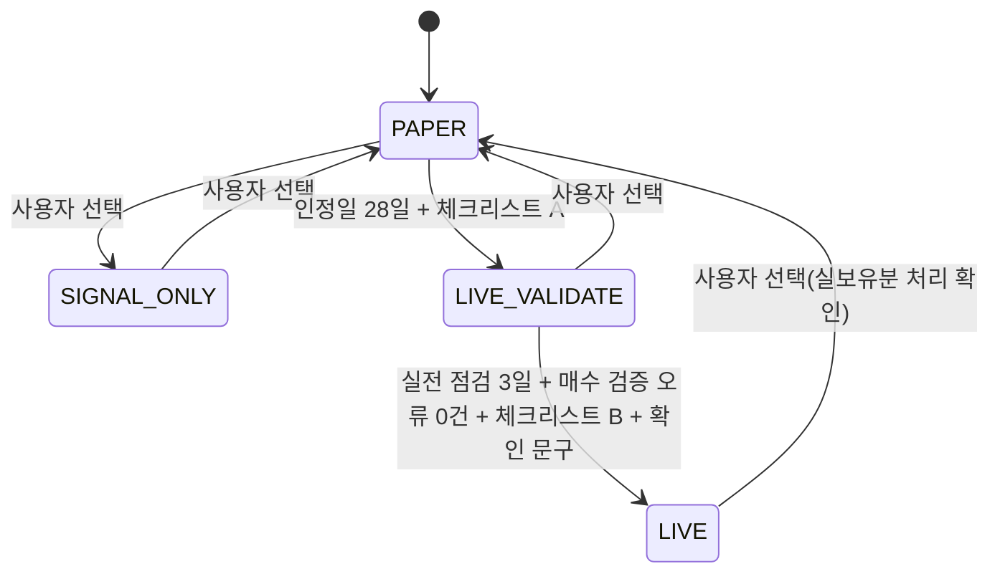
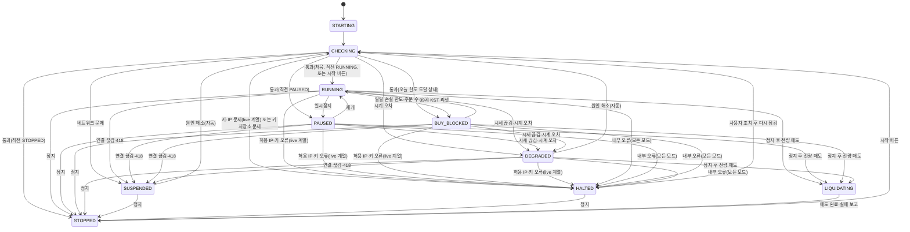
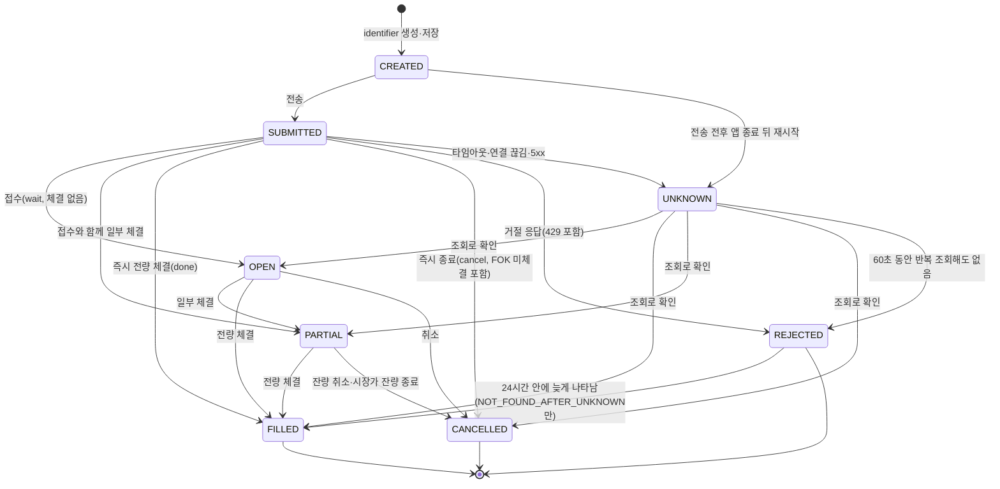
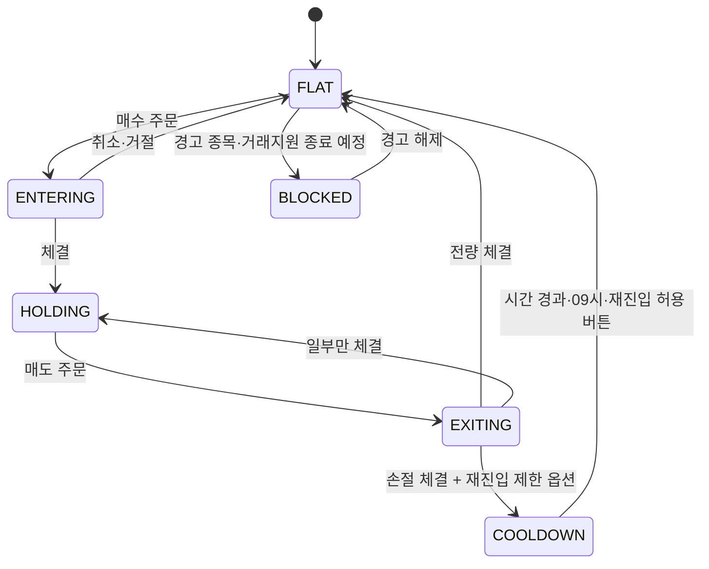

# 상태 전이 정의서

상태: 초안(1단계에서 주문 상태 대응 보완) · 관련: [위험 관리 정책서](risk-policy.md), [매매 로직 명세](trading-logic.md)

상태는 네 종류다: 실행 모드, 매매 상태, 주문 상태, 코인 상태. "live 계열"은 live-validate와 live를 뜻한다.

## 1. 실행 모드

- backtest는 실행 모드가 아니라 개발용 도구다.
- 체크리스트 A·B와 인정일 규칙은 [위험 관리 정책서](risk-policy.md) 6장.
- live에서 paper로 바꿀 때 실제 보유 코인이 있으면 MSG-C008로 처리 방법을 고른다. 실제 보유분을 관리 없이 남기지 않는다.
- 모드가 바뀌면 이벤트로 기록하고 알린다(NTF-14).

## 2. 매매 상태

| 상태 | 신규 매수 | 손절·청산 매도 | 시그널 평가 | 비고 |
|---|---|---|---|---|
| RUNNING | 가능 | 가능 | 평가·매매 | 정상 |
| PAUSED | 불가 | 가능 | 평가·기록(LLM 부정 매도는 옵션이 켜져 있으면 실행) | 사용자 일시정지 |
| BUY_BLOCKED | 불가 | 가능 | PAUSED와 같음 | 09:00 KST에 자동 해제 |
| DEGRADED | 불가 | 가능(REST 현재가로 점검) | 기록만 | 데이터 의심(시세 웹소켓 끊김, 시계 오차). 해소되면 자동 재점검 |
| SUSPENDED | 불가 | 불가(통신 불가) | 중지 | 네트워크 끊김, 418 차단. 해소되면 자동 재점검 |
| HALTED | 불가 | 불가 | 중지 | 사람 조치 필요, 긴급 알림 |
| STOPPED | 불가 | 불가(손절선 도달 시 알림만, NTF-17) | 중지 | 사용자 정지. 시작 버튼으로만 나감 |
| LIQUIDATING | 불가 | 전량 매도만 | 중지 | 끝나면 STOPPED |

- BUY_BLOCKED에는 RUNNING에서만 들어간다. PAUSED 중에 한도에 닿으면 PAUSED를 유지하고 "오늘 매수 차단"만 표시한다. 그날 09:00 KST 전에 재개하면 BUY_BLOCKED로 간다.
- 앱을 다시 시작하거나 SUSPENDED·DEGRADED·HALTED가 풀리면, CHECKING을 거쳐 직전 상태(RUNNING, PAUSED, BUY_BLOCKED, STOPPED)로 돌아간다. BUY_BLOCKED는 09:00 KST가 지났으면 RUNNING으로 돌아간다.
- paper와 signal-only에서는 업비트 키·IP 문제로 HALTED가 되지 않는다. 경고로만 남긴다(키 저장소 문제는 모든 모드에서 HALTED).
- 내부 오류(위험 관리·상태 불변식 위반, 위험 점검(JOB-02)이나 주문 관리의 예외 3회 연속)는 모든 모드에서 HALTED로 간다. 이때 손절도 멈춘다. 버그가 있을 수 있는 상태에서 자동 주문을 계속 내는 것보다 사람이 확인할 때까지 멈추는 쪽을 제안한다(D-058 대기, [시스템 구성도](../06-architecture/system-architecture.md) 7장). 알림은 NTF-03(MSG-E017).

## 3. 주문 상태

- UNKNOWN은 identifier 조회를 1·2·4·8·15·30·45·60초에 반복하고, 60초가 지난 뒤 "없음"을 3회 이상 받고 목록 조회에도 없을 때만 REJECTED로 확정한다([매매 로직 명세](trading-logic.md) 9장, D-046). 그 뒤 24시간 안에 늦게 나타난 주문도 실제 상태로 반영한다.
- 허용하는 전이는 [매매 로직 명세](trading-logic.md) 10장 표와 같다. 그림은 줄여서 그렸다. `NOT_FOUND_AFTER_UNKNOWN`으로 닫은 REJECTED는 늦게 나타나면 실제 상태(OPEN, PARTIAL, FILLED, CANCELLED)로 다시 연다.
- UNKNOWN 절차는 live의 실제 주문 생성에만 쓴다. live-validate 주문 검증의 타임아웃·재시작은 REJECTED(VALIDATE_TIMEOUT), paper 재시작 때 남은 주문은 REJECTED(PAPER_RESTART)로 닫는다.
- UNKNOWN이 풀리기 전에는 같은 코인에 새 주문을 만들지 않는다. 5분 넘게 풀리지 않으면 긴급 알림(NTF-16).
- 주문 생성이 429를 받으면 REJECTED(reason RATE_LIMIT_429)로 기록한다. 다시 주문하려면 새 identifier로 위험 검사부터 한다.
- 상태 변화는 모두 order_events에 기록한다.
- 업비트 응답의 state(REST: wait, watch, done, cancel / myOrder: trade, prevented 추가)를 이 상태로 바꾸는 표는 [매매 로직 명세](trading-logic.md) 10장(D-047)이다. 시장가 매수는 잔량이 남으면 `cancel`로 끝날 수 있어, 코인 상태는 주문 상태가 아니라 체결 합계로 정한다.

## 4. 코인 상태

- 보유 중에 경고가 뜨면 HOLDING을 유지하되 매수만 막고 알린다(MSG-W001, W002).
- 분할 매수의 추가 회차를 사는 동안에는 HOLDING을 유지한다(ENTERING으로 가지 않음). 추가 회차가 체결되지 않아도 HOLDING이다. 손절 점검 대상에서 빠지지 않는다(ADR-0008).
- 매도 뒤 남은 수량이 팔 수 없는 금액(매도 `min_total` 미만)이면 잔량으로 따로 기록하고 FLAT으로 간다([매매 로직 명세](trading-logic.md) 10장 잔량 규칙).
- "직접 풀 때까지 금지" 옵션의 COOLDOWN은 대시보드 코인 카드의 [재진입 허용] 버튼(MSG-C010)으로만 풀린다.
