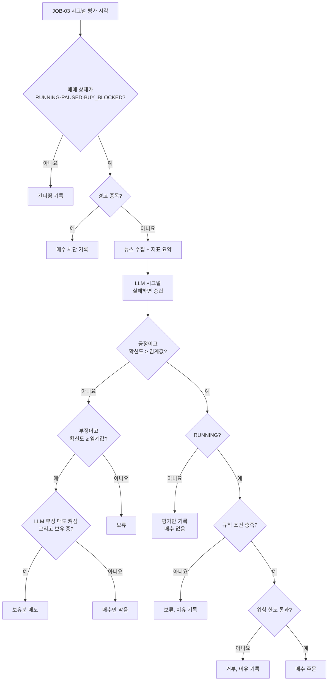
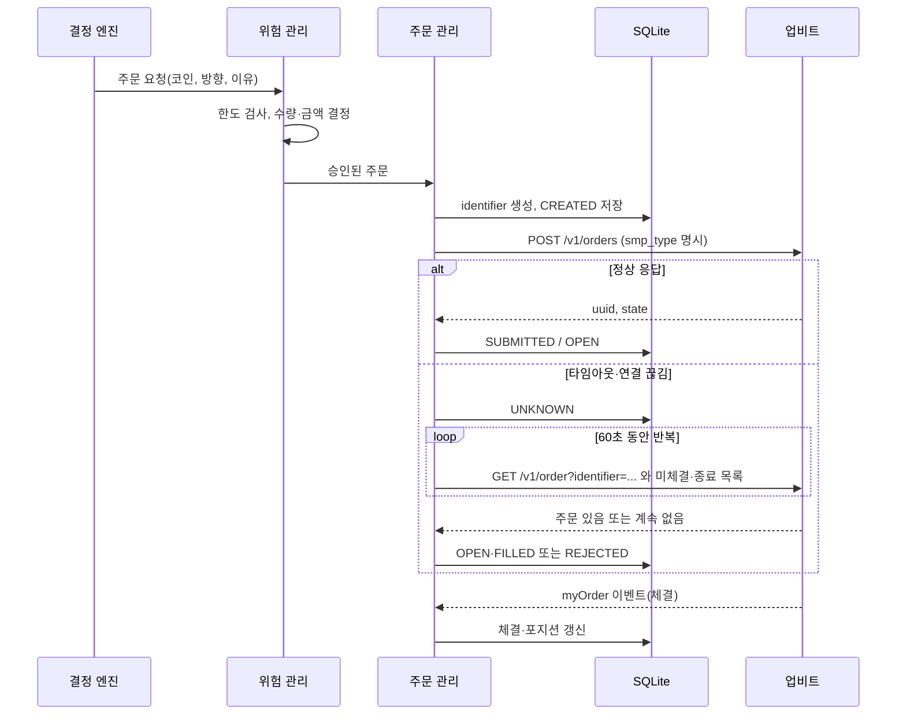

# 매매 로직 명세

상태: 1단계 보완 · 관련: [위험 관리 정책서](risk-policy.md), [LLM 시그널 명세](../05-integration/llm-signal.md), [업비트 API 연동 명세](../05-integration/upbit-api.md)

이 문서는 판단 순서와 원칙을 정한다. 규칙 조건, 매수 방식 같은 세부 값은 1단계 설계에서 확정한다. 어떤 조건이 수익을 내는지는 판단하지 않는다.

## 1. 판단 흐름



- 모든 갈림길의 결과는 이유 코드와 함께 결정 기록(decisions)에 남긴다.
- PAUSED와 BUY_BLOCKED에서도 평가와 기록은 한다. 매수는 하지 않고, LLM 부정 매도는 옵션이 켜져 있으면 청산으로 실행한다.
- 경고 종목은 LLM을 부르지 않는다(무료 한도 절약). 보유 중인 경고 종목은 알림을 보고 사용자가 처리한다.

## 2. 매수 조건

아래를 모두 만족해야 한다.

1. 매매 상태가 RUNNING이다.
2. 코인이 경고 종목이 아니다(유의, 주의 플래그, 거래지원 종료 예정).
3. 재진입 제한 중이 아니다(옵션을 켠 경우).
4. LLM 시그널이 positive이고 확신도가 임계값 이상이다(기본 0.7, 초안).
5. 규칙 조건을 만족한다(1단계에서 확정).
6. 위험 한도를 통과한다(예산, 노출, 최소 주문 금액, 주문 간격, 일일 주문 수, 결과 불명 주문 없음).

## 3. 매도 조건

아래 중 하나라도 해당하면 매도한다.

| 조건 | 기본 | 동작 상태 | 주문 |
|---|---|---|---|
| 손절: 평가손실률이 설정값에 닿음 | 켜짐 | RUNNING, PAUSED, BUY_BLOCKED, DEGRADED(REST 현재가) | 시장가 전량 |
| 익절: 평가수익률이 설정값에 닿음 | 꺼짐 | 손절과 같음 | 시장가 전량 |
| 규칙상 청산 조건 | 1단계에서 정의 | 1단계에서 정의 | 1단계에서 결정 |
| LLM 부정(확신도 ≥ 임계값) | 꺼짐(켜면 매도) | RUNNING, PAUSED, BUY_BLOCKED | 시장가 전량 |
| 정지 후 전량 매도 | 사용자 버튼 | LIQUIDATING | 시장가 전량 |
| 코인 선택 해제 시 "시장가 매도" 선택 | 사용자 선택 | 매도 가능한 상태 | 시장가 전량 |

- 손절은 시그널 주기와 상관없이 60초마다 점검한다(JOB-02). STOPPED에서는 주문하지 않고 손절선 도달만 알린다(NTF-17).
- 매도로 남는 소량(최소 주문 금액 미만)은 팔 수 없으므로 기록만 하고 손익 계산에 포함한다.

## 4. 포지션 원칙

- 코인마다 포지션은 하나다. 보유 중에 다시 긍정이 나오면, 분할 매수를 쓸 때만 다음 회차로 산다.
- 매수와 매도 주문을 같은 코인에 동시에 걸지 않는다(자기체결 방지). `smp_type`은 모든 주문에 명시한다.
- 꺼져 있던 동안 놓친 평가는 나중에 몰아서 실행하지 않는다.
- live에서 paper로 바꿀 때 "실보유분은 손절·청산만 계속 관리"를 고르면, 그 실제 보유분은 mode=live 포지션으로 남아 손절·청산 대상이 된다. 신규 매수는 하지 않는다.

## 5. 주문 흐름



- **identifier:** 같은 identifier로 다시 보내지 않는다(업비트는 identifier 재사용을 허용하지 않음). 다시 주문해야 하면 새 identifier로 위험 검사부터 다시 한다.
- **결과 불명(UNKNOWN):** 60초(초안) 동안 반복 조회해도 없을 때만 REJECTED로 확정한다. 그동안 같은 코인의 새 주문은 만들지 않는다.
- **429:** 주문 생성이 429를 받으면 REJECTED(reason RATE_LIMIT_429)로 기록한다. 손절 매도는 다음 초에 새 identifier로 바로 다시 시도한다. 조회(GET)의 429는 다음 초에 같은 요청을 다시 보낸다.
- **시장가 잔량:** 시장가 주문은 일부만 체결된 뒤 cancel 상태로 끝날 수 있으므로 체결 수량으로 반영한다.
- **paper:** 같은 흐름을 가상 거래소로 처리한다.
- **live-validate:** 주문을 `/v1/orders/test`로 보낸다. 통과하면 paper처럼 가상 체결로 포지션을 유지한다. 실제 보유가 없어서 생기는 매도 검증의 잔고 부족(insufficient_funds_ask)은 예상된 결과로 따로 집계한다.

## 6. 의사코드

```text
on_signal_tick(coin):
    if trading_state not in (RUNNING, PAUSED, BUY_BLOCKED): record_skip(coin); return
    if market_blocked(coin): record_decision(coin, BLOCKED, "MARKET_WARNING"); return
    news = collect_news(coin)                   # 실패해도 빈 목록으로 계속
    features = summarize_indicators(coin)
    sig = llm.evaluate(coin, features, news)    # 실패하면 neutral
    if sig.signal == POSITIVE and sig.confidence >= cfg.confidence_threshold:
        if trading_state != RUNNING: record_decision(coin, HOLD, "NOT_RUNNING"); return
        if not rules.entry_ok(coin, features): record_decision(coin, HOLD, "RULE_NOT_MET"); return
        order = risk.approve_buy(coin)          # 거부하면 이유 코드 반환
        if order.rejected: record_decision(coin, HOLD, order.reason); return
        orders.submit(order)
    elif sig.signal == NEGATIVE and sig.confidence >= cfg.confidence_threshold:
        if cfg.sell_on_negative and holding(coin): orders.submit(risk.approve_sell_all(coin, "LLM_NEGATIVE"))
        else: record_decision(coin, HOLD, "LLM_NEGATIVE")
    else:
        record_decision(coin, HOLD, "NEUTRAL")

every 60s (JOB-02):
    if trading_state == STOPPED:
        for coin in holdings():
            if unrealized_pct(coin) <= -cfg.stop_loss_pct: notify_once(NTF_17, coin)
        return
    if trading_state in (SUSPENDED, HALTED, LIQUIDATING): return
    # RUNNING, PAUSED, BUY_BLOCKED, DEGRADED(DEGRADED는 REST 현재가 사용)
    for coin in holdings():                     # live→paper 후 남긴 실보유분 포함
        pnl = unrealized_pct(coin)
        if pnl <= -cfg.stop_loss_pct: orders.submit(risk.approve_sell_all(coin, "STOP_LOSS"))
        elif cfg.take_profit_pct and pnl >= cfg.take_profit_pct: orders.submit(risk.approve_sell_all(coin, "TAKE_PROFIT"))
    if realized_loss_today() >= cfg.daily_loss_limit_krw:
        if trading_state == RUNNING: set_state(BUY_BLOCKED)
        elif trading_state == PAUSED: mark_buy_blocked_today()   # 일시정지는 유지
```

## 7. 1단계에서 정할 것

| 항목 | 후보 | 비고 |
|---|---|---|
| 규칙 조건 | 이동평균 위(추세 확인), 단기·장기 이동평균 정배열, RSI 과열 아님, 거래량 조건 등 | 후보별 장단점을 정리하고 규칙 부분 백테스트로 동작을 확인한 뒤 사용자가 고름 |
| 지표 캔들 단위 | 4시간봉, 일봉 등 | 시그널 주기와 맞출지 함께 결정 |
| 매수 방식 | 예산 전액 한 번에, 2~3회 분할 | 회차당 금액이 예산 하한 이상이어야 함 |
| 규칙상 청산 조건 | 규칙 조건이 깨질 때 매도 등 | 손절과 별개 |
| 시그널 유효 시간 | 평가 시점에만 판단, 또는 유효 시간 안에 규칙이 맞으면 진입 | 유효 시간을 쓰면 기본값 결정 |
| 확신도 임계값 | 초안 0.7 | 페이퍼 운영 기록을 보고 사용자가 조정 |
| 주문 유형 | 시장가(price/market), 최유리(best), 지정가(limit) | 손절은 항상 시장가 |
| 결과 불명 조회 | 간격, 횟수, 60초 기준 | 업비트 한도 안에서 |
| 페이퍼 슬리피지 모델 | 고정 비율(초안 0.1%), 호가 기반 | 페이퍼 손익에 반영 |
