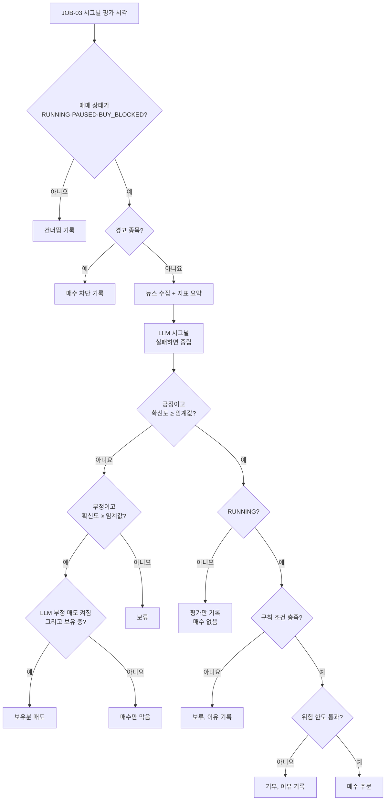
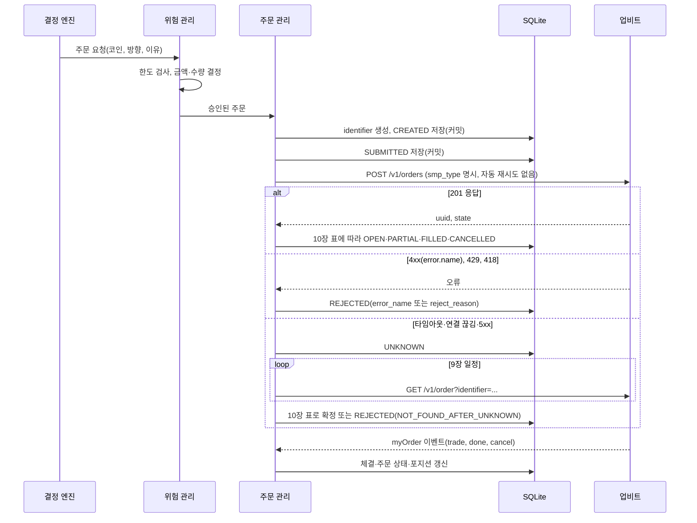

# 매매 로직 명세

상태: 초안(1단계 제안 반영, 일부 사용자 결정 대기 — 15장) · 관련: [위험 관리 정책서](risk-policy.md), [LLM 시그널 명세](../05-integration/llm-signal.md), [업비트 API 연동 명세](../05-integration/upbit-api.md), [ADR-0008 매수 방식](../06-architecture/adr/0008-buy-method.md)

이 문서는 판단 순서와 원칙, 주문 처리 규칙을 정한다. 규칙 조건(ADR-0007)은 별도 비교 리포트를 보고 정한다. 어떤 조건이 수익을 내는지는 판단하지 않는다. 업비트 동작에 관한 내용의 출처는 [업비트 API 연동 명세](../05-integration/upbit-api.md)와 그 문서가 가리키는 공식 문서(2026-11-05 확인)다.

## 1. 판단 흐름



- 모든 갈림길의 결과는 이유 코드(13장)와 함께 결정 기록(decisions)에 남긴다.
- PAUSED와 BUY_BLOCKED에서도 평가와 기록은 한다. 매수는 하지 않고, LLM 부정 매도는 옵션이 켜져 있으면 청산으로 실행한다.
- 경고 종목은 LLM을 부르지 않는다(무료 한도 절약). 보유 중인 경고 종목은 알림을 보고 사용자가 처리한다.

## 2. 매수 조건

아래를 모두 만족해야 한다.

1. 매매 상태가 RUNNING이다.
2. 코인이 경고 종목이 아니다(유의, 주의 플래그, 거래지원 종료 예정).
3. 재진입 제한 중이 아니다(옵션을 켠 경우).
4. LLM 시그널이 positive이고 확신도가 임계값 이상이다(기본 0.7, 초안).
5. 규칙 조건을 만족한다(ADR-0007, 결정 대기).
6. 위험 한도를 통과한다(예산, 노출, 최소 주문 금액, 주문 간격, 일일 주문 수, 결과 불명 주문 없음).

매수 단계와 금액은 [ADR-0008](../06-architecture/adr/0008-buy-method.md)(확정), [분할 매수·매도 설계](split-trading.md), 7장을 따른다. 매수는 최대 2단계다. 2단계는 보유 중 평가에서 위 조건을 다시 모두 만족하고 현재가가 평균 단가보다 하락률 이상 낮을 때만 산다(D-084).

## 3. 매도 조건

아래 중 하나라도 해당하면 매도한다.

| 조건 | 기본 | 동작 상태 | 주문 |
|---|---|---|---|
| 손절: 평가손실률이 설정값에 닿음 | 켜짐 | RUNNING, PAUSED, BUY_BLOCKED, DEGRADED(REST 현재가) | 시장가 전량 |
| 익절: 평가수익률이 익절 단계의 발동 수익률에 닿음 | 꺼짐 | 손절과 같음 | 시장가. 최대 2단계로 나눠 판다(D-085, [분할 매수·매도 설계](split-trading.md) 6장) |
| 규칙상 청산 조건 | ADR-0007과 함께 결정 | ADR-0007과 함께 결정 | 시장가 전량(제안) |
| LLM 부정(확신도 ≥ 임계값) | 꺼짐(켜면 매도) | RUNNING, PAUSED, BUY_BLOCKED | 시장가 전량 |
| 정지 후 전량 매도 | 사용자 버튼 | LIQUIDATING | 시장가 전량 |
| 코인 선택 해제 시 "시장가 매도" 선택 | 사용자 선택 | 매도 가능한 상태 | 시장가 전량 |

- 나눠 파는 것은 익절뿐이다. 손절과 그 밖의 매도는 전량이다(D-085).
- 손절은 시그널 주기와 상관없이 60초마다 점검한다(JOB-02). STOPPED에서는 주문하지 않고 손절선 도달만 알린다(NTF-17).
- 매도로 남는 소량(최소 주문 금액 미만)은 팔 수 없으므로 기록만 하고 손익 계산에 포함한다(12장).

## 4. 포지션 원칙

- 코인마다 포지션은 하나다. 보유 중에 다시 긍정이 나오면, 매수 2단계를 쓰고 아직 2단계를 사지 않았으며 현재가가 평균 단가보다 하락률 이상 낮을 때만 2단계를 산다(D-084). 첫 익절 뒤에는 사지 않는다. 단계 계획은 포지션을 열 때 고정하고, 설정을 바꾸면 다음 포지션부터 적용한다(D-082, [분할 매수·매도 설계](split-trading.md) 4장).
- 매수와 매도 주문을 같은 코인에 동시에 걸지 않는다(자기체결 방지). 같은 코인에 끝나지 않은 주문(CREATED, SUBMITTED, OPEN, PARTIAL, UNKNOWN)이 있으면 새 주문을 만들지 않는다.
- **코인별 직렬화(D-070):** 주문을 만드는 경로(JOB-02 손절·익절, JOB-03 매수·LLM 부정 매도, 정지·전량 매도·선택 해제 매도·모드 전환 매도, 429 재시도)는 코인별 잠금 하나를 거친다. 주문 가능 정보 같은 외부 조회는 잠금 전에 끝내고, 잠금 안에서 매매 상태·코인 상태·끝나지 않은 주문·재진입·노출을 DB에서 다시 읽어 위험 검사를 한 뒤 CREATED 커밋까지 기다림(await) 없이 처리한다. 전체 노출과 원화 잔고가 걸린 매수 승인은 전역 잠금으로 한 번에 하나씩 한다.
- 꺼져 있던 동안 놓친 평가는 나중에 몰아서 실행하지 않는다.
- live에서 paper로 바꿀 때 "실보유분은 손절·청산만 계속 관리"를 고르면, 그 실제 보유분은 mode=live 포지션(exit_only)으로 남아 손절·청산 대상이 된다. 신규 매수는 하지 않는다.
- **exit_only 실보유분 관리(D-068):**
  - exit_only 포지션이 하나라도 있으면 실행 모드와 상관없이 live와 같은 실자산 감시를 돌린다: 비공개 웹소켓(myOrder), JOB-05 주문 대조, JOB-14 키·IP·잔고 점검, 시작 점검의 키 검증과 잔고 대조.
  - exit_only 주문은 실제 주문이다. LiveBroker로 `POST /v1/orders`에 보내고 identifier 글자는 `l`, `orders.mode=live`이며 9장 결과 불명 절차와 11장 재조정을 그대로 따른다.
  - 키·IP 오류가 나면 HALTED로 가지 않고(가상 매매는 계속) exit_only 주문만 멈추며, 긴급 알림 MSG-E019(NTF-23)로 실보유분을 손절할 수 없다고 알린다(이벤트 EXIT_ONLY_BLOCKED).
  - exit_only가 남아 있으면 paper에서 signal-only·live-validate로 바꾸지 못한다.
  - "시장가 매도 후 전환"을 고르면 먼저 그 포지션들을 exit_only로 표시해 커밋한 뒤 매도한다. 매도가 끝나지 않거나 팔 수 있는 수량이 남으면 exit_only로 남는다(도중에 꺼져도 관리가 이어진다).

## 5. 시그널 유효 시간 (제안, D-045 대기)

| 후보 | 동작 | 장점 | 단점 |
|---|---|---|---|
| **A. 평가 시점에만 판단 (추천)** | JOB-03 평가 순간에 2장의 조건을 모두 만족할 때만 주문한다. 못 맞추면 그 평가는 끝난다 | 단순하다. 기록과 재현이 쉽다. 오래된 판단으로 사지 않는다 | 평가 직후 규칙이 맞아도 다음 평가(4시간 뒤)까지 진입하지 않는다 |
| B. 유효 시간 안에 규칙이 맞으면 진입 | 긍정 시그널을 정해진 시간(예: 60분) 동안 유효로 두고, 그동안 1분마다 규칙과 위험 한도를 다시 확인해 맞으면 주문한다 | 진입 기회가 늘어난다 | 시그널이 오래될수록 근거가 약해진다. 활성 시그널의 만료를 관리해야 하고 테스트 경우가 늘어난다. 규칙이 4시간봉 마감 기준이면 그 사이에 규칙 결과가 거의 바뀌지 않는다 |

- 추천은 A다. 규칙 조건(ADR-0007)이 실시간 가격을 쓰는 규칙으로 정해지면 B를 다시 검토한다.
- 평가 순간에 생긴 일시적 거절(최소 주문 간격, 429, 최유리 FOK 미체결)도 그 평가에서 끝낸다. 매수는 다시 시도하지 않는다("불확실하면 매수하지 않는다"). 손절·청산 매도는 예외로 다음 기회에 새 identifier로 다시 시도한다(8장).
- **평가 시각 정렬(제안, D-057 대기, ADR-0007과 함께 결정):** 규칙이 4시간봉을 쓰면 평가를 4시간봉 마감 직후로 맞춘다. 업비트 캔들 경계는 UTC 기준이라 4시간봉은 KST 01·05·09·13·17·21시에 끝난다. 마감 캔들이 API에 반영될 시간을 두려고 2분 뒤(예: 09:02 KST)에 평가한다. 평가 시각은 거래소 시각으로 정하고, 기다리는 시간은 monotonic 시간으로 잰다.

## 6. 주문 유형 (D-043)

업비트 주문 유형은 `limit`(지정가), `price`(시장가 매수, 총액 지정), `market`(시장가 매도, 수량 지정), `best`(최유리 지정가, `time_in_force`로 `ioc` 또는 `fok` 필수)다. `post_only`는 `limit` 전용이고 `smp_type`의 `cancel_maker`·`cancel_taker`·`reduce`와 함께 쓸 수 없다(2026-11-09부터 `none`은 함께 쓸 수 있고, post_only 주문에서 `smp_type`을 빼면 `none`으로 처리된다). 앱은 `post_only`를 쓰지 않는다.

| 용도 | 정한 유형 | 고르지 않은 대안 | 이유 |
|---|---|---|---|
| 신규 매수(ENTRY) | **최유리 FOK**: `ord_type=best`, `side=bid`, `price`=승인 금액, `time_in_force=fok` | 시장가 매수(`ord_type=price`) | FOK는 최우선 매도호가에서 전량 체결될 수 있을 때만 체결하고, 아니면 전량 취소한다. 그래서 체결 가격이 최우선 호가 한 단계로 묶이고, 일부만 체결되어 최소 주문 금액보다 작은(팔 수 없는) 포지션이 생기지 않는다. 체결되지 않으면 그 평가는 매수 없이 끝난다 |
| 손절·익절·청산·전량 매도 | **시장가 매도**: `ord_type=market`, `side=ask`, `volume`=매도 수량 | 없음(항상 시장가) | 체결이 가격보다 중요하다 |
| 쓰지 않음 | 걸어 두는 지정가 주문, `post_only`, 예약 주문(`watch`), 취소 후 재주문(`cancel_and_new`), 최유리 IOC | | 걸어 두고 취소하는 주문은 반복 취소(시세조종 오인)와 상태 관리 부담을 늘린다. IOC는 일부 체결로 팔 수 없는 소액 포지션을 만들 수 있다 |

- 시장가 매수는 고르지 않았다(D-043). 항상 체결되는 대신 슬리피지 상한이 없다. 시장가 매수는 잔량이 남으면 `cancel` 상태로 끝날 수 있다(체결분으로 반영, 10장).
- **SMP:** 모든 주문에 `smp_type=cancel_maker`를 명시한다. 앱 주문은 모두 즉시 체결형(테이커)이고, 업비트 SMP는 테이커 주문의 설정으로 동작한다. 같은 계정에서 사용자가 직접 걸어 둔 주문(메이커)과 맞부딪치면 사용자의 주문이 취소되고 앱 주문(손절 포함)은 진행된다. 업비트 문서는 SMP를 "동일 계정"·"동일 회원"의 주문 사이 기능으로 설명할 뿐 포켓 단위인지는 밝히지 않는다. 그래서 메인포켓에 걸어 둔 같은 코인의 주문도 취소될 수 있다고 보고 안내한다(확인 필요). `cancel_taker`는 손절 주문이 취소될 수 있어 쓰지 않는다. 2026-11-09부터 `smp_type`을 빼면 `cancel_maker`가 기본값이 되고 `none`이 추가되지만, 앱은 계속 명시한다.
- 봇 전용 서브포켓에서는 수동 매매를 하지 않고, 봇이 매매하는 코인은 메인포켓에서도 지정가 주문을 걸어 두지 않도록 [설치 가이드](../09-operations/install-guide.md)에서 안내한다.
- **페이퍼 체결 모형(D-043):** 최유리 FOK는 그 순간의 호가(REST 호가 조회)에서 최우선 매도호가 잔량 × 가격이 주문 금액 이상이면 그 가격으로 전량 체결, 아니면 미체결로 처리한다. 시장가 매도는 매수호가를 위에서부터 차례로 소진해 체결 가격을 계산한다. 호가를 받지 못하면 고정 슬리피지(`paper.slippage_pct`, 기본 0.1%)를 쓴다. 수수료는 `/v1/orders/chance`의 값(현재 0.05%)을 쓴다.

## 7. 주문 생성 규칙

### identifier

- 형식: `uat-{모드}-{UTC 시각 yyMMddHHmmss}-{임의 16진수 8자}`. 모드 글자는 `p`(paper), `v`(live-validate), `l`(live). 예: `uat-l-261105012345-9f3a7c1e`(27자).
- 업비트 규칙: identifier는 계정의 전체 주문에서 고유해야 하고, 이미 쓴 값은 주문 생성·체결 여부와 상관없이 다시 쓸 수 없다. 최대 64자다. 이미 쓴 값이면 `duplicated_identifier`(400)가 온다.
- identifier를 DB에 먼저 저장(CREATED)하고 전송한다. 같은 identifier로 다시 보내지 않는다. 다시 주문해야 하면 새 identifier로 위험 검사부터 다시 한다.
- `uat-` 접두어로 거래소 주문 목록에서 앱 주문을 구분한다(11장).
- live-validate의 주문 검증 API는 실제 주문을 만들지 않으며, 응답의 UUID와 identifier는 조회·취소에 쓸 수 없다. 그래도 같은 형식(`v`)으로 만들어 기록한다.

### 금액과 수량

- **매수 승인 금액(원)** = 내림(min(코인별 예산 − 그 코인 노출, 전체 노출 상한 − 전체 노출, 주문 가능 원화) ÷ (1 + `bid_fee`)). 매수 2단계면 단계 금액(내림(코인별 예산 × 단계 비율 ÷ 100))을 넘지 않는다([분할 매수·매도 설계](split-trading.md) 4장).
  - 주문 가능 원화는 live에서는 `/v1/orders/chance`의 `bid_account.balance`, paper·live-validate에서는 가상 잔고다.
  - `bid_fee`, `min_total`, `max_total`, `market.state`는 `/v1/orders/chance`에서 읽는다. 시작 점검 때와 주문 직전(10분 캐시)에 읽고 하드코딩하지 않는다.
  - 업비트 키 없이 paper로 운영하면 이 API를 부를 수 없다(주문조회 권한 필요). 이때만 공식 문서의 값(KRW 마켓 최소 주문 5,000원은 KRW 마켓 안내 문서, 수수료 0.05%와 최대 10억 원은 주문 가능 정보 API의 응답 예시)을 "추정값"으로 쓰고 화면·기록에 추정값임을 표시한다. 키를 넣으면 바로 API 값으로 바꾸고 예산 하한을 다시 검사한다. live 계열은 키가 필수이므로 추정값을 쓰지 않는다(제안, D-059 대기).
- 승인 금액이 매수 `min_total`(`market.bid.min_total`, 현재 5,000원) 미만이면 주문하지 않는다(RISK_MIN_ORDER). `max_total`(현재 10억 원)을 넘으면 거부한다.
- **첫 매수의 예산 하한(D-067):** 포지션이 FLAT일 때의 매수(1단계)는 승인 금액이 예산 하한(매도 `min_total`과 손절%로 그 자리에서 다시 계산, [위험 관리 정책서](risk-policy.md) 2장)보다 작으면 사지 않는다(RISK_BELOW_FLOOR). 원화 잔고, 전체 노출 상한, 남은 예산 때문에 승인 금액이 설정값보다 작아질 수 있기 때문이다. 2단계는 포지션이 커지기만 하므로 매수 `min_total`만 본다.
- **매수·매도 값 구분(D-067):** 주문 가능 정보는 매수·매도 값을 따로 준다(`market.bid.min_total`·`market.ask.min_total`, `bid_fee`·`ask_fee`). 매수 승인은 bid 값, 매도 가능 판단·잔량 규칙·예산 하한은 ask `min_total`, 페이퍼 매도 수수료는 `ask_fee`를 쓴다. `market.bid_types`에 `best_fok`가 없으면 그 코인 매수를 보류하고 경고 이벤트 ORDER_TYPE_UNSUPPORTED를 남긴다.
- **매도 수량**은 포지션 수량 전체다(live는 거래소 `balance`). 익절 단계만 예외로 기준 수량 × 단계 매도 비율을 팔고, 판 뒤 남는 부분이 손절 때 팔 수 없을 만큼 작으면 전량을 판다([분할 매수·매도 설계](split-trading.md) 6장). 매도 금액(수량 × 현재가)이 매도 `min_total` 미만이면 팔 수 없으므로 주문하지 않고 잔량으로 기록한다.
- 최유리 매수는 총액만, 시장가 매도는 수량만 보내므로 호가 단위 반올림이 필요 없다. 호가 단위는 페이퍼 체결 계산과 지정가를 쓰게 될 때만 쓴다. `GET /v1/orderbook/instruments`의 `tick_size`를 우선 쓰고, 실패하면 KRW 마켓 호가 단위 표를 쓴다.

## 8. 주문 흐름



- **자동 재시도 금지:** HTTP 클라이언트나 SDK의 자동 재시도는 주문 생성(POST)에 쓰지 않는다. 재시도가 필요한지는 주문 관리가 정한다.
- **429:** 주문 생성이 429를 받으면 REJECTED(RATE_LIMIT_429)로 기록한다. 손절·청산 매도는 다음 초에 새 identifier로 위험 검사부터 다시 해서 보낸다. 거래소가 접수하지 않은 주문은 최소 주문 간격 계산에서 빠지므로 이 재시도는 60초 간격에 막히지 않는다(제안, D-061 대기). 조회(GET)의 429는 다음 초에 같은 요청을 다시 보낸다.
- **`duplicated_identifier`(400, D-070):** 앱은 같은 identifier를 다시 보내지 않으므로, 이 오류는 같은 요청이 중간에서 한 번 더 전달돼 주문이 이미 접수됐을 가능성이 크다. REJECTED로 닫지 않고 UNKNOWN으로 두어 9장 절차로 확인한다. 찾은 주문의 market·side·ord_type이 이번 주문과 같고 생성 시각이 `submitted_at` 근처면 그 결과를 쓴다. 다르면(정말로 identifier가 겹친 경우) REJECTED(`reject_reason=DUPLICATED_IDENTIFIER`)로 닫고 이벤트 IDENTIFIER_CONFLICT를 남긴다.
- **418:** REJECTED(RATE_LIMIT_418)로 기록하고 SUSPENDED로 간다. 응답에 담긴 차단 시간이 지난 뒤 CHECKING에서 대조한다.
- **4xx:** `error.name`으로 처리한다. 인증 계열(`no_authorization_ip`, `expired_access_key`, `jwt_verification`, `invalid_query_payload`, `nonce_used`, `no_authorization_token`, `out_of_scope`)은 live 계열에서 HALTED로 간다([시스템 구성도](../06-architecture/system-architecture.md) 7장).
- **paper:** 같은 흐름을 가상 거래소로 처리한다. 가상 거래소는 바로 결과를 돌려준다.
- **live-validate:** 주문을 `/v1/orders/test`로 보낸다. 201이면 페이퍼 체결 모형으로 가상 체결한다. 실제 보유가 없어서 생기는 매도 검증의 잔고 부족(`insufficient_funds_ask`)은 예상된 결과(expected_reject=1)로 따로 집계하고 가상 매도는 진행한다. 그 밖의 4xx는 검증 오류로 센다(매수 검증 오류 0건이 실전 전환 조건). 주문 검증은 실제 주문을 만들지 않으므로 타임아웃이 나도 UNKNOWN이 아니라 REJECTED(VALIDATE_TIMEOUT)로 끝낸다.

## 9. 결과 불명(UNKNOWN) 확인 (D-046)

UNKNOWN이 되는 경우: 주문 생성 요청을 보낸 뒤 응답을 받지 못함(타임아웃, 연결 끊김), 5xx 응답, 앱이 CREATED·SUBMITTED 주문을 남긴 채 꺼졌다가 다시 시작함.

| 단계 | 내용 |
|---|---|
| 조회 | `GET /v1/order?identifier=...`(default 그룹, 주문조회 권한) |
| 간격 | UNKNOWN이 된 뒤 1, 2, 4, 8, 15, 30, 45, 60초(8회). 그 뒤에는 JOB-05 주기(30초)마다 |
| 주문이 있음 | 10장 표로 상태를 정하고 UNKNOWN을 푼다 |
| 404 `order_not_found` | "없음" 1회로 센다 |
| 404, `error.name` 없음 | "없음" 1회로 센다. 셀 때마다 경고 이벤트 UNNAMED_NOT_FOUND를 남긴다(D-094, 아래 "이름 없는 404 처리") |
| 429, 5xx, 타임아웃, 네트워크 오류 | 세지 않는다. 다음 간격에 다시 조회한다 |
| REJECTED 확정 | UNKNOWN이 된 지 60초가 지났고, "없음"을 3회 이상 받았고, 마지막 확인에서 `GET /v1/orders/uuids?identifiers[]=...`와 `GET /v1/orders/open?market=...`에도 없을 때. `reject_reason=NOT_FOUND_AFTER_UNKNOWN` |
| myOrder 이벤트 | 같은 identifier의 이벤트가 오면 바로 반영하고 조회를 멈춘다 |
| 늦게 나타난 주문 | REJECTED 확정 뒤 24시간 동안 JOB-05가 `GET /v1/orders/uuids?identifiers[]=...`(최대 100개)로 그 identifier를 직접 확인한다(`/v1/orders/closed`의 시각 구간은 주문 생성 시각 기준이라 놓칠 수 있다). 나타나면 실제 상태로 고치고 체결을 반영하며, 이벤트(ORDER_RECONCILED)와 경고를 남긴다 |
| 알림 | 5분 넘게 풀리지 않으면 NTF-16(긴급). 앱 주문은 즉시 체결형이므로 OPEN·PARTIAL로 5분 넘게 남은 주문도 같은 알림을 보낸다(D-070) |
| 그동안 | 같은 코인의 새 주문은 만들지 않는다(손절 포함). 다른 코인은 영향이 없다 |

- 이 절차의 요청은 초당 1회를 넘지 않는다(default 그룹 한도는 포켓당 초당 30회).
- 네트워크가 계속 끊겨 조회가 실패하면 "없음"이 쌓이지 않으므로 REJECTED로 확정하지 않는다. 연결이 돌아오면 이어서 확인한다.
- 손절 매도가 UNKNOWN이면 그 코인의 손절을 다시 낼 수 없다. 조회가 성공하면 약 60초, 조회가 계속 실패하면 연결이 돌아올 때까지다(5분이면 NTF-16). 이중 매도를 막으려고 이렇게 정한다.

### 이름 없는 404 처리 (D-094)

- **쉬운 설명:** 결과를 모르는 주문(UNKNOWN)을 identifier로 찾았을 때, 업비트가 "없다(404)"고 답하면서 오류 이름을 붙이지 않을 수 있다. 이 답을 "주문이 없다" 1회로 칠지 정했다. 치지 않으면 UNKNOWN이 풀리지 않을 수 있다.
- **정한 규칙(D-094, 선택지 B, 2026-11-07 사용자 결정):** `error.name` 없는 404도 `order_not_found`와 같이 "없음" 1회로 센다. 셀 때마다 경고 이벤트 UNNAMED_NOT_FOUND를 남긴다. REJECTED 확정 조건(60초, "없음" 3회 이상, 목록 조회 2개에도 없음)은 그대로다.
- **사실(2026-11-06 공식 문서 확인):**
  - REST 안내(rest-api-guide)의 404 표에서 "요청한 주문, 출금, 입금 또는 체결 등의 데이터를 찾을 수 없습니다"는 에러 코드가 "—"(이름 없음)다.
  - 개별 주문 조회 문서(get-order)의 404 예시는 `error.name`이 `order_not_found`다.
  - 어느 경우에 이름 없는 404가 오는지는 문서에 없다.
  - 3단계 3a 구현은 `order_not_found`만 "없음"으로 보고, 이름 없는 404는 오류(`UpbitNotFound`)로 올린다(QA 검토 R17-11). 이 규칙에 맞추는 일은 프론트/백엔드 정리 PR이 맡는다.
- **선택지(결정 기록):**

| 선택지 | 내용 | 영향 |
|---|---|---|
| A. 세지 않는다(지금 구현과 같음) | 이름 없는 404는 429·5xx처럼 다음 간격에 다시 조회한다 | 중복 주문 위험은 없다. 서버가 없는 주문에 이름 없는 404만 준다면 "없음"이 쌓이지 않아 UNKNOWN이 풀리지 않는다. 그동안 그 코인은 손절을 포함한 새 주문을 낼 수 없고, 5분 뒤 NTF-16(긴급)이 간다. 사람이 거래소 화면에서 확인해야 한다 |
| **B. "없음"으로 센다(선택)** | `order_not_found`와 같이 "없음" 1회로 센다. 셀 때마다 경고 이벤트(UNNAMED_NOT_FOUND)를 남긴다. REJECTED 확정 조건(60초, "없음" 3회 이상, 목록 조회 2개에도 없음)은 그대로다 | UNKNOWN이 60초쯤 뒤 풀린다. 이름 없는 404가 다른 원인(경로 오류 등)이어도, 확정하려면 다른 엔드포인트인 목록 조회 2개가 성공하고 거기에도 없어야 하므로 잘못 확정할 가능성은 낮다. 늦게 나타난 주문은 24시간 확인이 잡는다(이 장 표). 요청 수는 늘지 않는다 |
| C. 목록 조회로 확인될 때만 센다 | 이름 없는 404를 받으면 바로 `GET /v1/orders/uuids?identifiers[]=...`를 한 번 보낸다. 성공했고 그 identifier가 없을 때만 "없음" 1회로 센다 | B보다 한 번 더 확인한다. 이름 없는 404마다 요청이 1건 늘지만 초당 1회 이하 규칙 안이다. 구현이 조금 늘어난다 |

- **제안 때의 추천 이유:** 확정 전에 이미 목록 조회 2개로 다시 확인하므로, B로도 잘못 확정하기 어렵다. A는 손절까지 막힌 채 사람 확인을 기다려야 할 수 있다. 경고 이벤트로 업비트 응답이 바뀐 것(이름이 빠진 404)을 알아챌 수 있다.

## 10. 업비트 state 대응표 (D-047)

업비트 주문 상태: REST는 `wait`(체결 대기), `watch`(예약 주문 대기), `done`(체결 완료), `cancel`(주문 취소). 내 주문 웹소켓(myOrder)은 여기에 `trade`(체결 발생), `prevented`(SMP로 체결 방지)가 더 있다.

### 응답 수준

| 상황 | 앱 주문 상태 | 비고 |
|---|---|---|
| POST 201 | 아래 state 표로 결정 | 응답은 그 순간의 모습이다. 최종 상태는 myOrder나 조회로 확인한다 |
| POST 400·401·403·404(`error.name` 있음, `duplicated_identifier` 제외) | REJECTED | `error_name` 저장. 인증 계열은 HALTED(live 계열) |
| POST 400 `duplicated_identifier` | UNKNOWN | 8장. 9장 절차로 확인하고, 이번 주문이 아니면 REJECTED(DUPLICATED_IDENTIFIER) |
| POST 429 | REJECTED | `reject_reason=RATE_LIMIT_429` |
| POST 418 | REJECTED | `reject_reason=RATE_LIMIT_418`, SUSPENDED |
| POST 5xx, 타임아웃, 연결 끊김 | UNKNOWN | 9장. live의 `POST /v1/orders`에만 해당 |
| 앱 재시작 시 CREATED·SUBMITTED(live) | UNKNOWN | 9장 |
| live-validate: 주문 검증의 타임아웃·5xx, 재시작 시 남은 CREATED·SUBMITTED | REJECTED | `reject_reason=VALIDATE_TIMEOUT`. 주문 검증은 실제 주문을 만들지 않고 조회할 수도 없으므로 UNKNOWN 절차를 쓰지 않는다 |
| paper: 재시작 시 남은 CREATED·SUBMITTED | REJECTED | `reject_reason=PAPER_RESTART`. 가상 거래소는 바로 결과를 주므로 남은 주문은 전송 전에 꺼진 것이다 |

### state 값

| 출처 | 업비트 state | 조건 | 앱 주문 상태 | 코인 상태 | 처리 |
|---|---|---|---|---|---|
| REST, myOrder | `wait` | `executed_volume` = 0 | OPEN | 매수면 ENTERING(매수 2단계면 HOLDING 유지), 매도면 EXITING | |
| REST, myOrder | `wait` | `executed_volume` > 0 | PARTIAL | 매수면 HOLDING(체결분), 매도면 EXITING | 체결분을 fills에 추가 |
| REST, myOrder | `watch` | - | OPEN | 변화 없음 | 앱은 예약 주문을 쓰지 않는다. 경고 이벤트 MANUAL_ORDER_DETECTED(수동 주문 가능성) |
| myOrder | `trade` | - | PARTIAL(최종 상태는 `done`·`cancel`로 확정) | 매수면 HOLDING | `trade_uuid`로 중복을 거르고 fills에 추가 |
| REST, myOrder | `done` | - | FILLED | 매수면 HOLDING. 매도면 FLAT(남은 수량이 팔 수 있는 금액이면 HOLDING, 아래 "잔량" 규칙) 또는 COOLDOWN | 손절 체결이고 재진입 제한이 켜져 있으면 COOLDOWN |
| REST, myOrder | `cancel` | `executed_volume` = 0 | CANCELLED | 매수면 주문 전 상태로 돌아감(FLAT, 매수 2단계면 HOLDING), 매도면 HOLDING | 최유리 FOK 미체결이 여기에 온다 |
| REST, myOrder | `cancel` | `executed_volume` > 0 | CANCELLED(부분 체결 후 종료) | 체결분 기준(매수면 HOLDING) | 시장가 매수는 잔량이 남으면 `cancel`로 끝날 수 있다. 체결분으로 반영 |
| myOrder | `prevented` | - | 상태 유지(잔량이 없으면 뒤이어 `cancel`) | 변화 없음 | `prevented_volume` 기록, 경고 이벤트(SMP_PREVENTED) |
| REST | 응답에 `prevented_volume` > 0 | - | 위 표대로 | | 경고 이벤트(SMP_PREVENTED) |
| live-validate | 201 | - | 가상 체결 결과(FILLED 또는 CANCELLED) | 가상 포지션 | `test_uuid` 저장 |
| live-validate | 매도 검증 400 `insufficient_funds_ask` | - | 가상 체결 결과(FILLED 또는 CANCELLED). REJECTED가 아니다 | 가상 포지션 | `error_name` 기록, `expected_reject=1`. 같은 매도를 다시 내지 않는다(D-070) |
| paper | - | - | 가상 체결 결과 | 가상 포지션 | |

- 코인 상태의 최종 기준은 체결(fills) 합계다. 주문 상태가 CANCELLED라도 체결분이 있으면 포지션에 반영한다.
- 매수 2단계 주문이 진행되는 동안 코인 상태는 HOLDING을 유지한다. 그 주문이 끝날 때까지(보통 1초 안, UNKNOWN이면 9장 절차) 그 코인은 손절 주문을 낼 수 없고, 끝나는 즉시 손절을 다시 점검한다(D-070).
- **최종 상태(D-070):** FILLED, CANCELLED, 다시 열지 않는 REJECTED는 최종 상태다. 그 뒤에 온 myOrder `trade`·`wait` 이벤트나 조회 결과는 체결만 fills에 더하고(`trade_uuid`로 중복 제거) 주문 상태는 바꾸지 않는다.
- **잔량(dust) 규칙:** 매도 체결 뒤 남은 수량의 평가금액(수량 × 현재가)이 매도 `min_total` 미만이면 그 수량을 팔 수 없는 잔량으로 보고 `positions.dust_volume`으로 옮긴 뒤 FLAT으로 바꾼다. 잔량은 손절·매수 판단에서 보유로 치지 않고, 다음 매수가 체결되면 포지션 수량에 합친다(그래야 다음 매도 때 함께 팔 수 있다). 잔량의 원가는 FLAT이 될 때 실현 손실로 처리하고 잔량은 원가 0으로 남긴다(12장, D-067). 포지션 전체 평가금액이 `min_total` 아래로 떨어져 손절 매도를 낼 수 없을 때도 같은 규칙으로 잔량으로 옮기고, 경고 이벤트(DUST_RECORDED)와 NTF-18(MSG-E013, 최소 주문 금액 미만)로 알린다.
- **REJECTED 다시 열기:** `NOT_FOUND_AFTER_UNKNOWN`으로 닫은 주문이 9장 규칙에 따라 늦게 나타나면 REJECTED에서 실제 상태(OPEN, PARTIAL, FILLED, CANCELLED)로 고친다. 다른 이유의 REJECTED는 최종 상태다.
- REST 응답에서 값이 NULL인 필드(예: 2026-11-09 전의 `smp_type`)는 아예 빠질 수 있다. 빠진 필드는 "모름"으로 다룬다.

## 11. 재조정(대조) 규칙 (D-053)

거래소 상태가 로컬 기록보다 우선한다. 실제 자산이 걸린 포지션(live, 그리고 live → paper 뒤 남긴 exit_only 실보유분)에만 적용한다. paper와 live-validate 포지션은 가상이라 거래소와 대조하지 않는다.

| 시점 | 대상 |
|---|---|
| 시작 점검 6번(FR-02) | 주문 + 잔고 |
| 웹소켓 재연결 뒤, 잠자기 복귀 뒤, SUSPENDED·HALTED·DEGRADED에서 CHECKING으로 갈 때 | 주문 + 잔고 |
| JOB-05(30초) | 끝나지 않은 주문(CREATED, SUBMITTED, OPEN, PARTIAL, UNKNOWN)과 `NOT_FOUND_AFTER_UNKNOWN`으로 닫은 지 24시간이 안 된 주문 |
| JOB-14(10분, live 계열. paper에 exit_only 실보유분이 있으면 paper에서도, D-068) | 잔고(허용 IP·키 확인을 겸함) |

**주문**

1. 로컬에서 끝나지 않은 주문은 identifier로 조회해 10장 표로 맞춘다(`/v1/orders/uuids`로 최대 100개씩). 목록 조회는 체결 목록(trades)을 주지 않으므로, 응답의 `executed_volume`이 fills 합계와 다르면 그 주문을 `GET /v1/order?identifier=...`로 다시 조회해 `trades`로 fills를 채운다(`UNIQUE(identifier, trade_uuid)`로 중복 방지). REST 체결에는 수수료가 없으므로 주문의 `paid_fee`를 체결 금액 비율로 나눠 넣고(마지막 체결에 나머지), `is_maker`는 NULL, `source=api`로 둔다(D-070).
2. 거래소 미체결 목록(`/v1/orders/open`, `states[]=wait&states[]=watch`)과 최근 종료 목록(`/v1/orders/closed`, 마지막 대조 시각(`app_meta.last_order_reconcile_at`)부터, 최대 7일 구간. 공백이 7일보다 길면 7일씩 나눠 조회한다. `start_time`은 밀리초 타임스탬프로 보낸다. ISO 8601도 받지만 `:`·`+`가 들어가 인코딩 실수가 생기기 쉽다)에서 `uat-` 접두어인데 로컬에 없는 주문은 들여온다(`orders.source=reconcile`, `purpose=IMPORTED`, `decision_id` NULL, 경고 이벤트 ORDER_IMPORTED). DB를 백업에서 복원했을 때 생길 수 있다. 한 주문을 들여오다 실패하면 그 주문만 건너뛰고 이벤트를 남기며, 내부 오류 연속 횟수(D-058)에는 세지 않는다. 대조가 끝나면 마지막 대조 시각을 갱신한다(D-070).
3. `uat-` 접두어가 없는 미체결 주문(같은 포켓에서 사용자가 직접 낸 주문)은 관리하지 않는다. 선택한 코인의 주문이면 경고 이벤트 MANUAL_ORDER_DETECTED를 남긴다(자기체결 위험).

**잔고**

1. 선택 코인의 보유 수량은 거래소 `balance + locked`, 평균 단가는 `avg_buy_price`(`unit_currency`가 KRW일 때)다.
2. 거래소 수량을 로컬의 `volume + dust_volume`(잔량 포함)과 비교한다. 다르면 거래소 값으로 덮어쓰고, 원가(`cost_krw`)를 수량 × 평균 단가 × (1 + `bid_fee`)로 다시 계산해 `cost_estimated=1`로 표시한다. 이벤트 BALANCE_RECONCILED를 남기고 MSG-W010(NTF-20)으로 알린다.
3. 차이 무시 기준: 수량 차이가 0.00000001 이하이거나 평가금액 차이가 1원 미만.
4. 선택하지 않은 코인의 보유분은 관리하지 않는다. 처음 발견했을 때만 경고 이벤트 UNMANAGED_HOLDING으로 남긴다. 보유 중인 코인을 선택에서 빼면 MSG-C007로 처리를 고르게 하고, 응답 전까지는 계속 관리한다(D-068).
5. KRW 잔고는 화면 표시와 매수 가능 금액 계산에만 쓴다.

## 12. 손익 계산 (D-056)

- **평균 단가(avg_price):** 수수료를 뺀 매수 체결가의 가중 평균이다. 손절·익절의 기준이다. live는 대조할 때 거래소 `avg_buy_price`로 맞춘다.
- **원가(cost_krw):** 매수 체결 금액과 매수 수수료의 합이다. 매도할 때마다 판 수량 비율만큼 줄인다.
- **실현 손익(매도 체결 1건)** = 매도 금액 − 매도 수수료 − 원가 × (판 수량 ÷ 매도 직전 수량).
- **일일 실현 손실**은 그날(09:00 KST 기준) 매도 체결 가운데 실현 손익이 음수인 것의 절댓값 합이다. 이익이 난 체결과 상계하지 않는다([위험 관리 정책서](risk-policy.md) 2장의 "실현 손실 합계"). 일일 손실 한도는 이 값이 한도 이상인지로 판단한다(Decimal, 반올림 전). 아래 잔량 원가 규칙(D-067 ③)에 따라 매도 없이 잔량으로 옮긴 포지션의 원가도 더한다.
- **일일 실현 손익(순)**은 이익과 손실을 합친 값으로, 화면·일일 요약·평가 지표에만 쓴다.
- **평가손실률** = (현재가 − 평균 단가) ÷ 평균 단가 × 100. 현재가는 시세 웹소켓 ticker의 `trade_price`, DEGRADED에서는 REST 현재가다.
- 최소 주문 금액 미만이라 팔지 못한 잔량은 `round_trips.dust_volume`에 남긴다.
- **잔량 원가(D-067):** 잔량의 원가(잔량으로 옮길 때 남아 있는 `cost_krw`)는 포지션이 FLAT이 될 때 실현 손실로 처리하고, 잔량은 원가 0으로 남긴다. 매도 체결로 FLAT이 되면 그 체결의 실현 손익에서 잔량 원가도 뺀다. 매도 없이 잔량으로 옮기면(포지션 전체가 매도 `min_total` 미만) 그 원가를 round_trips와 그날 일일 실현 손실에 더한다. 다음 매수에 합칠 때 평균 단가는 잔량의 평균 단가와 새 매수 체결가를 수량으로 가중 평균하고, 원가에는 새 매수분만 더한다. live는 대조 때 거래소 `avg_buy_price`로 맞춘다.

## 13. 이유 코드 (초안)

| 코드 | 뜻 | action |
|---|---|---|
| SKIP_STATE | 평가 대상 상태가 아님 | SKIP |
| MARKET_WARNING | 경고 종목 | BLOCKED |
| NEUTRAL | 중립(LLM 실패 포함) | HOLD |
| LOW_CONFIDENCE | 긍정·부정이지만 확신도가 임계값 미만 | HOLD |
| NOT_RUNNING | 긍정이지만 RUNNING이 아님 | HOLD |
| RULE_NOT_MET | 규칙 조건 미충족 | HOLD |
| RISK_BUDGET, RISK_EXPOSURE, RISK_MIN_ORDER, RISK_BELOW_FLOOR, RISK_ORDER_INTERVAL, RISK_DAILY_ORDERS, RISK_DAILY_LOSS, RISK_PENDING_ORDER, RISK_REENTRY, RISK_KRW_BALANCE | 위험 한도 거부(RISK_BELOW_FLOOR는 첫 매수 금액이 예산 하한 미만, D-067) | HOLD |
| BUY_STEPS_DONE | 보유 중 긍정이지만 매수 단계를 다 샀거나 익절을 시작함(D-085) | HOLD |
| STEP_DROP_NOT_MET | 2단계 하락 조건 미충족: 현재가 > 평균 단가 × (1 − 하락률/100)(D-084) | HOLD |
| PLAN_INVALID | 단계 계획이 지금 기준값(최소 주문 금액, 손절 % 등)으로 저장 검사를 못 맞춤. 새 포지션의 첫 매수를 하지 않음(MSG-E015) | HOLD |
| LLM_NEGATIVE | 부정(확신도 ≥ 임계값). 매도 옵션이 꺼져 있으면 HOLD, 켜져 있고 보유 중이면 SELL | HOLD 또는 SELL |
| ENTRY | 매수 | BUY |
| STOP_LOSS, TAKE_PROFIT, RULE_EXIT, LIQUIDATE, DESELECT_SELL, MODE_EXIT_SELL | 매도 이유 | SELL |

주문 거절 이유(`orders.reject_reason`, 초안):

| 코드 | 뜻 |
|---|---|
| EXCHANGE_ERROR | 거래소가 `error.name`과 함께 거절(이름은 `orders.error_name`) |
| RATE_LIMIT_429 | 주문 생성이 429 |
| RATE_LIMIT_418 | 주문 생성이 418(일시 차단) |
| NOT_FOUND_AFTER_UNKNOWN | 결과 불명 확인 절차(9장)에서 주문을 찾지 못함. 24시간 안에 나타나면 다시 연다 |
| VALIDATE_TIMEOUT | live-validate 주문 검증의 타임아웃·5xx, 또는 재시작 때 남은 검증 주문 |
| VALIDATE_ERROR | live-validate 주문 검증이 4xx로 거절. 매도 검증의 예상된 `insufficient_funds_ask`는 REJECTED가 아니라 가상 체결로 처리하고 `expected_reject=1`만 남긴다(10장) |
| DUPLICATED_IDENTIFIER | `duplicated_identifier`를 받고 조회한 주문이 이번 주문과 다름(버그, 8장) |
| PAPER_RESTART | paper 주문이 전송 전에 앱이 꺼져 남음 |

## 14. 의사코드

```text
on_signal_tick(coin):
    if trading_state not in (RUNNING, PAUSED, BUY_BLOCKED): record_decision(coin, SKIP, "SKIP_STATE"); return
    if market_blocked(coin): record_decision(coin, BLOCKED, "MARKET_WARNING"); return
    news = collect_news(coin)                   # 실패해도 빈 목록으로 계속
    features = summarize_indicators(coin)
    sig = llm.evaluate(coin, features, news)    # 실패하면 neutral
    if sig.signal == POSITIVE and sig.confidence >= cfg.confidence_threshold:
        if trading_state != RUNNING: record_decision(coin, HOLD, "NOT_RUNNING"); return
        if not rules.entry_ok(coin, features): record_decision(coin, HOLD, "RULE_NOT_MET"); return
        if holding(coin):                       # 2단계 판단(D-084·D-085)
            if not plan.has_next_buy_step(coin): record_decision(coin, HOLD, "BUY_STEPS_DONE"); return  # 다 샀거나 익절 시작
            if price(coin) > avg_price(coin) * (1 - plan.drop_pct(coin) / 100): record_decision(coin, HOLD, "STEP_DROP_NOT_MET"); return
        elif not plan.valid_now(): record_decision(coin, HOLD, "PLAN_INVALID"); return   # 새 포지션: 지금 기준값으로 계획 검사
        order = risk.approve_buy(coin)          # 코인별 잠금 안에서 다시 읽고 검사. 거부하면 RISK_* 이유 코드(첫 매수는 예산 하한 포함)
        if order.rejected: record_decision(coin, HOLD, order.reason); return
        orders.submit(order)                    # 최유리 FOK, 금액 ≤ 단계 금액. 미체결이면 그 평가는 끝
    elif sig.signal == NEGATIVE and sig.confidence >= cfg.confidence_threshold:
        if cfg.sell_on_negative and holding(coin): orders.submit(risk.approve_sell_all(coin, "LLM_NEGATIVE"))
        else: record_decision(coin, HOLD, "LLM_NEGATIVE")
    elif sig.signal in (POSITIVE, NEGATIVE):
        record_decision(coin, HOLD, "LOW_CONFIDENCE")
    else:
        record_decision(coin, HOLD, "NEUTRAL")

every 60s (JOB-02):
    if trading_state == STOPPED:
        for coin in holdings():
            if unrealized_pct(coin) <= -cfg.stop_loss_pct: notify_once(NTF_17, coin)
        return
    if trading_state not in (RUNNING, PAUSED, BUY_BLOCKED, DEGRADED): return
    # STARTING·CHECKING(대조 전), SUSPENDED, HALTED, LIQUIDATING은 손절 주문 없음. DEGRADED는 REST 현재가 사용
    for coin in holdings():                     # live→paper 후 남긴 실보유분 포함
        if has_unfinished_order(coin): continue # UNKNOWN·미체결이 있으면 새 주문 없음
        pnl = unrealized_pct(coin)
        if pnl <= -cfg.stop_loss_pct: orders.submit(risk.approve_sell_all(coin, "STOP_LOSS"))
        elif plan.next_tp_step(coin) and pnl >= plan.next_tp_step(coin).at_pct:
            orders.submit(risk.approve_sell_tp(coin))   # 넘은 단계들의 비율을 합친 수량. 남는 부분이 작으면 전량(D-085)
    if realized_loss_today() >= cfg.daily_loss_limit_krw:   # 손실만 합산(이익과 상계하지 않음)
        if trading_state == RUNNING: set_state(BUY_BLOCKED)
        elif trading_state == PAUSED: mark_buy_blocked_today()   # 일시정지는 유지
```

## 15. 결정 현황

| 항목 | 제안 | 상태 |
|---|---|---|
| 규칙 조건, 지표 캔들 단위, 규칙상 청산 조건 | [규칙 조건 후보 비교 리포트](../research/rule-candidates.md)를 보고 사용자가 고름(ADR-0007) | 대기(D-021, D-072) |
| 분할 매수·매도 | 매수 최대 2단계(비율 입력), 2단계는 매수 조건 재충족 + 평균 단가 대비 하락률, 익절만 최대 2단계, 나머지 매도는 전량([ADR-0008](../06-architecture/adr/0008-buy-method.md), [분할 매수·매도 설계](split-trading.md)) | 유효(D-082~D-085) |
| 2단계 하락률 기본값 | 2%. 손절 %가 2% 이하이면 기본값을 비우고 직접 입력([분할 매수·매도 설계](split-trading.md) 3.2·9.6) | 유효(D-086) |
| 시그널 유효 시간 | 평가 시점에만 판단(5장) | 대기(D-045) |
| 평가 시각 정렬 | 4시간봉 마감 + 2분(5장) | 대기(D-057, ADR-0007과 함께) |
| 주문 유형, 페이퍼 체결 모형 | 매수 최유리 FOK, 매도 시장가, 호가 기반 페이퍼 체결(6장). 분할 단계 주문에도 같은 유형([분할 매수·매도 설계](split-trading.md) 7장) | 유효(D-043) |
| 확신도 임계값 | 0.7(초안) | 페이퍼 운영 기록을 보고 사용자가 조정 |
| 결과 불명 조회 | 9장 | 유효(초안, D-046) |
| 개별 주문 조회의 이름 없는 404 | "없음" 1회로 셈, 경고 이벤트(9장) | 유효(D-094) |
| state 대응표, SMP, identifier | 6·7·10장 | 유효(초안, D-047) |
| 재조정(대조) 규칙 | 11장 | 유효(초안, D-053) |
| 손익 계산(일일 손실은 손실만 합산) | 12장 | 유효(초안, D-056) |
| 키 없는 paper의 수수료·최소 주문 금액 | 공식 문서 값을 추정값으로(7장) | 대기(D-059) |
| 거절된 주문과 최소 주문 간격 | 거래소가 접수한 주문만 셈(8장) | 대기(D-061) |
| 첫 매수의 예산 하한, 매수·매도 값 구분, 잔량 원가 | 7·10·12장 | 유효(D-067) |
| exit_only 실보유분 관리, 보유 코인 선택 해제 | 4·11장 | 유효(D-068) |
| 정지·전량 매도(정지 상태 먼저 저장, 앱 주문만 취소, 주문 수 상한 예외, 대기 후 매도) | [위험 관리 정책서](risk-policy.md) 3장 | 유효(D-069) |
| 코인별 직렬화, duplicated_identifier, 최종 상태, 체결 복구, 들여온 주문 | 4·8~11장 | 유효(초안, D-070) |
