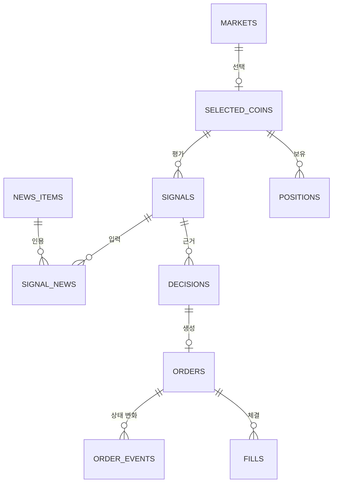

# 데이터 모델

상태: 1단계 보완 · 관련: [로그·감사 기록 정의서](logging-audit.md), [상태 전이 정의서](../03-functional/state-machines.md)

저장소는 SQLite이고 위치는 `%LOCALAPPDATA%\upbit-autotrader\data\`다. 열 이름과 형식은 초안이며 1단계에서 확정한다.

## 1. 관계도

## 2. 테이블

### markets: 종목 목록과 경고

| 열 | 형식 | 설명 |
|---|---|---|
| market (PK) | TEXT | 예: KRW-BTC |
| korean_name, english_name | TEXT | |
| warning | INTEGER | 유의 종목(0/1) |
| caution_json | TEXT | 주의 플래그 항목별 값 |
| market_state | TEXT | PREVIEW, ACTIVE, DELISTED |
| delisting_date | TEXT | 거래지원 종료일 |
| updated_at | TEXT | |

### selected_coins: 선택한 코인

| 열 | 형식 | 설명 |
|---|---|---|
| market (PK, FK) | TEXT | |
| enabled | INTEGER | |
| added_at, removed_at | TEXT | |

### candles: 지표 계산·백테스트용 캐시

| 열 | 형식 | 설명 |
|---|---|---|
| market, unit, start_utc (복합 PK) | TEXT | unit 예: m240, d1 |
| open, high, low, close, volume | TEXT | 소수는 문자열로 저장 |

### news_items, signal_news: 뉴스 제목과 시그널 연결

| 열 | 형식 | 설명 |
|---|---|---|
| id (PK) | INTEGER | |
| source | TEXT | naver, coindesk 등 |
| url (UNIQUE) | TEXT | 중복 제거 기준 |
| title | TEXT | 200자 이내 |
| published_at, fetched_at | TEXT | |

signal_news는 (signal_id, news_id) 복합 PK다.

### signals: LLM 평가

| 열 | 형식 | 설명 |
|---|---|---|
| id (PK) | INTEGER | |
| market | TEXT | |
| evaluated_at | TEXT | |
| mode | TEXT | paper, signal-only, live-validate, live |
| model_requested, model_responded | TEXT | 재라우팅 감지 |
| prompt_version | TEXT | |
| features_json | TEXT | LLM에 준 지표 요약 |
| raw_response | TEXT | 원문 |
| signal, confidence, reason | TEXT, REAL, TEXT | 검증된 값 |
| status | TEXT | ok, invalid, timeout, quota, refused, error |
| latency_ms, tokens_in, tokens_out | INTEGER | |

### decisions: 판단 결과

| 열 | 형식 | 설명 |
|---|---|---|
| id (PK) | INTEGER | |
| market, at, mode | TEXT | |
| signal_id (FK, NULL 가능) | INTEGER | 손절처럼 시그널 없는 결정도 있음 |
| action | TEXT | BUY, SELL, HOLD, BLOCKED |
| reason_code | TEXT | 예: RULE_NOT_MET, STOP_LOSS, MARKET_WARNING |
| rule_result_json, risk_result_json | TEXT | |

### orders, order_events, fills: 주문

| 열 | 형식 | 설명 |
|---|---|---|
| identifier (PK) | TEXT | 앱이 만든 고유 ID, 전송 전에 저장 |
| upbit_uuid | TEXT | 업비트 주문 ID |
| market, side, ord_type | TEXT | side: bid, ask |
| price, volume, krw_amount | TEXT | 소수는 문자열 |
| smp_type | TEXT | 항상 값 있음 |
| mode, state | TEXT | state는 상태 전이 정의서의 주문 상태 |
| decision_id (FK) | INTEGER | |
| error_name | TEXT | 업비트 error.name |
| created_at, updated_at | TEXT | |

- order_events: id, identifier(FK), at, from_state, to_state, source(api, websocket, reconcile), payload_json(비밀 제외).
- fills: id, identifier(FK), at, price, volume, fee, krw_value.

### positions: 코인 상태

| 열 | 형식 | 설명 |
|---|---|---|
| market, mode (복합 PK) | TEXT | |
| volume, avg_price | TEXT | live 계열은 거래소 `avg_buy_price` 기준(수동 매매 포함) |
| status | TEXT | FLAT, ENTERING, HOLDING, EXITING, COOLDOWN, BLOCKED |
| cooldown_until | TEXT | 재진입 제한 해제 시각 |
| blocked_reason | TEXT | |
| opened_at | TEXT | |

### daily_stats: 일별 집계(09:00 KST 기준)

| 열 | 형식 | 설명 |
|---|---|---|
| date_kst, mode (복합 PK) | TEXT | |
| realized_pnl_krw, fees_krw | INTEGER | |
| orders_count | INTEGER | |
| buy_blocked | INTEGER | 일일 손실 한도 도달 여부 |
| counted_minutes | INTEGER | 인정일 계산용(paper 모드의 RUNNING·PAUSED·BUY_BLOCKED 시간) |

### events, notifications, app_meta

- events: id, at, level, code, message, context_json. 감사 기록이다.
- notifications: id, at, ntf_code, channel, status, error.
- app_meta: key(PK), value. 스키마 버전, 설치 ID, 페이퍼 시작 시각 등.

## 3. 원칙

- 시각은 UTC ISO 8601로 저장하고 화면에서 KST로 보여 준다.
- 가격과 수량은 부동소수 오차를 피하려고 문자열로 저장하고 Decimal로 계산한다. 원화 합계는 정수 원 단위.
- paper와 live 기록은 mode 열로 나눈다.
- 비밀(키, 토큰, JWT)은 어떤 테이블에도 저장하지 않는다.
- 스키마 변경은 버전 번호와 마이그레이션 스크립트로 한다.
