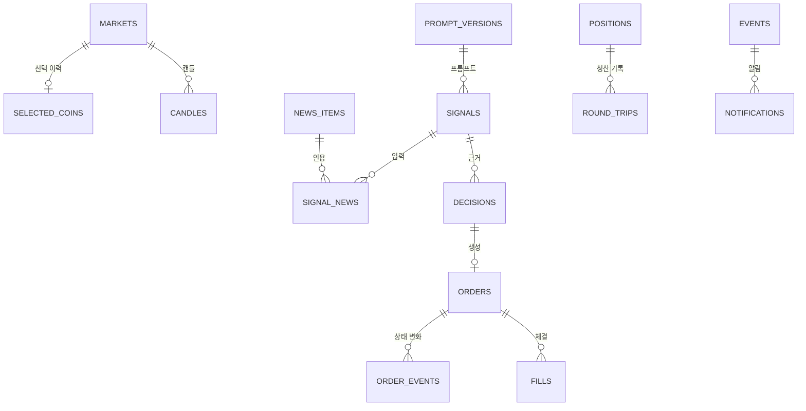

# 데이터 모델

상태: 초안(1단계 제안, 사용자 결정 대기: D-041 DB 접근 방식, D-044 실행 모드 저장 위치) · 관련: [로그·감사 기록 정의서](logging-audit.md), [상태 전이 정의서](../03-functional/state-machines.md), [매매 로직 명세](../03-functional/trading-logic.md), [시스템 구성도](../06-architecture/system-architecture.md)

저장소는 SQLite 파일 하나다: `%LOCALAPPDATA%\upbit-autotrader\data\autotrader.db`(같은 폴더에 `-wal`, `-shm` 파일이 생긴다). 아래 테이블·열·인덱스는 1단계 제안이며 2단계 구현 전에 사용자 확인을 받는다.

## 1. 접근 방식 (제안, D-041 대기)

| 후보 | 장점 | 단점 |
|---|---|---|
| **표준 라이브러리 `sqlite3` + 직접 쓴 SQL + 자체 마이그레이션 (추천)** | 의존성이 없다. 트랜잭션과 PRAGMA를 직접 통제한다. PyInstaller 추가 설정이 없다. 테이블 18개 규모라 코드량이 감당할 만하다 | 행과 객체 사이 변환 코드를 직접 쓴다 |
| SQLAlchemy Core + Alembic | 쿼리 조립과 마이그레이션 도구가 있다 | 의존성이 크다. Alembic 스크립트를 데이터 파일로 묶어야 한다. 이 규모에서는 이점이 작다 |
| 경량 ORM(peewee 등) | 코드가 짧다 | 트랜잭션·잠금 동작을 라이브러리에 맡긴다. 의존성이 늘어난다 |

### 연결 규칙

- **쓰기 연결은 1개**이고 core 스레드(asyncio 루프 스레드, [시스템 구성도](../06-architecture/system-architecture.md) 3장)만 쓴다. 모든 쓰기는 이 연결의 트랜잭션으로 한다.
- 화면 조회는 앱 계층이 여는 **읽기 전용 연결**(`file:...?mode=ro` URI, `PRAGMA query_only=ON`)을 쓴다. WAL 모드라 읽기가 쓰기를 막지 않는다.
- 백업(JOB-11)과 CSV 내보내기는 작업 스레드가 별도 연결로 한다. core 루프를 막지 않기 위해서다.
- 다른 프로세스가 DB를 쓰지 못하게 단일 인스턴스 잠금을 먼저 잡는다([시스템 구성도](../06-architecture/system-architecture.md) 8장).

### 연결을 열 때 설정

| PRAGMA | 값 | 이유 |
|---|---|---|
| `journal_mode` | WAL | 읽기와 쓰기를 동시에 한다 |
| `synchronous` | FULL | 주문 기록(전송 전 identifier 저장)이 정전에도 남게 한다. 쓰기 빈도가 낮아 성능 부담이 작다 |
| `foreign_keys` | ON | SQLite 기본값은 꺼짐 |
| `busy_timeout` | 5000 | 잠금을 최대 5초 기다린다 |

- 테이블은 `STRICT`로 만든다(SQLite 3.37.0 이상 필요). 시작 점검과 `--self-test`에서 `sqlite3.sqlite_version`이 3.37.0 이상인지 확인한다.

## 2. 값 형식

| 종류 | 저장 형식 | 예 |
|---|---|---|
| 시각 | TEXT, UTC ISO 8601, 밀리초, 끝에 `Z` | `2026-11-05T01:23:45.678Z` |
| 하루(09:00 KST 시작) | TEXT `YYYY-MM-DD`(그 하루가 시작한 KST 날짜) | `2026-11-05` = 11-05 09:00 ~ 11-06 09:00 KST |
| 가격·수량·수수료·금액(정밀) | TEXT, Decimal 문자열(지수 표기 없음) | `"143250000"`, `"0.00006981"` |
| 원화 합계(보고용) | INTEGER, 원 단위. Decimal 합계를 반올림(ROUND_HALF_UP) | `-1200` |
| 참·거짓 | INTEGER 0 또는 1 | |
| 열거값 | TEXT, 정해진 영문 코드 | `paper`, `FILLED` |
| JSON | TEXT, UTF-8 JSON. 비밀은 넣지 않는다 | |

- 위험 한도 비교(일일 손실 등)는 반올림 전 Decimal 값으로 한다. INTEGER 합계는 화면·알림·CSV용이다.
- 업비트 REST는 가격·수량을 문자열로 주고, 웹소켓은 JSON 숫자로 준다. 웹소켓 메시지는 `json.loads(..., parse_float=Decimal)`로 읽어 부동소수 오차 없이 저장한다.
- 업비트가 주는 KST 시각(`+09:00`)은 UTC로 바꿔 저장하고 원문이 필요하면 `payload_json`에 남긴다.

## 3. 관계도

- `orders.retry_of`는 같은 테이블의 이전 주문을 가리킨다(429 뒤 새 identifier로 다시 낸 손절 등).
- `positions`와 `round_trips`는 (market, mode)로 이어진다.

## 4. 테이블

PK는 기본 키, FK는 외래 키다. "필수"는 NOT NULL이다.

### schema_migrations: 적용한 마이그레이션

| 열 | 형식 | 제약 | 설명 |
|---|---|---|---|
| version | INTEGER | PK | 마이그레이션 번호(1부터) |
| name | TEXT | 필수 | 파일 이름(예: `0001_initial`) |
| applied_at | TEXT | 필수 | 적용 시각 |
| app_version | TEXT | 필수 | 적용한 앱 버전 |

`PRAGMA user_version`에도 최신 번호를 쓴다. 둘이 다르면 시작 점검 실패로 본다.

### app_meta: 앱 상태 값(키·값)

| 열 | 형식 | 제약 | 설명 |
|---|---|---|---|
| key | TEXT | PK | 아래 키 목록 중 하나 |
| value | TEXT | 필수 | |
| updated_at | TEXT | 필수 | |

| 키 | 값 | 비고 |
|---|---|---|
| `install_id` | UUID | 진단 묶음 구분용 |
| `mode` | paper, signal-only, live-validate, live | 현재 실행 모드. 설정 파일이 아니라 DB에 둔다(D-044 대기, [설정 항목 정의서](../03-functional/settings.md) 1장) |
| `mode_changed_at` | 시각 | |
| `trading_state` | RUNNING, PAUSED, BUY_BLOCKED, STOPPED | 재시작 때 복원할 직전 상태 |
| `buy_blocked_date_kst` | `YYYY-MM-DD` | 일일 손실 한도·주문 수 상한에 닿은 날 |
| `paper_started_at` | 시각 | |
| `live_validate_started_at` | 시각 | |
| `clean_shutdown` | 0 또는 1 | 시작할 때 0으로 쓰고 정상 종료 때 1로 쓴다. 0인 채로 시작하면 비정상 종료로 기록 |
| `upbit_key_expire_at` | 업비트 원문(KST) | `GET /v1/api_keys`로 읽은 만료 일시([업비트 API 연동 명세](../05-integration/upbit-api.md) 1장) |
| `upbit_key_expire_checked_at` | 시각 | |
| `settings_applied_json` | JSON | 마지막으로 적용한 설정(비밀 없음). 설정 파일을 앱 밖에서 고쳤는지 비교한다 |

### markets: 종목 목록과 경고

| 열 | 형식 | 제약 | 설명 |
|---|---|---|---|
| market | TEXT | PK | 예: KRW-BTC. KRW 마켓만 저장 |
| korean_name | TEXT | 필수 | |
| english_name | TEXT | 필수 | |
| warning | INTEGER | 필수 | `market_event.warning`(유의 종목) |
| caution_json | TEXT | 필수 | `market_event.caution` 원본(항목별 참·거짓) |
| caution_any | INTEGER | 필수 | 주의 항목 중 하나라도 참 |
| market_state | TEXT | | 시세 웹소켓 `market_state`(예: ACTIVE) |
| delisting_date | TEXT | | 거래지원 종료일 |
| trading_suspended | INTEGER | | 시세 웹소켓 `trading_suspended` |
| listed | INTEGER | 필수 | 마지막 목록 조회에 있었는지. 목록에서 빠지면 0 |
| updated_at | TEXT | 필수 | |

### selected_coins: 코인 선택 이력

현재 선택의 기준은 설정 파일의 `coins`다. 이 테이블은 언제 넣고 뺐는지 남기는 이력이다.

| 열 | 형식 | 제약 | 설명 |
|---|---|---|---|
| market | TEXT | PK, FK markets | |
| added_at | TEXT | 필수 | 마지막으로 선택한 시각 |
| removed_at | TEXT | | NULL이면 선택 중 |
| removal_choice | TEXT | | 보유 중 해제했을 때 고른 처리: `hold`, `sell`(MSG-C007) |

### candles: 지표·백테스트용 캔들 캐시

| 열 | 형식 | 제약 | 설명 |
|---|---|---|---|
| market | TEXT | PK(1) | |
| unit | TEXT | PK(2) | `m1`, `m3`, `m5`, `m10`, `m15`, `m30`, `m60`, `m240`, `d1` |
| start_utc | TEXT | PK(3) | 캔들 시작 시각(`candle_date_time_utc`) |
| open, high, low, close | TEXT | 필수 | |
| volume | TEXT | 필수 | `candle_acc_trade_volume` |
| value | TEXT | 필수 | `candle_acc_trade_price` |
| fetched_at | TEXT | 필수 | |

- `WITHOUT ROWID` 테이블로 만든다.
- 끝나지 않은 캔들(시작 + 단위 길이 > 거래소 시각)은 저장하지 않는다. 거래가 없던 구간은 캔들이 없으므로 빈칸을 만들어 채우지 않는다.

### news_items: 뉴스 제목

| 열 | 형식 | 제약 | 설명 |
|---|---|---|---|
| id | INTEGER | PK | |
| source | TEXT | 필수 | naver, coindesk, cointelegraph |
| url | TEXT | 필수, UNIQUE | 추적용 쿼리 파라미터를 지운 URL. 중복 제거 기준 |
| title | TEXT | 필수 | HTML 제거, 200자 이내 |
| published_at | TEXT | | 출처가 준 발행 시각 |
| fetched_at | TEXT | 필수 | |

### prompt_versions: 프롬프트 문안

| 열 | 형식 | 제약 | 설명 |
|---|---|---|---|
| version | TEXT | PK | 예: `p1` |
| system_text | TEXT | 필수 | 시스템 지시 전문 |
| user_template | TEXT | 필수 | 사용자 입력 틀 |
| created_at | TEXT | 필수 | |

시스템 지시를 시그널마다 저장하지 않으려고 분리한다.

### signals: LLM 평가

| 열 | 형식 | 제약 | 설명 |
|---|---|---|---|
| id | INTEGER | PK | |
| market | TEXT | 필수 | |
| scheduled_for | TEXT | | 정렬된 평가 예정 시각 |
| evaluated_at | TEXT | 필수 | 실제 호출 시작 시각 |
| mode | TEXT | 필수 | paper, signal-only, live-validate, live |
| trading_state | TEXT | 필수 | 평가 시점 매매 상태 |
| prompt_version | TEXT | 필수, FK prompt_versions | |
| model_requested | TEXT | 필수 | 설정의 모델 ID |
| model_responded | TEXT | | 응답이 알려 준 모델(재라우팅 감지) |
| features_json | TEXT | 필수 | LLM에 준 지표 요약 |
| request_text | TEXT | 필수 | 실제로 보낸 사용자 입력 전문(키·잔고·계정 정보 없음) |
| raw_response | TEXT | | 응답 원문 |
| signal | TEXT | 필수 | positive, negative, neutral. 실패하면 neutral |
| confidence | REAL | | 0.0~1.0 |
| reason | TEXT | | 300자 이내 |
| status | TEXT | 필수 | ok, invalid, timeout, quota, refused, error |
| error_detail | TEXT | | 예: `quota:day`, `http:503`(비밀 없음) |
| latency_ms | INTEGER | | |
| tokens_in, tokens_out, tokens_thinking | INTEGER | | |

### signal_news: 시그널에 쓴 뉴스

| 열 | 형식 | 제약 | 설명 |
|---|---|---|---|
| signal_id | INTEGER | PK(1), FK signals | |
| news_id | INTEGER | PK(2), FK news_items | |
| rank | INTEGER | 필수 | 프롬프트 안 순서(1부터) |

### decisions: 판단 결과

| 열 | 형식 | 제약 | 설명 |
|---|---|---|---|
| id | INTEGER | PK | |
| market | TEXT | 필수 | |
| at | TEXT | 필수 | |
| mode | TEXT | 필수 | |
| trading_state | TEXT | 필수 | 판단 시점 상태 |
| trigger | TEXT | 필수 | `signal_tick`(JOB-03), `risk_tick`(JOB-02), `user`(버튼), `reconcile`, `mode_change`, `retry` |
| signal_id | INTEGER | FK signals | 손절처럼 시그널 없는 결정은 NULL |
| action | TEXT | 필수 | BUY, SELL, HOLD, BLOCKED, SKIP |
| reason_code | TEXT | 필수 | [매매 로직 명세](../03-functional/trading-logic.md) 13장의 이유 코드 |
| rule_result_json | TEXT | | 규칙 평가 결과(ADR-0007 확정 후 형식 고정) |
| risk_result_json | TEXT | | 한도 검사 결과와 승인 금액 |
| would_order_json | TEXT | | signal-only 모드에서 "냈을 주문" |

### orders: 주문

| 열 | 형식 | 제약 | 설명 |
|---|---|---|---|
| identifier | TEXT | PK | 앱이 만든 ID. 전송 전에 저장. 형식은 [매매 로직 명세](../03-functional/trading-logic.md) 7장 |
| upbit_uuid | TEXT | UNIQUE | 실제 주문 UUID(live) |
| test_uuid | TEXT | | live-validate 검증 응답의 UUID(조회·취소에 못 씀) |
| market | TEXT | 필수 | |
| side | TEXT | 필수 | bid, ask |
| ord_type | TEXT | 필수 | limit, price, market, best |
| time_in_force | TEXT | | ioc, fok(post_only는 쓰지 않음) |
| smp_type | TEXT | 필수 | 보낸 값. 앱은 항상 cancel_maker(매매 로직 명세 6장) |
| req_price | TEXT | | 보낸 `price`(지정가 단가 또는 매수 총액) |
| req_volume | TEXT | | 보낸 `volume` |
| approved_krw | INTEGER | | 위험 관리가 승인한 매수 금액 |
| purpose | TEXT | 필수 | ENTRY, STOP_LOSS, TAKE_PROFIT, RULE_EXIT, LLM_NEGATIVE, LIQUIDATE, DESELECT_SELL, MODE_EXIT_SELL |
| mode | TEXT | 필수 | paper, live-validate, live |
| state | TEXT | 필수 | CREATED, SUBMITTED, OPEN, PARTIAL, FILLED, CANCELLED, REJECTED, UNKNOWN |
| exchange_state | TEXT | | 마지막으로 본 업비트 `state` 원문 |
| executed_volume | TEXT | 필수, 기본 `'0'` | |
| executed_funds | TEXT | 필수, 기본 `'0'` | 체결 금액 합 |
| paid_fee | TEXT | 필수, 기본 `'0'` | |
| prevented_volume | TEXT | 필수, 기본 `'0'` | SMP로 취소된 수량 |
| decision_id | INTEGER | FK decisions | 재조정으로 들여온 주문은 NULL |
| retry_of | TEXT | FK orders(identifier) | 다시 낸 주문이면 이전 주문 |
| error_name | TEXT | | 업비트 `error.name` |
| reject_reason | TEXT | | 앱 이유 코드(예: RATE_LIMIT_429, NOT_FOUND_AFTER_UNKNOWN, VALIDATE_ERROR) |
| expected_reject | INTEGER | 필수, 기본 0 | live-validate 매도 검증의 `insufficient_funds_ask`처럼 예상된 거절 |
| created_at | TEXT | 필수 | CREATED 저장 시각 |
| submitted_at | TEXT | | 전송 직전 시각 |
| unknown_since | TEXT | | UNKNOWN이 된 시각 |
| closed_at | TEXT | | 최종 상태(FILLED, CANCELLED, REJECTED)가 된 시각 |
| updated_at | TEXT | 필수 | |

### order_events: 주문 상태 변화

| 열 | 형식 | 제약 | 설명 |
|---|---|---|---|
| id | INTEGER | PK | |
| identifier | TEXT | 필수, FK orders | |
| at | TEXT | 필수 | |
| from_state | TEXT | | |
| to_state | TEXT | 필수 | |
| source | TEXT | 필수 | app, api, websocket, reconcile |
| exchange_state | TEXT | | 이 변화의 근거가 된 업비트 state(`trade`, `prevented` 포함) |
| payload_json | TEXT | | 응답 요약(비밀·JWT 없음) |

### fills: 체결

| 열 | 형식 | 제약 | 설명 |
|---|---|---|---|
| id | INTEGER | PK | |
| identifier | TEXT | 필수, FK orders | |
| trade_uuid | TEXT | 필수 | 업비트 체결 UUID(`trades[].uuid`, myOrder `trade_uuid`). paper는 앱이 만든다 |
| at | TEXT | 필수 | 체결 시각 |
| side | TEXT | 필수 | bid, ask |
| price | TEXT | 필수 | |
| volume | TEXT | 필수 | |
| funds | TEXT | 필수 | 체결 금액 |
| fee | TEXT | 필수 | |
| is_maker | INTEGER | | |
| realized_pnl | TEXT | | 매도 체결의 실현 손익(Decimal). 매수는 NULL |
| source | TEXT | 필수 | api, websocket, paper |

- `UNIQUE(identifier, trade_uuid)`로 웹소켓과 REST에서 같은 체결이 두 번 들어오는 것을 막는다.

### positions: 코인별 포지션

| 열 | 형식 | 제약 | 설명 |
|---|---|---|---|
| market | TEXT | PK(1) | |
| mode | TEXT | PK(2) | paper, live-validate, live(signal-only는 포지션 없음) |
| volume | TEXT | 필수 | 보유 수량(live는 거래소 `balance + locked`) |
| avg_price | TEXT | 필수 | 수수료를 뺀 평균 매수가. 손절·익절 기준. live는 거래소 `avg_buy_price` |
| cost_krw | TEXT | 필수 | 매수 수수료를 포함한 남은 원가(Decimal). 실현 손익 계산용 |
| cost_estimated | INTEGER | 필수, 기본 0 | 수동 매매 등으로 원가를 거래소 평균가로 다시 계산했으면 1 |
| status | TEXT | 필수 | FLAT, ENTERING, HOLDING, EXITING, COOLDOWN, BLOCKED |
| entries | INTEGER | 필수, 기본 0 | 이번 포지션의 매수 회차 수(ADR-0008) |
| exit_only | INTEGER | 필수, 기본 0 | live → paper 전환 뒤 남긴 실보유분(손절·청산만 관리) |
| cooldown_until | TEXT | | 재진입 제한 해제 시각. status가 COOLDOWN인데 NULL이면 수동 해제 대기 |
| blocked_reason | TEXT | | |
| opened_at | TEXT | | |
| updated_at | TEXT | 필수 | |

### round_trips: 청산된 포지션 기록

포지션이 FLAT으로 돌아갈 때 1행을 만든다. 페이퍼 평가 지표(거래 수, 이익·손실 거래 수, 평균 보유 시간)를 계산한다.

| 열 | 형식 | 제약 | 설명 |
|---|---|---|---|
| id | INTEGER | PK | |
| market, mode | TEXT | 필수 | |
| opened_at, closed_at | TEXT | 필수 | |
| entries | INTEGER | 필수 | 매수 회차 수 |
| buy_funds_krw, sell_funds_krw, fees_krw | INTEGER | 필수 | |
| realized_pnl_krw | INTEGER | 필수 | |
| exit_reason | TEXT | 필수 | 마지막 매도의 purpose |
| dust_volume | TEXT | 필수, 기본 `'0'` | 최소 주문 금액 미만이라 팔지 못한 잔량 |

### daily_stats: 일별 집계(09:00 KST 기준)

| 열 | 형식 | 제약 | 설명 |
|---|---|---|---|
| date_kst | TEXT | PK(1) | |
| mode | TEXT | PK(2) | |
| realized_pnl_krw | INTEGER | 필수, 기본 0 | 그날 매도 체결의 실현 손익 합 |
| fees_krw | INTEGER | 필수, 기본 0 | |
| orders_count | INTEGER | 필수, 기본 0 | 그날 거래소(또는 가상 거래소)로 보낸 주문 수. 거절 포함 |
| buy_blocked | INTEGER | 필수, 기본 0 | 일일 손실 한도·주문 수 상한 도달 |
| counted_minutes | INTEGER | 필수, 기본 0 | RUNNING·PAUSED·BUY_BLOCKED 상태였던 분 |
| uptime_minutes | INTEGER | 필수, 기본 0 | 앱이 켜져 있던 분(가동률) |
| recognized | INTEGER | | JOB-13이 확정. 1=인정일, 0=아님, NULL=아직 |

- paper 행의 `recognized`가 인정일이다. live-validate 일수도 같은 규칙(하루 12시간)으로 센다(제안, D-049 대기).
- 분은 JOB-02(60초)마다 실제 경과한 monotonic 시간으로 더한다. 앱이 꺼져 있던 시간은 더하지 않는다.

### events: 감사 기록

| 열 | 형식 | 제약 | 설명 |
|---|---|---|---|
| id | INTEGER | PK | |
| at | TEXT | 필수 | |
| level | TEXT | 필수 | critical(긴급), warning(경고), info(정보) |
| code | TEXT | 필수 | [로그·감사 기록 정의서](logging-audit.md) 4장의 이벤트 코드 |
| market | TEXT | | |
| msg_id | TEXT | | 예: MSG-E001 |
| message | TEXT | 필수 | 화면에 보인 문구 |
| context_json | TEXT | | 비밀 없음 |

### notifications: 보낸 알림

| 열 | 형식 | 제약 | 설명 |
|---|---|---|---|
| id | INTEGER | PK | |
| at | TEXT | 필수 | |
| ntf_code | TEXT | 필수 | NTF-01 등 |
| dedupe_key | TEXT | 필수 | 중복 억제 기준. 예: `NTF-03:no_authorization_ip` |
| channel | TEXT | 필수 | telegram, ui |
| status | TEXT | 필수 | sent, failed, suppressed, batched |
| event_id | INTEGER | FK events | |
| error | TEXT | | 실패 이유(토큰이 들어간 URL은 넣지 않음) |

## 5. 인덱스

| 테이블 | 인덱스 | 쓰는 곳 |
|---|---|---|
| orders | `(market) WHERE state IN ('CREATED','SUBMITTED','OPEN','PARTIAL','UNKNOWN')` 부분 인덱스 | 같은 코인에 끝나지 않은 주문이 있는지(위험 관리, 자기체결 방지) |
| orders | `(mode, created_at)` | 일일 주문 수, 거래 기록 화면 |
| orders | `(decision_id)` | 결정과 주문 연결 |
| order_events | `(identifier, at)` | 주문 상세 |
| fills | `(at)` | 일일 실현 손익, CSV 내보내기 |
| signals | `(market, evaluated_at)` | 시그널 기록 화면, 연속 실패 판정 |
| signal_news | `(news_id)` | 뉴스 삭제·조회 |
| news_items | `(published_at)` | 최근 24시간 제목 |
| decisions | `(market, at)` | 코인별 기록 |
| round_trips | `(mode, closed_at)` | 페이퍼 평가 지표 |
| events | `(at)`, `(code, at)` | 이벤트 로그, 코드별 조회 |
| notifications | `(dedupe_key, at)` | 30분·1시간 중복 억제 |

PK와 UNIQUE 제약(`orders.upbit_uuid`, `news_items.url`, `fills(identifier, trade_uuid)`)은 자동으로 인덱스가 생긴다.

## 6. 마이그레이션

- 마이그레이션은 번호가 붙은 SQL 파일이다: `storage/migrations/0001_initial.sql`, `0002_...sql`. 앱 패키지 안에 넣는다(PyInstaller 데이터 파일).
- 시작할 때 `PRAGMA user_version`과 앱이 아는 최신 번호를 비교한다.

| 경우 | 동작 |
|---|---|
| 같음 | 그대로 진행 |
| DB가 더 낮음 | `backup\pre-migrate-v{현재}-{시각}.db`로 백업(SQLite 백업 API) → 번호 순서대로 적용. 파일 하나를 한 트랜잭션으로 적용하고 같은 트랜잭션에서 `user_version`과 `schema_migrations`를 갱신 |
| DB가 더 높음 | 앱보다 새 버전이 만든 DB다. 매매를 시작하지 않고 시작 점검 실패로 안내한다(새 버전을 쓰거나 백업 복원). [운영 런북](../09-operations/runbook.md) 3장의 되돌리기와 맞물린다 |
| 적용 중 오류 | 트랜잭션을 되돌리고 시작 점검 실패. 백업 파일 위치를 안내한다 |

- 열 삭제·형식 변경은 SQLite 권장 절차(새 테이블 생성 → 복사 → 교체)로 한다.
- 테스트: 빈 DB에 전체 적용한 스키마와, 각 과거 버전 스냅샷에 차례로 적용한 스키마가 같은지 비교한다.

## 7. 보관과 크기

| 대상 | 보관 | 크기 추정(코인 3개, 4시간 평가) |
|---|---|---|
| signals(입출력 원문 포함) | 제한 없음 | 하루 18건 × 약 6KB → 연 40MB 안팎 |
| news_items, signal_news | 제한 없음 | 연 수 MB |
| orders, order_events, fills | 제한 없음 | 연 1MB 미만(일일 주문 수 상한 20건) |
| candles | 제한 없음 | 연 1MB 미만(m240, d1 기준) |
| events, notifications | 제한 없음 | 연 수 MB |

- 백업 7개를 남기므로 1년 뒤 백업 폴더는 수백 MB가 될 수 있다. 크기가 문제가 되면 `request_text`와 `raw_response`의 보관 기간을 정하는 것을 다시 결정한다.

## 8. 원칙

- 시각은 UTC로 저장하고 화면에서 KST로 보여 준다.
- 가격과 수량은 문자열로 저장하고 Decimal로 계산한다. 원화 합계(보고용)는 정수 원 단위다.
- paper와 live 기록은 mode 열로 나눈다.
- 비밀(키, 토큰, JWT, Authorization 헤더)은 어떤 테이블에도 저장하지 않는다. `GET /v1/api_keys` 응답에 들어 있는 다른 키의 Access Key도 저장하지 않는다.
- 스키마 변경은 번호가 붙은 마이그레이션으로만 한다.
