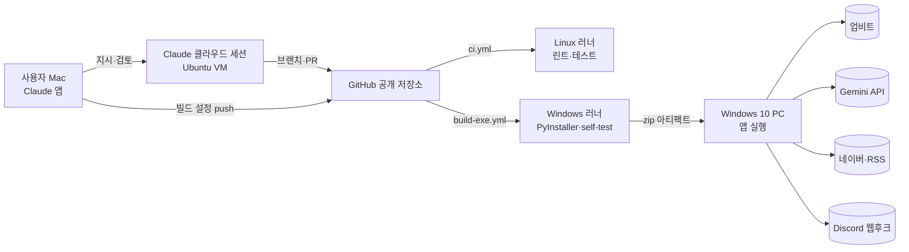
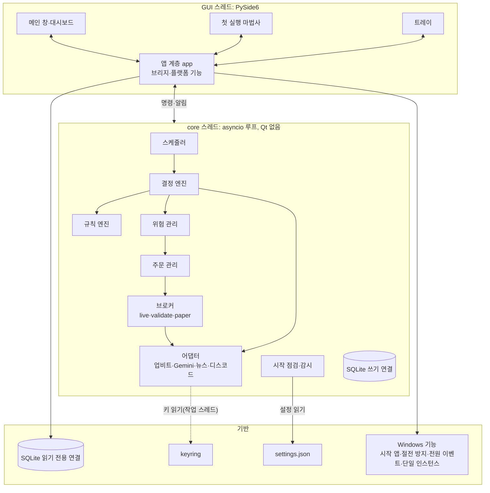

# 시스템 구성도

상태: 초안(1단계 제안 반영, 사용자 결정 대기 — 10장) · 관련: [기술 스택·버전 정책](tech-stack.md), [결정 기록](adr/README.md), [데이터 모델](../04-data/data-model.md), [ADR-0009 GUI와 asyncio 연결](adr/0009-gui-asyncio-bridge.md)

## 1. 개발·빌드·실행 흐름



- 실제 키는 Windows PC에만 있다. 클라우드 VM과 CI에는 없다.
- `.github/workflows/`는 클라우드 세션이 push할 수 없어서 사용자 Mac에서 관리한다([ADR-0004](adr/0004-github-actions-windows-build.md)).

## 2. 앱 내부 구성



명령은 `run_coroutine_threadsafe`로 core 루프에 넣고, 알림은 Qt 시그널(큐 연결)로 GUI 스레드에 전한다(3장).

| 구성 요소 | 책임 |
|---|---|
| 스케줄러 | 주기 작업(JOB-01~14) 실행. monotonic 시간 기준, 날짜 경계는 거래소 시각 |
| 결정 엔진 | 시그널, 규칙, 위험 결과를 모아 매수·매도·보류 결정 |
| 규칙 엔진 | 지표 계산과 규칙 조건 평가(조건은 ADR-0007로 결정) |
| 위험 관리 | 모든 주문의 마지막 관문. 한도 검사, 주문 금액 결정. I/O가 없는 순수 계산 |
| 주문 관리 | identifier 생성·저장, 전송, 결과 불명 확인, 재조정, 상태 전이 |
| 브로커 | live(업비트 주문), validate(`/v1/orders/test` + 가상 체결), paper(가상 체결)를 같은 인터페이스로 |
| 시작 점검·감시 | 시작 점검, 데이터 끊김·시계 오차 감시, 상태 전환 |
| 어댑터 | 외부 서비스 호출. 인터페이스(6장) 뒤에 두고 테스트에서는 가짜로 바꾼다 |
| 앱 계층(app) | 앱 조립과 수명 주기, GUI ↔ core 브리지, Windows 플랫폼 기능. Qt 시그널은 이 계층만 쓴다 |

## 3. 스레드 모델 (ADR-0009, D-040)

asyncio 이벤트 루프를 GUI와 다른 스레드(core 스레드)에서 돌린다. 화면이 모달 대화상자나 무거운 그리기로 멈춰도 손절 점검(60초)과 웹소켓 처리가 영향을 받지 않게 하려는 것이다. 근거와 대안은 [ADR-0009](adr/0009-gui-asyncio-bridge.md).

| 스레드 | 하는 일 | 하지 않는 일 |
|---|---|---|
| GUI(메인) | QApplication, 창·트레이·대화상자, 앱 계층 브리지, 단일 인스턴스 서버, 전원 이벤트 수신(네이티브 이벤트 필터), 시작 앱 등록, 절전 방지 호출, 화면 조회용 읽기 전용 DB 연결 | 네트워크 호출, DB 쓰기, 매매 판단 |
| core(asyncio 루프 1개) | 스케줄러, 결정·규칙·위험·주문 관리, 업비트 REST·웹소켓, Gemini, 뉴스, 디스코드 웹후크, DB 쓰기 연결 | Qt import |
| 작업 스레드(필요할 때) | keyring 읽기·쓰기(`asyncio.to_thread`), DB 백업, CSV 내보내기 | 매매 상태 변경 |

### 통신 규칙

- **GUI → core:** 앱 계층의 `CoreHandle`이 `asyncio.run_coroutine_threadsafe(명령, loop)`로 넘긴다. 결과(`concurrent.futures.Future`)는 완료 콜백에서 Qt 시그널로 돌려준다. GUI는 결과를 기다리며 멈추지 않는다.
- **core → GUI:** core는 `CoreObserver`(6장, 순수 Python)를 호출한다. 앱 계층 구현은 Qt 시그널을 emit만 한다. 시그널을 받는 QObject가 GUI 스레드에 있으므로 Qt가 큐 연결로 GUI 스레드에서 처리한다.
- **넘기는 값:** 바뀌지 않는 스냅샷(frozen dataclass, Decimal, str)만 넘긴다. 가변 객체를 스레드 사이에 공유하지 않는다.
- **양 조절:** 시세처럼 자주 바뀌는 값은 core가 코인별로 초당 1회 이하로 묶어 보낸다.
- **긴급 정지:** "정지"·"정지 후 전량 매도"도 같은 명령 경로로 간다. core 루프가 GUI와 독립이라 화면이 바빠도 바로 처리된다.
- **주문 직렬화:** core 안에서 주문을 만드는 코루틴은 코인별 `asyncio.Lock`을 거친다. 잠금 안에서는 DB에서 상태를 다시 읽어 위험 검사를 하고 CREATED 커밋까지 기다림 없이 처리한다. 사용자 명령(정지, 전량 매도, 선택 해제, 모드 전환)도 같은 잠금을 거친다([매매 로직 명세](../03-functional/trading-logic.md) 4장, D-070).

### 시작과 종료

1. 시작: 단일 인스턴스 잠금(8장) → 설정 읽기 → QApplication 생성 → core 스레드 시작(루프 준비 완료 신호를 최대 10초 기다림) → 마법사 또는 대시보드 표시 → 시작 점검.
2. 마법사의 키 검증도 core 명령(`validate_keys`)으로 한다. 네트워크 호출은 항상 core 스레드에서만 한다.
3. 종료: 트레이 → 종료 → MSG-C005 확인 → `shutdown` 명령(스케줄러 정지, 작업 취소, 웹소켓·HTTP 종료, APP_STOP 기록, `clean_shutdown=1`, NTF-02는 최대 5초) → 루프 정지 → 스레드 join(최대 10초) → QApplication 종료. join이 10초 안에 끝나지 않으면 로그를 비우고 프로세스를 강제로 끝낸다(`os._exit(1)`). 이때 `clean_shutdown`은 0으로 남아 다음 시작에서 비정상 종료로 기록하고 거래소 기준으로 대조한다. 강제 종료로 단일 인스턴스 잠금도 풀린다(D-071).

### 감시와 예외

- core는 5초마다 heartbeat를 보낸다. heartbeat에는 JOB-02(위험 점검)가 마지막으로 끝난 시각(monotonic)을 넣는다. 루프는 돌지만 JOB-02가 타임아웃 없는 기다림에 걸리면 heartbeat만으로는 알 수 없기 때문이다. JOB-02 완료가 180초 넘게 없으면 heartbeat가 끊긴 것과 같게 처리한다. 모든 외부 호출에는 타임아웃을 두고, 주기 작업 한 회차에는 전체 시간 상한(예: JOB-02 45초)을 둔다(D-071). 앱 계층이 heartbeat를 30초 넘게 받지 못하면 화면과 트레이를 빨강으로 바꾸고 MSG-E016을 보이고 로그에 남긴다. 이때 손절도 멈춰 있을 수 있으므로 사용자가 앱을 다시 시작한다(시작 점검이 거래소 기준으로 맞춘다).
- core가 멈추면 core의 디스코드 알림도 나가지 않는다. 그래서 앱 계층에 비상 전송 경로를 하나 둔다(제안, D-060 대기): 작업 스레드에서 `app-alarm` 웹후크로 한 번 동기 POST를 보내 NTF-21(MSG-E016)을 알린다. core와 상태를 나누지 않고 웹후크 주소는 keyring에서 직접 읽는다. "네트워크 호출은 core 스레드에서만" 규칙의 유일한 예외다. 대안은 heartbeat가 2분 넘게 없으면 앱이 스스로 다시 시작하는 것이다(시작 점검이 거래소 기준으로 대조).
- core 작업의 예외는 작업 단위로 잡아 로그·이벤트로 남기고 다음 주기에 다시 한다. 위험 점검(JOB-02)과 주문 관리에서 3회 연속이면 HALTED로 간다(모든 모드, 이벤트 INTERNAL_ERROR, NTF-03·MSG-E017). 나머지 작업은 경고만 한다. HALTED에서는 손절도 멈춘다. 사용자가 이 규칙을 정했다(D-058, [위험 관리 정책서](../03-functional/risk-policy.md) 2장).
- GUI 쪽 예외는 `sys.excepthook`으로 로그에 남기고 core에 영향을 주지 않는다.
- Windows에서는 Python 기본 이벤트 루프(Proactor)를 그대로 쓴다.

### SQLite

- 쓰기 연결 1개는 core 스레드가 가진다. 화면은 앱 계층의 읽기 전용 연결을 쓴다. WAL 모드라 서로 막지 않는다([데이터 모델](../04-data/data-model.md) 1장).

## 4. 모듈 경계

- 매매 핵심(`core`)은 Qt를 import하지 않는다. 그래서 GUI 없이 표준 asyncio 루프에서 테스트할 수 있다.
- 외부 연동은 인터페이스로 감싼다: 거래소(공개·비공개 REST, 웹소켓), 시그널 제공자, 뉴스 출처, 알림, 시계, 비밀 저장소, 공인 IP 확인.
- 테스트는 각 인터페이스의 가짜 구현과 `tests/fixtures/`의 녹화 응답을 쓴다.

## 5. 디렉터리 구조 (계획)

```text
upbit-autotrader/
├─ src/autotrader/
│  ├─ __main__.py     진입점(--self-test 포함)
│  ├─ app/            앱 조립, 수명 주기, GUI ↔ core 브리지
│  ├─ ui/             PySide6 화면
│  ├─ core/           결정·규칙·위험·주문·스케줄러, 인터페이스와 오류 타입(Qt 의존 없음)
│  ├─ adapters/       upbit, gemini, news, discord, public_ip
│  ├─ storage/        SQLite, 마이그레이션(migrations/*.sql)
│  ├─ platform/       시작 앱, 절전 방지, 전원 이벤트, 단일 인스턴스
│  └─ config/         설정 스키마, keyring
├─ tests/             unit, integration, gui, fixtures
├─ packaging/         autotrader.spec
├─ scripts/
└─ docs/
```

## 6. 인터페이스 시그니처 (제안)

설계용 표기다(구현 코드가 아니다). 2단계 이후 구현할 때 이름은 바뀔 수 있지만 책임과 반환 규칙은 지킨다.

- 금액·수량·가격은 `Decimal`, 시각은 UTC `datetime`(tz 포함)이다.
- `async` 메서드는 core 스레드의 asyncio 루프에서만 부른다.
- 실패는 7장의 오류 타입으로 알린다. 단, `SignalProvider`와 `Notifier`는 예외를 올리지 않고 결과 값으로 실패를 알린다.

```python
# ── 시계·비밀 ─────────────────────────────────────────────
class Clock(Protocol):
    def monotonic(self) -> float: ...                 # 초. 주기와 대기 계산
    def utc_now(self) -> datetime: ...                # PC 시계. 기록용
    def exchange_now(self) -> datetime: ...           # PC 시계 + 측정한 거래소 시각 오차
    async def sleep(self, seconds: float) -> None: ...

class AdjustableClock(Clock, Protocol):             # 거래소 시각 오차를 측정해 넣는 쪽(JOB-09)만 쓴다
    def set_exchange_offset(self, seconds: float) -> None: ...

class SecretStore(Protocol):                         # keyring. 블로킹이므로 작업 스레드에서 부른다
    def get(self, name: SecretName) -> str | None: ...
    def set(self, name: SecretName, value: str) -> None: ...
    def delete(self, name: SecretName) -> None: ...

# ── 업비트 ────────────────────────────────────────────────
class QuotationApi(Protocol):                        # 공개 REST(키 없음, IP 단위 한도)
    async def list_markets(self) -> list[MarketInfo]: ...                      # /v1/market/all?is_details=true
    async def get_candles(self, market: str, unit: CandleUnit, *,
                          count: int = 200, to: datetime | None = None) -> list[Candle]: ...
    async def get_tickers(self, markets: Sequence[str]) -> list[Ticker]: ...
    async def get_orderbooks(self, markets: Sequence[str]) -> list[Orderbook]: ...
    async def get_tick_sizes(self, markets: Sequence[str]) -> dict[str, Decimal]: ...  # /v1/orderbook/instruments
    async def server_time(self) -> datetime: ...                               # 응답 Date 헤더 기준

class ExchangeApi(Protocol):                         # 비공개 REST(키 필요, 포켓 단위 한도). 자동 재시도 없음
    async def get_accounts(self) -> list[Balance]: ...
    async def get_order_chance(self, market: str) -> OrderChance: ...
    async def create_order(self, req: OrderRequest) -> OrderSnapshot: ...      # POST /v1/orders
    async def test_order(self, req: OrderRequest) -> OrderSnapshot: ...        # POST /v1/orders/test
    async def get_order(self, *, identifier: str) -> OrderSnapshot | None: ... # 404 order_not_found면 None
    async def get_orders(self, *, identifiers: Sequence[str]) -> list[OrderSnapshot]: ...  # 최대 100개
    async def list_open_orders(self, market: str | None = None) -> list[OrderSnapshot]: ...
    async def list_closed_orders(self, *, market: str | None,
                                 start: datetime, end: datetime) -> list[OrderSnapshot]: ...  # 최대 7일
    async def cancel_order(self, *, identifier: str) -> OrderSnapshot: ...    # 정지 때 앱 주문만 하나씩(일괄 취소 API는 쓰지 않음)
    async def list_api_keys(self) -> list[ApiKeyInfo]: ...                     # GET /v1/api_keys(만료일). 전체 Access Key는 담지 않는다(앞 4자, 현재 키 여부, 만료 시각)

class PublicStream(Protocol):                        # wss://api.upbit.com/websocket/v1
    def ticker(self, markets: Sequence[str]) -> AsyncIterator[TickerEvent]: ...
    # 끊기면 NetworkError로 끝난다. 재연결과 REST 대조는 호출하는 쪽(감시)이 한다

class PrivateStream(Protocol):                       # wss://api.upbit.com/websocket/v1/private
    def events(self) -> AsyncIterator[MyOrderEvent | MyAssetEvent | AnnouncementEvent]: ...

class Broker(Protocol):                              # LiveBroker, ValidateBroker, PaperBroker
    mode: Mode
    async def submit(self, order: ApprovedOrder) -> SubmitOutcome: ...   # Accepted | Rejected | Unknown
    async def lookup(self, identifier: str) -> OrderSnapshot | None: ...
    async def cancel(self, identifier: str) -> None: ...
    async def open_orders(self) -> list[OrderSnapshot]: ...
    async def balances(self) -> list[Balance]: ...

# ── 시그널·뉴스·알림·IP ───────────────────────────────────
class SignalProvider(Protocol):
    async def evaluate(self, req: SignalRequest) -> SignalResult: ...
    # 예외를 올리지 않는다. 실패하면 signal="neutral", status=timeout|quota|invalid|refused|error
    # SignalResult: signal, confidence, reason, status, quota_kind(minute|day|unknown|None),
    #               model_requested, model_responded, request_text, raw_response,
    #               latency_ms, tokens_in, tokens_out, tokens_thinking

class NewsSource(Protocol):
    name: str                                        # naver, coindesk, cointelegraph
    async def fetch(self, coin: CoinNames, *, since: datetime, limit: int) -> list[Headline]: ...

class Notifier(Protocol):
    async def send(self, text: str) -> SendResult: ... # 실패해도 예외 대신 결과(sent|failed|rate_limited)

class PublicIpResolver(Protocol):
    async def current_ipv4(self) -> str | None: ...   # 8장. 실패하면 None

# ── 매매 핵심 ─────────────────────────────────────────────
class EntryRule(Protocol):                           # ADR-0007 후보를 담기 위한 가안. 후보가 다른 입력(호가, 다른 마켓 캔들 등)을 쓰면 바꾼다
    name: str
    def required_candles(self) -> Mapping[CandleUnit, int]: ...
    def evaluate(self, market: str, candles: CandleSet, ticker: Ticker) -> RuleResult: ...
    # RuleResult: ok(bool), reason_code, details(JSON으로 남길 값)

class ExitRule(Protocol):                            # 규칙상 청산 조건(ADR-0007과 함께)
    name: str
    def required_candles(self) -> Mapping[CandleUnit, int]: ...
    def evaluate(self, market: str, candles: CandleSet, ticker: Ticker,
                 position: PositionView) -> RuleResult: ...

class RiskManager(Protocol):                         # I/O 없는 순수 계산. 분기 커버리지 100% 대상
    def approve_buy(self, ctx: RiskContext, market: str) -> Approval | Rejection: ...
    def approve_sell_all(self, ctx: RiskContext, market: str, reason: SellReason) -> Approval | Rejection: ...
    # RiskContext: 설정 한도, 노출, 잔고, 일일 실현 손익, 일일 주문 수, 끝나지 않은 주문, 재진입 상태,
    #              OrderChance(bid_min_total, ask_min_total, bid_fee, ask_fee, max_total, state, bid_types), 매매 상태

# ── 저장 ──────────────────────────────────────────────────
class Repository(Protocol):                          # 쓰기 연결. core 스레드 전용, 메서드 하나 = 트랜잭션 하나
    def insert_order(self, order: OrderRecord) -> None: ...                    # CREATED 저장
    def transition_order(self, identifier: str, to_state: OrderState, *,
                         source: EventSource, exchange_state: str | None = None,
                         payload: Mapping[str, object] | None = None) -> None: ... # 상태 + order_events
    def apply_fill(self, fill: FillRecord, effect: FillEffect) -> bool: ...    # 체결 1건 반영. 이미 있으면 False(아무것도 안 바꿈)
    # FillEffect: 주문 갱신(executed_*, paid_fee, 상태), 포지션 갱신, realized_pnl, round_trip 또는 None, daily_stats 증분.
    # fills·orders·positions·round_trips·daily_stats를 한 트랜잭션으로 커밋한다(데이터 모델 1장, D-070)
    def unfinished_orders(self, market: str | None = None) -> list[OrderRecord]: ...
    def record_signal(self, s: SignalRecord) -> int: ...
    def record_decision(self, d: DecisionRecord) -> int: ...
    def record_event(self, e: EventRecord) -> int: ...
    def get_meta(self, key: MetaKey) -> str | None: ...
    def set_meta(self, key: MetaKey, value: str) -> None: ...

class SettingsStore(Protocol):
    def load(self) -> Settings: ...                   # 검증·마이그레이션 포함. 실패하면 ConfigError
    def save(self, settings: Settings) -> None: ...   # 임시 파일 → 교체, settings.json.bak

# ── 앱 계층 ↔ core ────────────────────────────────────────
class CoreCommands(Protocol):                        # 앱 계층이 run_coroutine_threadsafe로 부른다
    async def pause(self) -> None: ...
    async def resume(self) -> None: ...
    async def stop(self) -> StopResult: ...                     # 정지(MSG-C001)
    async def stop_and_liquidate(self) -> LiquidationResult: ... # 정지 후 전량 매도(MSG-C002)
    async def start(self) -> None: ...                          # STOPPED에서만
    async def recheck(self) -> CheckReport: ...                 # HALTED 등에서 다시 점검
    async def allow_reentry(self, market: str) -> None: ...     # MSG-C010
    async def apply_settings(self, new: Settings, *, loosening_confirmed: bool) -> ApplyResult: ...
    async def change_mode(self, target: Mode, *, live_exit: LiveExitChoice | None = None) -> ModeChangeResult: ...
    async def validate_keys(self, kind: KeyKind) -> KeyCheckResult: ...   # 마법사·설정의 키 검증
    async def shutdown(self) -> None: ...

class CoreObserver(Protocol):                        # core 스레드에서 불린다. 구현은 Qt 시그널 emit만
    def on_status(self, snap: StatusSnapshot) -> None: ...      # 모드, 상태, 연결, 다음 평가 시각
    def on_coin(self, snap: CoinSnapshot) -> None: ...          # 코인별 초당 1회 이하
    def on_event(self, ev: EventView) -> None: ...
    def on_check_report(self, report: CheckReport) -> None: ...
    def on_heartbeat(self, last_risk_check_done: float | None) -> None: ...  # 5초마다. JOB-02 마지막 완료(monotonic)

# ── 플랫폼(앱 계층, GUI 스레드) ──────────────────────────
class Autostart(Protocol):
    def is_enabled(self) -> bool: ...
    def enable(self, exe_path: Path) -> None: ...     # HKCU Run
    def disable(self) -> None: ...
    def registered_path(self) -> Path | None: ...

class KeepAwake(Protocol):
    def set_active(self, active: bool) -> None: ...   # SetThreadExecutionState. GUI 스레드에서 부른다

class SingleInstance(Protocol):
    def acquire(self) -> bool: ...                    # 8장
    def notify_existing(self) -> None: ...            # 이미 실행 중인 앱에 창을 띄우라고 알림
    def release(self) -> None: ...
```

## 7. 오류 타입 (제안)

```text
AutotraderError
├─ ConfigError                 설정 파일 형식·범위 오류, 스키마 버전이 앱보다 높음
├─ SecretStoreError            keyring 접근 실패
├─ StorageError                SQLite 오류
│  └─ SchemaVersionError       DB가 앱보다 새 버전
├─ InvariantViolation          위험 관리·상태 불변식 위반(버그)
└─ ExternalError               외부 연동 공통. 어댑터가 던진다
   ├─ NetworkError             DNS 실패, 연결 실패, TLS 오류, 연결 끊김
   │  └─ RequestTimeout        응답 대기 시간 초과
   ├─ UpbitError               http_status, error_name, message, rate_group, remaining_sec
   │  ├─ UpbitAuthError        no_authorization_ip, expired_access_key, jwt_verification,
   │  │                        invalid_query_payload, nonce_used, no_authorization_token
   │  ├─ UpbitPermissionError  out_of_scope(401 또는 403으로 올 수 있음)
   │  ├─ UpbitOrderRejected    insufficient_funds_bid/ask, under_min_total_bid/ask, over_krw_funds_bid,
   │  │                        invalid_parameter, validation_error, invalid_time_in_force,
   │  │                        invalid_post_only, duplicated_identifier, create_bid/ask_error, notfoundmarket
   │  ├─ UpbitMarketOffline    market_offline(403, 점검 중)
   │  ├─ UpbitNotFound         404(order_not_found 등)
   │  ├─ UpbitRateLimited      429
   │  ├─ UpbitBlocked          418(blocked_until)
   │  └─ UpbitServerError      5xx
   ├─ NewsError                출처별 실패. 수집기가 건너뛴다
   ├─ LlmError                 SignalProvider 안에서만 쓴다. 밖으로는 SignalResult.status
   └─ NotifyError              Notifier 안에서만 쓴다. 밖으로는 SendResult
```

- 업비트 오류는 HTTP 상태가 아니라 `error.name`으로 분류한다(같은 `out_of_scope`가 401·403으로 올 수 있음). 표에 없는 이름은 HTTP 상태로 분류하고 이벤트에 원문 이름을 남긴다.
- 시세(Quotation) API의 오류는 `error.name`이 숫자이므로 HTTP 상태로 분류한다.

| 오류 | live 주문 생성(`POST /v1/orders`) 중이면 | 다른 호출이면(live-validate 주문 검증 포함) | 매매 상태 | 알림 |
|---|---|---|---|---|
| NetworkError, RequestTimeout | UNKNOWN(매매 로직 명세 9장) | 백오프 후 다시. 계속되면 SUSPENDED | 통신 불가가 이어지면 SUSPENDED | NTF-04 |
| UpbitAuthError, UpbitPermissionError | REJECTED | 중단 | live 계열은 HALTED, paper·signal-only는 경고. paper에 exit_only 실보유분이 있으면 그 주문만 멈추고 긴급 알림(D-068) | NTF-03(paper의 exit_only는 NTF-23) |
| UpbitOrderRejected | REJECTED(error_name). `duplicated_identifier`는 UNKNOWN(매매 로직 명세 8장) | - | 유지. 잔고 부족이면 잔고 다시 조회 | NTF-18 |
| UpbitMarketOffline | REJECTED | - | 그 코인 매수만 보류 | NTF-18 |
| UpbitNotFound | - | 조회면 `None`으로 바꾼다 | 유지 | - |
| UpbitRateLimited(429) | REJECTED(RATE_LIMIT_429) | 다음 초에 같은 요청 | 유지, 그 그룹 요청 속도를 낮춤 | 반복되면 NTF-19 |
| UpbitBlocked(418) | REJECTED(RATE_LIMIT_418) | 중단 | 차단 시간 동안 SUSPENDED | NTF-04 |
| UpbitServerError(5xx) | UNKNOWN | 1회 다시, 실패하면 다음 주기 | 유지 | - |
| SecretStoreError | - | - | 모든 모드에서 HALTED | NTF-03 |
| ConfigError, SchemaVersionError | - | - | 매매를 시작하지 않음(SCR-07) | - |
| InvariantViolation | 보내지 않음 | - | HALTED(모든 모드, D-058) | NTF-03(MSG-E017) |
| 처리하지 못한 예외 | - | 로그·이벤트 후 다음 주기 | JOB-02·주문 관리에서 3회 연속이면 HALTED(D-058) | NTF-03(MSG-E017) |

## 8. 단일 인스턴스와 공인 IP 확인 (제안)

### 단일 인스턴스 (D-052 대기)

1. `QLockFile`로 `%LOCALAPPDATA%\upbit-autotrader\app.lock`을 잡는다. 이 잠금이 기준이다. 앱이 켜져 있는 내내 잡는 잠금이므로 `setStaleLockTime(0)`으로 두고 `tryLock`은 짧게 기다린다(Qt 문서 권장). 비정상 종료로 남은 잠금은 QLockFile이 파일에 적힌 정보로 판단해 지운다. 같은 PC(머신 ID로 비교)에서 부팅 ID가 다르거나, 적힌 프로세스 ID의 프로세스가 없거나 이름이 다르면 남은 잠금으로 본다.
2. 잠금을 잡은 프로세스는 `QLocalServer`(이름: `upbit-autotrader-` + 사용자별 해시)를 연다. 이 서버는 창을 띄우라는 신호를 받는 데만 쓴다. Windows에서는 두 서버가 같은 파이프 이름으로 동시에 listen할 수 있고 들어온 연결은 그중 아무 서버로나 가므로, 중복 실행 판정에 쓸 수 없다(Qt 문서). `removeServer`도 Windows에서는 아무 일도 하지 않는다.
3. 잠금을 못 잡은 두 번째 프로세스는 `getLockInfo`로 첫 프로세스의 ID를 읽고 `AllowSetForegroundWindow(그 ID)`를 부른 뒤, `QLocalSocket`으로 "show"를 보내고 바로 끝난다. 사용자가 방금 실행한 두 번째 프로세스는 앞으로 나올 권한이 있으므로 그 권한을 첫 프로세스에 넘겨 줄 수 있다.
4. 첫 프로세스는 "show"를 받으면 창을 띄우고 앞으로 가져온다.
5. 잠금을 못 잡았는데 서버에도 연결되지 않으면(남은 잠금을 정리하지 못한 경우) 사용자 확인을 받아 `removeStaleLockFile`로 정리하고 다시 시도한다. Windows에서는 잠금을 가진 프로세스가 아직 실행 중이면 이 호출이 실패한다. 잠금 파일에는 PC 이름(Windows는 `COMPUTERNAME`)을 UTF-8로 적고 같은 PC인지는 머신 ID로 판단하므로, PC 이름에 한글이 있어도 판단 방식은 같다.

- 잠금이 DB와 주문을 지키는 장치다. 두 프로세스가 같은 DB에 주문을 쓰면 중복 주문이 날 수 있기 때문이다.
- 출처: Qt 6.12.0 소스의 문서 주석과 구현(qtbase 태그 v6.12.0의 `src/corelib/io/qlockfile.cpp`·`qlockfile_win.cpp`, `src/network/socket/qlocalserver.cpp`·`qlocalserver_win.cpp`). Microsoft Learn의 `AllowSetForegroundWindow` 본문은 이 세션의 네트워크 정책에서 열 수 없어 검색 요약으로만 확인했다(확인 필요). 2단계 구현 때 Windows 10에서 동작을 확인한다(TS-45).

### 공인 IP 확인 (D-051 대기)

- 업비트의 `no_authorization_ip` 응답에는 IP가 들어 있지 않다(오류 메시지 "This is not a verified IP."). 그래서 MSG-E001에 현재 IP를 보여 주려면 따로 확인해야 한다.
- 제안: **필요할 때만** 외부 조회 서비스에 HTTPS로 묻는다. 허용 IP 오류(주문, JOB-14, 시작 점검), 마법사 W2의 키 검증 실패, 실전 전환 체크리스트 A 화면에서만 부른다. 주기적으로 부르지 않는다.
- 순서: `https://api.ipify.org`(IPv4 전용) → 실패하면 `https://checkip.amazonaws.com`. 5초 안에 답이 없으면 IP 없이 안내하고, 업비트 FAQ처럼 "내 IP 주소"를 검색해 확인하라고 알려 준다.
- 대안: 외부 서비스를 쓰지 않고 항상 사용자가 직접 확인하게 한다(외부 요청 없음, 대신 안내만 가능).
- 확인한 IP는 화면과 알림(NTF-03)에만 쓴다. 진단 묶음에서는 가린다.
- 확인 필요: ipify와 checkip.amazonaws.com의 이용 조건·한도는 공식 사이트에서 직접 확인하지 못했다(검색 결과는 제3자 요약뿐). 오류가 났을 때만 부르므로 요청 수는 하루 몇 번 수준이다. 2단계 전에 사용자가 이용 조건을 확인한다.

## 9. 실행 중 파일 위치

```text
%LOCALAPPDATA%\upbit-autotrader\
├─ settings.json        일반 설정(비밀 없음), settings.json.bak
├─ app.lock             단일 인스턴스 잠금
├─ data\                autotrader.db(+ -wal, -shm)
├─ logs\                app.log
└─ backup\              DB 백업 7개, 마이그레이션 전 백업, 이전 설정 파일
```

## 10. 결정 현황

| 항목 | 제안 | 상태 |
|---|---|---|
| asyncio와 Qt 연결 | core 전용 스레드에서 asyncio 루프(3장, [ADR-0009](adr/0009-gui-asyncio-bridge.md)) | 유효(D-040) |
| 업비트 클라이언트 | httpx 기반 자체 클라이언트([ADR-0006](adr/0006-upbit-client.md)) | 유효(D-038) |
| 인터페이스 시그니처, 오류 타입 | 6·7장 | 유효(초안, 구현하면서 이름 조정 가능) |
| EntryRule·ExitRule 입력 | 6장 가안(한 마켓의 캔들과 ticker) | 대기(ADR-0007, D-021) |
| DB 접근 방식 | 표준 `sqlite3` + 직접 SQL([데이터 모델](../04-data/data-model.md) 1장) | 대기(D-041) |
| 단일 인스턴스 | QLockFile + QLocalServer(8장) | 대기(D-052) |
| 공인 IP 확인 | 필요할 때만 외부 조회(8장) | 대기(D-051) |
| 주문 직렬화(코인별 잠금), 체결 1건 반영 = 한 트랜잭션 | 3·6장 | 유효(초안, D-070) |
| JOB-02 완료 시각 감시, 종료 시간 초과 시 강제 종료 | 3장 | 유효(초안, D-071) |
