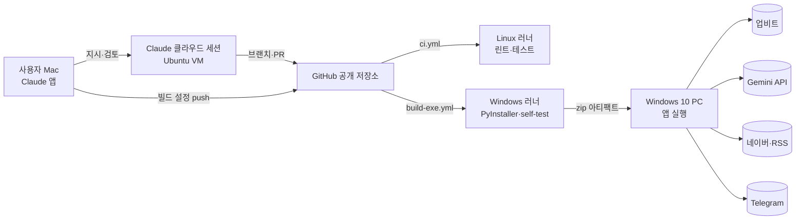
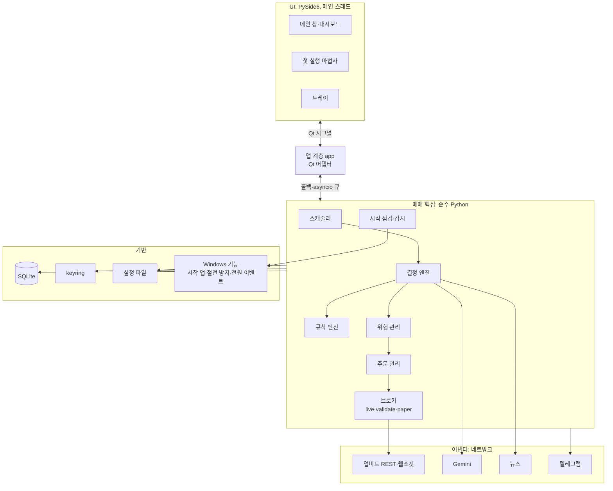

# 시스템 구성도

상태: 1단계 보완 · 관련: [기술 스택·버전 정책](tech-stack.md), [결정 기록](adr/README.md), [데이터 모델](../04-data/data-model.md)

## 1. 개발·빌드·실행 흐름



- 실제 키는 Windows PC에만 있다. 클라우드 VM과 CI에는 없다.
- `.github/workflows/`는 클라우드 세션이 push할 수 없어서 사용자 Mac에서 관리한다([ADR-0004](adr/0004-github-actions-windows-build.md)).

## 2. 앱 내부 구성



| 구성 요소 | 책임 |
|---|---|
| 스케줄러 | 주기 작업(JOB-01~13) 실행. monotonic 시간 기준 |
| 결정 엔진 | 시그널, 규칙, 위험 결과를 모아 매수·매도·보류 결정 |
| 규칙 엔진 | 지표 계산과 규칙 조건 평가(조건은 1단계에서 확정) |
| 위험 관리 | 모든 주문의 마지막 관문. 한도 검사, 주문 금액 결정 |
| 주문 관리 | identifier 생성·저장, 전송, 재조정, 상태 전이 |
| 브로커 | live(업비트 주문), validate(`/v1/orders/test`), paper(가상 체결)를 같은 인터페이스로 |
| 시작 점검·감시 | 시작 점검, 데이터 끊김·시계 오차 감시, 상태 전환 |
| 어댑터 | 외부 서비스 호출. 인터페이스 뒤에 두고 테스트에서는 가짜로 바꾼다 |
| 앱 계층(app) | 앱 조립과 수명 주기. 매매 핵심과 화면 사이의 다리로, Qt 시그널은 이 계층만 쓴다 |

## 3. 스레드와 비동기

- 화면은 Qt 메인 스레드에서만 그린다.
- 네트워크(REST, 웹소켓)와 스케줄러는 asyncio 이벤트 루프에서 돈다. 루프를 별도 스레드에 둘지, qasync로 Qt 루프와 합칠지는 1단계에서 정한다(ADR-0009).
- 화면과 매매 핵심 사이 통신은 앱 계층이 맡는다. 앱 계층이 매매 핵심의 콜백·asyncio 큐를 Qt 시그널(큐 연결)로 바꾼다. 매매 핵심은 Qt를 모른다.
- SQLite는 WAL 모드로 쓰고, 쓰기는 한 곳으로 모은다.

## 4. 모듈 경계

- 매매 핵심(`core`)은 Qt를 import하지 않는다. 그래서 GUI 없이 테스트할 수 있다.
- 외부 연동은 인터페이스로 감싼다: 거래소, 시세 피드, 뉴스 출처, 시그널 제공자, 알림, 시계, 비밀 저장소.
- 테스트는 각 인터페이스의 가짜 구현과 `tests/fixtures/`의 녹화 응답을 쓴다.

## 5. 디렉터리 구조 (계획)

```text
upbit-autotrader/
├─ src/autotrader/
│  ├─ __main__.py     진입점(--self-test 포함)
│  ├─ app/            앱 조립, 수명 주기
│  ├─ ui/             PySide6 화면
│  ├─ core/           결정·규칙·위험·주문·스케줄러(Qt 의존 없음)
│  ├─ adapters/       upbit, gemini, news, telegram
│  ├─ storage/        SQLite, 마이그레이션
│  ├─ platform/       시작 앱, 절전 방지, 전원 이벤트, 단일 인스턴스
│  └─ config/         설정 스키마, keyring
├─ tests/             unit, integration, gui, fixtures
├─ packaging/         autotrader.spec
├─ scripts/
└─ docs/
```

## 6. 실행 중 파일 위치

```text
%LOCALAPPDATA%\upbit-autotrader\
├─ 설정 파일(형식은 1단계에서 결정)
├─ data\      SQLite DB
├─ logs\      app.log
└─ backup\    DB 백업 7개
```

## 7. 1단계에서 정할 것

- asyncio와 Qt 연결 방식(ADR-0009)
- 업비트 클라이언트(ADR-0006)
- 인터페이스 시그니처와 오류 타입
- DB 접근 방식(직접 SQL 또는 경량 ORM)
- 공인 IP 확인 방법, 단일 인스턴스 방법
